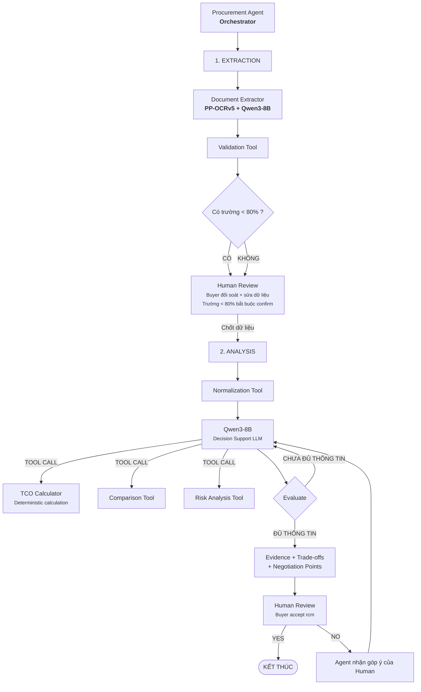

## System Architecture

### Overview Diagram

# AI Workflow

## Components

<!-- ### 1. Frontend (React/Next.js)

- **Purpose:** User interface cho sản phẩm
- **Key Features:** Responsive, dark mode, realtime
- **State Management:** React hooks / Zustand

### 2. Backend (FastAPI)

- **Purpose:** API server xử lý business logic
- **API Design:** RESTful endpoints
- **Auth:** JWT (nếu cần) -->

### 3. AI Agent (LangGraph)

- **Pattern:** Orchestrator → Tool Calling → Human-in-the-Loop (HITL) phân tách thành 2 Phase (Extraction & Analysis/Recommendation).
- **Core Models:**
  - **LLM:** Qwen3-8B (trích xuất dữ liệu có cấu trúc JSON, phân tích tổng hợp, lập luận và đề xuất).
  - **OCR Engine:** PP-OCRv5 (quét text, xử lý layout bảng biểu/đa cột từ các file PDF báo giá).
- **State Schema (`src/agent/state.py`):**
  - Định nghĩa `ProcurementAgentState` (`TypedDict`, `total=False`):
    - `case_id` & `pr_data`: Mã PR, tiêu chí bắt buộc (số lượng, hạn giao hàng yêu cầu, ngân sách).
    - `documents`: Danh sách tài liệu báo giá PDF từ các nhà cung cấp.
    - `raw_extractions`: Dữ liệu thô trích xuất từ báo giá. Mỗi trường kèm `confidence_score` riêng (field-level), `needs_confirmation` (True nếu < 80%), và `confirmed_by_human`.
    - `review_mode`: `"mandatory"` | `"optional"` — do `confidence_router` gán, quyết định hành vi màn hình đối soát.
    - `normalized_quotes`: Báo giá đã chuẩn hóa đơn vị tính (UOM) và quy đổi ngoại tệ.
    - `tco_results`: Kết quả tính toán tổng chi phí sở hữu (Total Cost of Ownership).
    - `comparison_matrix`: Ma trận đối đầu so sánh các tiêu chí (giá, lead time, bảo hành, thanh toán).
    - `risk_flags`: Danh sách cảnh báo rủi ro phát hiện từ báo giá.
    - `recommendation`: Đề xuất nhà cung cấp tối ưu kèm giải trình logic và trích dẫn bằng chứng.
    - `human_feedback`: Ý kiến phản hồi và chỉ đạo điều chỉnh từ Buyer.
- **Pipeline Nodes (`src/agent/nodes.py`):**
  - **Phase 1: Ingestion & Extraction**
    - `extract_documents`: Sử dụng PP-OCRv5 đọc PDF và Qwen3-8B trích xuất các trường dữ liệu theo schema.
    - `validate_extraction`: Kiểm tra tính toàn vẹn dữ liệu, gán `confidence_score` cho từng trường, và gắn cờ `needs_confirmation = True` cho trường < 80%.
    - `human_review_extraction` *(HITL)*: Điểm dừng `interrupt()`. Nếu có trường < 80% → **bắt buộc** Buyer confirm từng trường được gắn cờ. Nếu tất cả >= 80% → Buyer **tùy chọn** review/sửa hoặc skip. Chặn "Chốt dữ liệu" khi còn trường chưa confirm.
  - **Phase 2: Analysis & Recommendation**
    - `normalize`: Chuẩn hóa đơn vị đo lường và tiền tệ về hệ quy chuẩn thống nhất của PR.
    - `decision_llm`: Node điều phối gọi các công cụ tính toán và đối chiếu dữ liệu.
    - `evaluate`: Đánh giá mức độ đáp ứng của từng NCC đối với các ràng buộc của PR.
    - `generate_evidence`: Tổng hợp bảng so sánh và tạo lập báo cáo giải trình đề xuất kèm trích dẫn số liệu.
    - `human_review_recommendation` *(HITL)*: Điểm dừng `interrupt()` cho Buyer xem xét đề xuất cuối cùng.
    - `process_feedback`: Tiếp nhận phản hồi điều chỉnh từ Buyer để tái phân tích hoặc hoàn tất quy trình.
- **Deterministic Tools (`src/agent/tools.py`):**
  - `validate_extraction`: Xác thực schema và tính đầy đủ của dữ liệu trích xuất từ báo giá.
  - `normalize_data`: Quy chuẩn đơn vị tính và tiền tệ; gắn cờ cảnh báo đối với đơn vị lạ để can thiệp thủ công.
  - `calculate_tco`: Tính tổng chi phí sở hữu xác định tuyệt đối bằng code logic (không để LLM tính toán số học):
    $$\text{TCO} = (\text{unit\_price} \times \text{quantity} + \text{surcharges}) \times (1 + \text{VAT\_rate})$$
  - `compare_suppliers`: Lập ma trận so sánh chi tiết giữa các nhà cung cấp theo từng tiêu chí. Highlight ô có chênh lệch vượt ngưỡng cấu hình (`deviation_threshold`, mặc định 15%) so với trung bình.
  - `analyze_risks`: Rà soát và gắn cờ rủi ro (thiếu lead time, giao trễ hơn hạn PR, chi phí ẩn).
- **Conditional Routing & Guardrails (`src/agent/graph.py`):**
  - `confidence_router`: Kiểm tra field-level — gắn `review_mode` trong state: nếu **bất kỳ trường nào** có `confidence < 80%` → `mandatory` (buyer bắt buộc confirm các trường đó). Nếu tất cả >= 80% → `optional` (buyer tùy chọn review/sửa hoặc chốt ngay). Cả hai mode đều đi qua `human_review_extraction`.
  - `evaluate_sufficiency`: Kiểm tra tối thiểu 2 báo giá hợp lệ trước khi chuyển sang pha so sánh.
  - `buyer_decision_router`: Phê duyệt $\rightarrow$ kết thúc (`END`), Yêu cầu chỉnh sửa $\rightarrow$ `process_feedback`.
- **Human-in-the-Loop (HITL) Checkpoints:**
  - **Checkpoint 1 — Extraction review:** `interrupt()` luôn được gọi. Nếu có trường < 80%: buyer **bắt buộc** confirm các trường đó trước khi chốt. Nếu tất cả >= 80%: buyer **tùy chọn** review hoặc skip.
  - **Checkpoint 2 — Recommendation review:** `interrupt()` bắt buộc. Buyer phê duyệt hoặc yêu cầu chỉnh sửa đề xuất.

<!-- ### 4. Database

- **Type:** PostgreSQL (production) / SQLite (dev)
- **ORM:** SQLAlchemy (nếu cần)
- **Migrations:** Alembic (nếu cần)

### 5. Vector Store

- **Type:** ChromaDB (local) / Pinecone (cloud)
- **Embeddings:** OpenAI embeddings
- **Purpose:** RAG / similarity search
-->
## Data Flow

<!-- 1. User gửi request từ Frontend
2. API route nhận và validate input (Pydantic) -->
3. Agent xử lý qua LangGraph pipeline
4. LLM generate response
5. Tools thực thi actions (nếu cần)
6. Response trả về Frontend qua API 

## Design Decisions

| Decision | Choice | Reason |
|----------|--------|--------|
<!-- | Framework | FastAPI | Async, auto-docs, type-safe | -->
| Agent | LangGraph | Flexible state machine |
<!-- | Database | SQLite→PostgreSQL | Dev dễ, prod mạnh |
| Frontend | Next.js | Full-stack ready | -->
