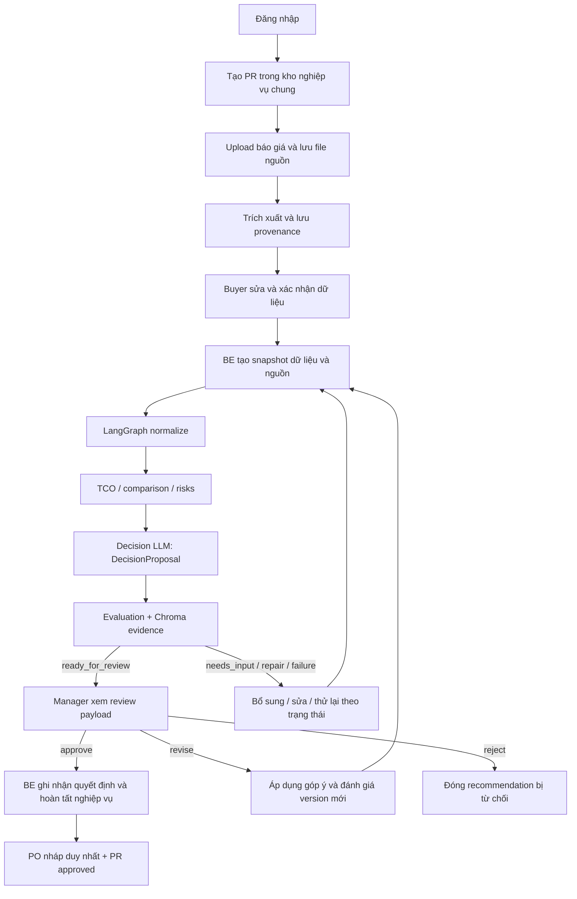

# Kế hoạch nối FE – BE – Agent để chạy end-to-end

Ngày lập: 02/10/2026. Trạng thái: **In Review — đã triển khai happy path và kiểm API/browser với provider giả; đang chờ smoke Groq/Qwen thật**.

Hướng dẫn chạy: [runbook](end-to-end-runbook.md). Kiểm chứng: [integration results](end-to-end-integration-results.md).

Tài liệu hiện trạng: [Luồng FE–BE–Agent](fe-be-agent-flow.md).

## 1. Bắt đầu từ đâu?

Thứ tự nên làm: **khôi phục BE → thống nhất dữ liệu/contract → nối dữ liệu đã confirm vào graph → chuẩn bị evidence và evaluation → nối FE → nối duyệt với PO → kiểm thử toàn luồng → đưa extraction của agent vào luồng chung**.

Điểm quan trọng: FE đã có luồng mua sắm khá đầy đủ. Nên lấy PR và báo giá mà FE đang sử dụng làm nguồn dữ liệu nghiệp vụ chung, rồi gắn agent vào đó. Chỉ đổi URL của FE sang `/api/prs` sẽ không đủ vì hai API đang dùng ID, schema và kho dữ liệu khác nhau.

Chia thành hai mốc để dễ kiểm chứng:

| Mốc | Kết quả cần đạt | Extraction |
|---|---|---|
| **Mốc A: E2E nghiệp vụ với agent phân tích** | Đăng nhập → tạo PR → upload → Buyer confirm → LangGraph phân tích → evaluation → Manager review → PO nháp | Tận dụng parser/OCR của luồng báo giá UI hiện có |
| **Mốc B: E2E đầy đủ extraction của agent** | Upload → agent OCR/LLM extraction → đối soát thật → resume → phân tích/evaluation → duyệt → PO | Nối thêm adapter PaddleOCR/extraction LLM và HITL-1 của agent |

Khi hoàn tất, Mốc A sẽ nối FE–BE–LangGraph–evaluation–PO, nhưng chưa chứng minh OCR/LLM extraction của agent hoạt động. Chỉ gọi hoàn tất toàn pipeline mong muốn sau khi Mốc B cũng đạt tiêu chí kiểm chứng.

## 2. Luồng đích

BE là đầu mối: FE gọi HTTP API; BE gọi graph bằng Python trong cùng tiến trình. Chưa cần tách agent thành service riêng hoặc bổ sung một server FE riêng để đạt mốc đầu.

## 3. Quyết định kiến trúc đề xuất

| Nội dung | Hướng đề xuất |
|---|---|
| Nguồn PR | `PurchaseRequestRepository` đang dùng bởi UI; `case_id` của agent ánh xạ tới `PurchaseRequest.id` |
| Nguồn quotation | Quotation repository hiện có; chỉ dữ liệu đã được xác nhận mới dùng để quyết định |
| Supplier identity | ID ổn định do BE quản lý; lưu mapping supplier ↔ quotation ↔ item. Không dùng tên NCC tự do làm khóa duy nhất |
| API cho FE | Giữ API root `/api/v1`; thêm endpoint tích hợp vào namespace này thay vì buộc FE quản lý hai luồng tạo PR |
| API agent cũ | Hoàn thiện hoặc chuyển thành wrapper gọi cùng application service; không tạo thêm một PR RAM cho PR đã có |
| Recommendation chính thức | `DecisionProposal` → `EvaluationResult` → `render_review()`; kết quả MCDA cũ có thể dùng đối chiếu, không thay thế review của agent |
| HITL-1 | Buyer sửa/xác nhận extraction; quyết định tiếp tục dựa trên validation dữ liệu, không tự confirm trong helper |
| HITL-2 | Manager phê duyệt recommendation version hiện hành; cấu hình `approval_role="manager"` và Actor tương ứng phía server |
| Trạng thái | Giữ PR status nghiệp vụ; thêm analysis/recommendation status riêng để tránh nhầm `comparing` với `awaiting_review` |
| Phạm vi ca đầu tiên | Một loại hàng, cùng số lượng, cùng tiền tệ/UOM, ít nhất 2 NCC độc lập; VAT/phí/lead time có nguồn rõ ràng |

Các phần sau giữ kế hoạch được duyệt làm mốc đối chiếu. Endpoint/contract đã triển khai được mô tả trong runbook; các phần còn giới hạn được ghi trong báo cáo kết quả.

## 4. Các bước triển khai theo thứ tự

### Bước 1 — Khôi phục khả năng import và khởi động BE

**Việc làm:**

- Sửa dòng lỗi cú pháp `extractor =   or GeminiAPIExtractionClient()`; khôi phục cơ chế truyền `extraction_client` để test được bằng fake adapter.
- Hoàn thiện các tên chưa được định nghĩa trong API analyze: `_actor`, `_workflow`, `graph`, `case_id`.
- Thống nhất response `/analyze` theo `AnalysisRunResponse`; không còn trộn với `AnalysisResponse` cũ và trạng thái `completed`.
- Graph đang gọi `decision_proposal`; cập nhật output graph phụ hoặc giữ nó làm đường debug riêng với contract đúng.
- Đối chiếu test hiện có với imports và factory thực tế; không nới assertion để làm test pass.

**File chính:** `src/agents/nodes/extract_documents.py`, `src/api/routes/pr.py`, `src/models/procurement.py`, `tests/test_api/test_pr.py`.

**Xong khi:** import `src.main` thành công, `/health` và `/ui/` phục vụ được, test auth/PR hiện có chạy được. Chưa yêu cầu OCR/LLM thật ở bước này.

### Bước 2 — Thống nhất ID, dữ liệu và snapshot phân tích

**Việc làm:**

- Tạo application service nhận `pr_id`, đọc PR/quotation từ repository hiện có và chuyển thành input agent.
- Mapping PR: `code → pr_number`, `estimated_budget → budget`, `delivery_due_date → deadline`; chuyển tiền bằng quy tắc Decimal/rounding rõ ràng tại boundary.
- Mapping quotation: `product_name → item_name`, cùng quantity/unit/unit_price và provenance. Bổ sung dữ liệu VAT, phí, thời gian giao, điều kiện áp dụng nếu schema UI chưa giữ được.
- Lưu ID item/NCC/quotation ổn định, tránh gộp nhầm nhiều báo giá có cùng tên nhà cung cấp. Hai file từ một NCC không tự được tính thành hai candidate độc lập.
- Tạo snapshot và hash/revision cho mỗi lần phân tích: input PR, quotation đã confirm, file nguồn, human edits và chính sách áp dụng.
- Lưu liên kết `pr_id ↔ analysis_id ↔ recommendation_id/version ↔ source_revision`. Có thể dùng metadata bền vững cùng hệ lưu trữ hiện tại; không bắt buộc chuyển toàn bộ nghiệp vụ sang database mới ngay.
- Chặn phân tích nếu thiếu dữ liệu bắt buộc. Không suy ra VAT mặc định, phí bằng 0 hoặc bảo hành từ giá trị hiển thị thay thế. Tool TCO hiện có default VAT: integration phải validate trước khi gọi tool.

**File chính:** `src/models/schemas.py`, `src/models/procurement.py`, `src/services/quotations.py`, `src/services/purchase_requests.py`; dự kiến thêm `src/services/procurement_workflow.py` và contract analysis riêng.

**Xong khi:** từ một PR tạo trên UI, BE tạo được input agent đúng schema; upload/confirm cập nhật đúng cùng PR; dữ liệu thiếu trả yêu cầu bổ sung rõ ràng.

### Bước 3 — Chuẩn bị evidence và dữ liệu đã xác nhận

Đây là phần cần làm trước khi mong evaluation trả `ready_for_review`. Có Chroma collection rỗng hoặc chỉ lưu tổng TCO trong state sẽ chưa đủ.

**Việc làm:**

- Giữ text/row/cell nguồn từ PDF/OCR cùng document ID, hash, page, block và vị trí bảng khi có; mapper hiện tại của UI đang bỏ bớt metadata cần cho agent/evaluation.
- Tạo `Chunk` + `SourceFact` và ingest qua `ChromaEvidenceAdapter.ingest()` với tenant/case/supplier scope đúng.
- Tạo facts có nhãn, giá trị, đơn vị và điều kiện được ràng buộc với đúng đoạn nguồn; không tạo “bằng chứng” bằng cách viết lại kết luận của LLM thành text rồi ingest.
- Với dữ liệu Buyer sửa, lưu audit edit có actor/time/field/before/after và liên kết quotation/nguồn; context chỉ nhận edit ID đã được server xác thực.
- Với TCO suy ra, lưu các operands/component sources và calculation plan tương thích formula allowlist. Phép tính của tool và phép replay ở evaluator phải đối chiếu được; không giả định output tool tự động là citation.
- Thuộc tính không đọc được để `None`; nếu thiếu locator, đơn vị, time origin hoặc thông tin thuế/phí thì yêu cầu bổ sung thay vì bỏ qua gate.

**File chính:** `src/extraction/pdf_extractor.py`, `src/services/quotation_parser.py`, `src/services/quotations.py`, `src/models/evaluation.py`, `src/services/evaluation_evidence.py`; dự kiến thêm service ingestion/mapping evidence.

**Xong khi:** một bộ báo giá ẩn danh có thể truy hồi đúng nguồn và replay số liệu; chunk sai hash/supplier/case bị từ chối; human edit đã xác thực được truy vết.

### Bước 4 — Nối graph phân tích vào dữ liệu chung

**Việc làm:**

- Thêm entrypoint graph nhận `raw_extractions` đã được xác nhận để Mốc A bắt đầu ở `normalize`, tránh chạy lại extraction làm mất dữ liệu Buyer vừa sửa.
- Chạy `normalize → check_data_ready → decision_proposal → evaluate` với dependencies do application cấp.
- Nhận đủ tool results, proposal, evaluation và trạng thái lỗi; không báo `completed` nếu đang chờ review hoặc thiếu input.
- Bảo đảm config `thread_id` gắn analysis/snapshot, không tái dùng checkpoint cũ cho input mới mà không có quy tắc version.
- Tạo endpoint phân tích nghiệp vụ trên PR hiện có; retry cùng yêu cầu phải đọc lại kết quả/run phù hợp, không sinh recommendation trùng.
- Giai đoạn demo có thể gọi đồng bộ với timeout và chống double-click. Nếu OCR/LLM chạy lâu, chuyển sang run/job có trạng thái và polling; lời gọi provider đồng bộ không nên chặn event loop của BE.

**File chính:** `src/agents/graph.py`, `src/agents/state.py`, `src/agents/nodes/decision_llm.py`, API routes và application service ở bước 2.

**Xong khi:** endpoint phân tích một PR nghiệp vụ gọi đúng node LangGraph, nhận `DecisionProposal` thật từ đường graph; mọi lỗi được trả thành trạng thái có thể xử lý. Kiểm tra trước bằng OCR/LLM fake, không gọi dịch vụ ngoài trong test.

### Bước 5 — Cấp evaluation dependencies và quyền ở startup

**Việc làm:**

- Trong lifespan, mở persistent Chroma collection và EvaluationStore; chọn embedding configuration rõ ràng.
- Gọi `configure_evaluation(...)`, cung cấp context provider lấy snapshot đã xác thực; dựng graph bằng `build_graph(evaluation_workflow=..., context_provider=...)` hoặc factory tương đương cho entrypoint phân tích.
- Adapter `(state) → context` của graph và provider `(case_id, actor) → context` của API phải đọc cùng snapshot/version; tránh hai lần dựng context không đồng nhất.
- Nối Bearer session hiện tại sang `Actor` từ thông tin server. Với demo một tổ chức có thể dùng tenant cố định phía server; quyền case và role lấy từ ứng dụng, không từ body/header do FE tự khai.
- Context provider cấp candidate IDs, constraints, rules, source hashes, facts, calculation plans, minimum candidates và approval role. Chốt rõ chính sách là hard constraint hay warning, không tự đổi hành vi MCDA thành quy tắc cứng.
- Có thể chưa bật auto-repair ở lần đầu; vẫn phải trả `repairable` và hành động cần xử lý. Khi bật `DecisionOutputRepair`, giữ ngân sách repair và version của workflow hiện có.

**File chính:** `src/main.py`, `src/api/dependencies.py`, `src/api/routes/evaluation.py`, `src/config.py`; dự kiến thêm trusted context provider.

**Xong khi:** ca hợp lệ tới `awaiting_review`; API review nhận được Actor từ session; case/tenant/role sai bị chặn. Thiếu provider hoặc evidence trả lỗi rõ, không tự chuyển sang duyệt.

### Bước 6 — Nối FE với analysis và review payload

**Việc làm:**

- Thêm hành động “Phân tích bằng Agent” khi dữ liệu đủ điều kiện; gọi API analysis của PR hiện tại.
- Hiển thị trạng thái đang chạy, cần bổ sung, repair/failure và chờ review. Refresh phải tải lại analysis hiện hành từ BE.
- Màn hình comparison lấy dữ liệu tính toán của analysis/snapshot; phần giải thích chính thức lấy payload của `render_review()`.
- Render ranking, verified claims/evidence, trade-offs, uncertainties và negotiation suggestions theo contract mới; không ép payload mới vào `AgentRecommendation` cũ.
- Bỏ việc dùng confidence `0.94` và execution steps dựng sẵn như bằng chứng thực thi agent. Nếu cần tiến độ, lấy event/status do BE ghi nhận.
- Luồng Buyer gửi duyệt đưa đúng recommendation version đã qua evaluation vào hàng đợi Manager; Manager mở đúng payload đó.

**File chính:** `frontend/core/api.js`, `frontend/features/comparison/comparison.js`, `frontend/features/approvals/approvals.js`, `frontend/features/purchase-request/purchase-request.js`, `frontend/config/constants.js`.

**Xong khi:** một thao tác trên UI gọi được graph qua BE; cùng `analysis_id`, recommendation/version xuất hiện từ API đến UI; Manager thấy nguồn và số liệu đã kiểm chứng.

### Bước 7 — Nối quyết định review với PR và PO

Đây là bước bắt buộc của E2E nghiệp vụ. `EvaluationWorkflow.feedback()` hiện chỉ cập nhật EvaluationStore; nó chưa tạo PO hoặc cập nhật repository PR.

**Việc làm:**

- Tạo application command cho approve/reject/revise, sử dụng feedback contract hiện có với recommendation ID/version/idempotency key.
- Trước approve, kiểm tra quyền, version, source snapshot hiện hành, recommendation đủ điều kiện và acknowledgment cho uncertainty bắt buộc.
- Approve lấy `preferred_supplier_id` đã review để tìm đúng quotation và items của snapshot. Nếu Manager muốn chọn NCC khác, cần đề xuất/evaluation mới theo chính sách đã chốt.
- Dùng receipt đã approve để finalize: tạo một PO nháp duy nhất, liên kết recommendation/version/quotation/snapshot, rồi cập nhật PR.
- Bảo đảm retry/double-click không tạo PO thứ hai. Repository PO hiện chỉ tránh trùng code, chưa có idempotency theo approval.
- Vì feedback dùng SQLite còn PR/PO dùng JSON, chưa có transaction chung. Bổ sung bản ghi finalization bền vững và cơ chế replay/reconcile, hoặc đưa phần cần atomicity vào cùng store. Nếu crash giữa approval và PO, retry phải hoàn tất đúng command cũ; FE chỉ báo hoàn tất khi có PO đã lưu.
- Chặn hoặc chuyển các endpoint `/approve` cũ sang command mới để không duyệt bỏ qua evaluation.
- Reject đóng recommendation hiện tại. Nếu nghiệp vụ đưa PR về `comparing` để làm lại, lần tiếp theo phải tạo recommendation ID mới: store hiện coi `rejected` là terminal.
- Revise chưa được coi là “applied” khi mới nhận note. Apply changes theo owner, sinh version mới, chạy đủ evaluation rồi mới cho review lại; `mark_feedback_applied()` chỉ gọi khi đáp ứng điều kiện này.

**File chính:** `src/api/routes/__init__.py`, `src/api/routes/evaluation.py`, `src/services/evaluation_workflow.py`, `src/services/purchase_orders.py`, `src/services/purchase_requests.py`, application service/finalization store dự kiến; FE comparison và PO.

**Xong khi:** một approval hợp lệ tạo đúng một PO từ dữ liệu đã review; stale version bị từ chối; retry sau lỗi/crash hoàn tất mà không nhân đôi PO; reject/revise có lifecycle rõ ràng.

### Bước 8 — Kiểm chứng Mốc A từ UI đến PO

**Thứ tự kiểm tra:** mapping contract → deterministic tools → evidence/evaluation → API–graph → trình duyệt → provider thật.

- Dùng báo giá PDF ẩn danh có đáp án tính tay cho tổng tiền, thuế/phí, thứ hạng và số liệu nguồn. Không lấy output hệ thống làm đáp án kỳ vọng.
- Trong test tự động, mock provider OCR/LLM nhưng chạy thật application service, graph, evaluator, repository và API boundary.
- Sau khi pass với provider fake, chạy một lượt smoke bằng provider thật đã cấu hình; đo timeout/latency và kiểm cùng ID/source/version. Không coi fake E2E là bằng chứng model thật đã chạy.
- Test session/role, PR/quotation, confirm, analysis, review, approval/PO và refresh/restart theo ma trận ở mục 6.

**File chính:** `tests/test_api/`, `tests/test_agents/test_graph.py`, các test evaluation và fixtures; dự kiến thêm test integration PR–agent–PO và browser E2E.

**Xong khi:** Mốc A đạt các tiêu chí ở mục 7 với trace và artifacts kiểm chứng được.

### Bước 9 — Nối extraction của agent và HITL-1 để đạt Mốc B

**Việc làm:**

- Upload lưu tài liệu dưới cùng PR/quotation IDs, khởi chạy entrypoint `extract_documents` của graph thay vì đường parser đơn thuần.
- Chọn rõ adapter OCR và extraction LLM qua settings/factory; test cấu hình và lỗi provider. Không dùng tên model trong tài liệu thay cho cấu hình thực thi.
- Trả extraction/confidence/provenance cho màn hình đối soát hiện có. Bổ sung field UI cần thiết như VAT/phí/UOM/điều kiện, nếu thiếu ở contract hiện tại.
- Thêm API lấy pending extraction và API gửi correction/confirmation; validate fields và quyền ở BE, cập nhật nguồn/audit edits rồi `Command(resume=...)` đúng thread/run.
- Sửa node review để áp dụng corrections và confirm đúng fields; node hiện tại chỉ xóa flags sau resume, chưa áp dụng sửa dữ liệu từ Buyer.
- Bỏ helper tự `approved/confirm_all`. Trường confidence thấp vẫn phải được xác nhận thật; nhánh optional tuân theo chính sách review đã chốt.
- Sau resume dùng chính dữ liệu Buyer đã duyệt cho normalize, context và evidence, không extraction lại làm thay đổi snapshot.
- Lưu bền checkpoint của HITL-1 hoặc có cơ chế khôi phục pending extraction được kiểm thử. MemorySaver hiện tại không đảm bảo resume sau restart.

**File chính:** `src/agents/nodes/extract_documents.py`, `human_review_extraction.py`, `validate_extraction.py`, `src/services/document_extraction.py`, `src/agents/graph.py`; API tích hợp, quotation repository và FE quotation editor/source review.

**Xong khi:** upload trên UI thực sự chạy OCR/LLM extraction của agent, dừng đúng khi cần đối soát; Buyer sửa field làm thay đổi đúng output downstream; có thể tiếp tục ca pending sau refresh và theo cơ chế restart đã thiết kế.

## 5. API contract đề xuất cho FE

Giữ auth, tạo PR, upload và confirm hiện có. Các API dưới đây là interface đề xuất; chưa đổi route trong lần lập tài liệu này.

| API | Mục đích | Kết quả chính |
|---|---|---|
| `POST /api/v1/prs/{pr_id}/analysis` | Tạo hoặc chạy analysis trên snapshot đủ điều kiện | `analysis_id`, status, recommendation ID/version khi có, actions/errors |
| `GET /api/v1/prs/{pr_id}/analysis` | Tải analysis hiện hành sau refresh | Run status, snapshot revision, kết quả tính toán và liên kết review |
| `GET /api/v1/recommendations/{id}/review` | Wrapper có auth cho review payload | Output của `render_review()`, không phải raw proposal |
| `POST /api/v1/recommendations/{id}/feedback` | Review + application orchestration | FeedbackReceipt và finalization status/PO ID nếu đã hoàn tất |
| `GET /api/v1/prs/{pr_id}/extraction-review` | Mốc B: lấy dữ liệu cần đối soát | Extraction, flags, source references, run/revision |
| `POST /api/v1/prs/{pr_id}/extraction-review` | Mốc B: sửa/xác nhận và resume | Fields được confirm, trạng thái run kế tiếp hoặc lỗi cần sửa |

`AnalysisRunResponse` hiện có chưa chứa trạng thái chạy nền hoặc extraction review. Nếu triển khai run/job và Mốc B, định nghĩa response envelope ở application layer riêng rồi chứa payload graph/evaluation bên trong; không nhét trạng thái mới vào schema cũ mà chưa cập nhật các consumer.

FE không gửi candidate scope, quyền Actor, policy hay calculation plan để BE tin trực tiếp. BE dựng chúng từ snapshot, session và cấu hình nghiệp vụ.

## 6. Ma trận kiểm chứng tối thiểu

| Tình huống | Kết quả cần đạt |
|---|---|
| Happy path: 2 NCC, cùng hàng, đầy đủ dữ liệu | UI → graph → evidence/evaluation → review → 1 PO nháp đúng đáp án |
| Chỉ có 1 candidate độc lập | Hành động thiếu candidates rõ ràng; không tự mở duyệt |
| Báo giá chưa confirm hoặc thiếu VAT/phí bắt buộc | Không chạy decision trên dữ liệu chưa đủ; trả fields/actions cần bổ sung |
| Buyer sửa đơn giá/quantity/UOM | Snapshot, TCO, evidence và proposal mới đều dùng dữ liệu sửa, có audit |
| Nguồn thiếu/sai hash/sai NCC | Evaluation chặn hoặc yêu cầu bổ sung; không dựng citation thay thế |
| LLM output sai contract hoặc lỗi provider | Repair/technical failure theo chính sách, không hiện thành công giả |
| Token hết hạn / role sai / case sai | 401/403 phù hợp, không áp dụng feedback hoặc tạo PO |
| Recommendation version cũ hoặc quotation đổi sau review | 409/invalidation phù hợp; tải hoặc phân tích version hiện hành |
| Double-click approve / retry mạng | Cùng receipt và cùng PO; không sinh bản thứ hai |
| Crash sau approval trước PO | Khôi phục finalization từ command/receipt bền vững, hoàn tất đúng một PO |
| Reject rồi làm lại PR | Recommendation bị reject giữ terminal; lần phân tích mới có ID mới |
| Revise explanation/data/preference/rule | Route đúng owner; dữ liệu được áp dụng thực và reevaluate trước review lại |
| Refresh / restart BE | PR/quotation/review và liên kết analysis còn đọc được; đăng nhập lại nếu session RAM hết |
| Mốc B: confidence thấp và pending HITL-1 | Không tự confirm; sửa/xác nhận thật và resume đúng run |

## 7. Khi nào có thể nói “đã chạy end-to-end”?

**Mốc A hoàn tất khi:**

- Người dùng thao tác từ UI: login → tạo PR → upload/confirm → analyze → gửi review → Manager approve → mở PO.
- Log/trace ghi ID và trạng thái chứng minh API đã gọi graph và evaluation; không chỉ gọi `build_comparison()`.
- Review hiển thị số liệu có evidence đúng snapshot; approve version hiện hành tạo đúng một PO liên kết proposal đã duyệt.
- Các ca lỗi/chống retry quan trọng ở mục 6 pass; có browser run và smoke provider thật, không chỉ unit test.

**Mốc B hoàn tất khi có thêm:**

- Upload gọi đúng OCR/extraction LLM của agent, có dữ liệu đầu ra/provenance kiểm chứng được.
- Confidence/HITL-1 thực sự tác động đến luồng; correction/confirmation của Buyer được áp dụng vào state downstream.
- Pending extraction/review có cơ chế phục hồi rõ ràng; toàn luồng từ upload đến PO chạy với provider thật trên bộ dữ liệu ẩn danh.

## 8. Công việc đầu tiên khi bắt đầu triển khai

1. Làm **Bước 1** để BE chạy lại và có baseline test rõ ràng.
2. Chốt mapping ID/contract ở **Bước 2**, đặc biệt dữ liệu VAT/phí/provenance mà UI còn thiếu.
3. Làm một ca ẩn danh xuyên **Bước 3–5** ở API trước, sau đó mới nối FE và duyệt/PO ở **Bước 6–7**.
4. Kiểm chứng **Mốc A**, rồi triển khai extraction/HITL-1 để đạt **Mốc B**.

Không cần làm trước việc tách microservice, đổi framework FE, viết lại toàn bộ UI hoặc chuyển tất cả JSON sang PostgreSQL. Những thay đổi đó có thể xét sau khi luồng chung đã được kiểm chứng.

Kế hoạch ban đầu chỉ thêm tài liệu. Theo yêu cầu triển khai tiếp theo, code/contract/test đã được nối theo mốc này; chưa đạt tiêu chí provider thật ở mục 7 khi chưa có key/endpoint Groq/Qwen. Không thay đổi công thức deterministic tools hoặc thêm dependency.
