# Kết quả nối FE – BE – Agent

Trạng thái: **In Review**, kiểm chứng ngày 02–03/10/2026. Đã nối luồng nghiệp vụ và chạy happy case ở API, trình duyệt với **extraction/decision model giả**. LangGraph, evaluation, Chroma và persistence trong bài kiểm tra là thật. **Chưa xác nhận end-to-end với Groq/Qwen thật** vì máy chưa có `GROQ_API_KEY` hoặc `QWEN_BASE_URL` hợp lệ.

## Luồng đã nối

```mermaid
flowchart LR
    FE[Buyer tạo PR và upload PDF] --> BE[FastAPI /api/v1]
    BE --> Intake[OCR / extract_documents]
    Intake --> HITL[Buyer sửa và xác nhận]
    HITL --> Snapshot[Snapshot và evidence]
    Snapshot --> Graph[normalize → decision_llm → evaluate]
    Graph --> Review[Manager xem claims và nguồn]
    Review --> Feedback[Approve với version và idempotency key]
    Feedback --> PO[PO nháp và PR đã duyệt]
```

FE gọi BE cùng origin. Agent chạy trong BE, dùng chung PR/quotation thay vì case RAM riêng. Startup cấp EvaluationStore và Chroma bền vững; feedback approved được finalize thành PO, có reconcile khi tiến trình khởi động lại.

## Thay đổi chính

| Phần | Kết quả |
|---|---|
| Intake | PDF AI chạy graph extraction, dừng chờ Buyer xác nhận; correction được validate và resume rõ ràng. Pending extraction và OCR text gốc phục hồi sau restart. |
| Dữ liệu | NCC có UUID do server cấp; VAT/phí/lead time/warranty được xác nhận; snapshot chứa file hash và audit actor/time/before/after. |
| Analysis | Chạy graph trên confirmed context; facts/TCO có source operands; chỉ recommendation qua evaluation mới gửi duyệt. Missing data, nguồn thay đổi hoặc sai tổng làm tròn bị chặn. |
| FE review | Đọc analysis đã lưu, hiển thị xếp hạng, factual claims, nguồn, tradeoffs, uncertainty; Manager tải file thuộc đúng snapshot đã kiểm chứng. |
| Approval / PO | Manager feedback gắn recommendation ID/version; retry không tạo PO trùng; PO giữ breakdown hàng/VAT/phí và tổng đã duyệt. |
| API cũ | Không tự xác nhận extraction; không bypass evaluation để duyệt. Luồng nghiệp vụ dùng `/api/v1`. |

Các file trọng tâm: `src/services/procurement_intake.py`, `src/services/procurement_workflow.py`, `src/api/routes/procurement_workflow.py`, `src/models/procurement_workflow.py`, graph/HITL nodes, repository/schema liên quan và các màn quotation/comparison/approval/PO trong `frontend/`.

Không thêm dependency, không sửa `.env`, Makefile, dataset/baseline hay logic `calculate_tco`/`compare_suppliers`. `make check` có format một số file hiện hữu; các thay đổi đó không đổi thuật toán tiền/TCO.

## Kiểm chứng

| Kiểm tra | Kết quả và giới hạn |
|---|---|
| `make check` | **231 passed**, 5 deprecation warnings; Ruff pass. Không gọi provider ngoài trong pytest. |
| Ruff cho live smoke | `ruff check src/ tests/ scripts/smoke_procurement_live.py`: pass. |
| API integration | Graph/evaluator/Chroma/SQLite thật, model fixture; confirmed edits → review → approve → PO; cold restart đọc lại được review. |
| Browser happy case | **Pass**, 50 API requests, không có JavaScript page error; Buyer → upload AI PDF → sửa giá → confirm → analysis → refresh → submit → Manager → tải nguồn → approve → PO → refresh. |
| Tiền tính tay | A: 1.000 × 10 + VAT 10%, phí 0 = **11.000 VND**. B: 1.200 × 10 + VAT 10%, phí 0 = **13.200 VND**. PO của fixture chọn A đúng 11.000 VND. |
| Idempotency / recovery | Retry cùng approval chỉ có một PO; lỗi giữa receipt approved và ghi PO được startup reconcile hoàn tất. |
| Các đường chặn | Chưa confirm, thiếu VAT/phí, NCC trùng, snapshot stale, evidence outage, feedback version cũ, tiền làm tròn lệch đều không tạo PO. |
| Startup thực | Lifespan của app thật với kho tạm: `/health` 200, `/ui/` 200, khởi tạo workflow/evidence stores được; chưa gọi model. |
| Groq live smoke | Dừng trước API vì thiếu `GROQ_API_KEY`; **không tính là pass**. Qwen live chưa chạy vì chưa có endpoint. |

Do thư mục cha được đổi tên trong phiên làm việc, `pytest` console script của `.venv` còn shebang cũ. Lượt `make check` cuối dùng wrapper tạm trỏ tới `.venv/bin/python -m pytest`; Makefile không đổi. Khi chạy thủ công tại đường dẫn mới, dùng `.venv/bin/python -m ...` như trong runbook.

### Benchmark evaluation trước / sau

Đã chạy `make eval`; repo hiện không có recipe nên lệnh đó không thực hiện benchmark. Số liệu dưới đây lấy từ `python -m scripts.evaluate_post_decision`, chạy trước và sau tích hợp:

| Chỉ số | Trước | Sau |
|---|---:|---:|
| Tổng trial | 240 | 240 |
| Trial claim thiếu/sai hỗ trợ | 200 | 200 |
| False support | 0 | 0 |
| p50 | 5,027 ms | 4,696 ms |
| p95 | 10,972 ms | 6,769 ms |

Đây là 6 fixture ẩn danh lặp lại 40 lần mỗi loại, retriever giả có cùng API Chroma, một luồng và không cache. Không suy ra chất lượng trên dữ liệu thật hoặc cải thiện hiệu năng từ chênh lệch thời gian; số liệu không bao gồm OCR/LLM/API provider. Test integration riêng kiểm kho Chroma thật và luồng nghiệp vụ.

## Trace và ảnh

- [API trace của browser](e2e-artifacts/browser-trace.json): PR `a910187c-acda-40bd-b1cc-8623824d9f99`, recommendation `4af29b70-f12e-44fe-ab73-a6839b77a453`, PO `25c19416-702e-58e5-92fb-2a01d1343c9c`.
- [Buyer analysis](e2e-artifacts/buyer-analysis.png).
- [Manager review](e2e-artifacts/manager-review.png).
- [PO nháp](e2e-artifacts/draft-po.png).
- [Benchmark JSON trước/sau](e2e-artifacts/evaluation-benchmark.json).

Artifacts chỉ chứa PDF/PR/NCC ẩn danh từ fixture, không dùng báo giá nghiệp vụ thật. Browser chạy bằng Playwright trên Brave/Chromium với profile và kho dữ liệu tạm, không thay phiên đăng nhập của người dùng.

## Việc còn lại để xác nhận model thật

1. Cấu hình Groq hoặc Qwen trong `.env` ở máy, restart BE.
2. Chạy `scripts.smoke_procurement_live` theo [runbook](end-to-end-runbook.md). Script dùng PDF ẩn danh, stores tạm, model thật và các thao tác Buyer/Manager mô phỏng; không inject model fixture.
3. Chạy lại happy case trên UI với provider đó để kiểm extraction, thời gian phản hồi và review thực tế. Nếu model không đáp ứng JSON/evidence contract, analysis phải dừng ở lỗi/needs_input, chưa thể duyệt.

Phạm vi hiện tại: một mặt hàng, VND, cùng quantity/UOM, ít nhất hai NCC, explicit VAT/phí/lead time/warranty. PDF scan cần PaddleOCR hosted, chưa smoke dịch vụ thật. Explanation revision đã có version mới và evaluation lại; data/preference/rule revisions còn chờ editor/owner command. Chưa bật auto-repair. Auth demo, supplier alias theo tên và JSON repository đơn tiến trình chưa đáp ứng vận hành production nhiều worker.

[Hướng dẫn chạy đầy đủ](end-to-end-runbook.md) · [Plan triển khai](end-to-end-integration-plan.md) · [Task In Review](../tasks/T-12-end-to-end-integration.md)
