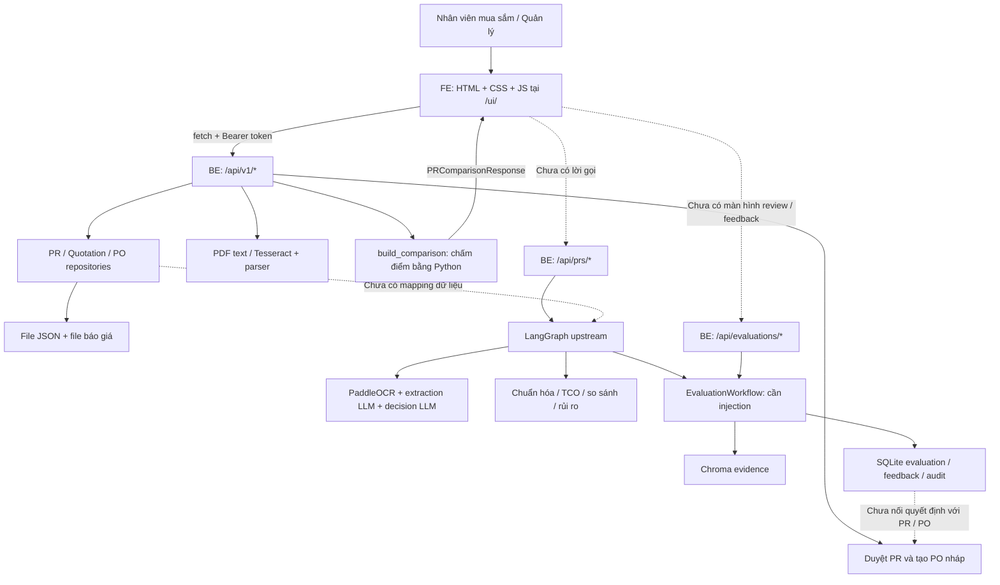

# Codebase Analysis Report - P-109: Luồng FE, BE và Agent

## Overview

| Field | Value |
|---|---|
| Repository | P-109 — Procurement Agent / Procura |
| Repository Type | Một repository chứa FE, BE và agent |
| Date | 02/10/2026 — giờ Việt Nam |
| Analyzed By | Codex; đọc code, kiểm tra cú pháp/import, lint mục tiêu và thử chạy test API |

**Kết luận: chưa kết nối hoàn chỉnh FE → BE → LangGraph Agent → FE.** FE đã có code gọi BE cho luồng nghiệp vụ PR → báo giá → xác nhận → so sánh → phê duyệt → PO nháp. Nhưng phần so sánh/đề xuất trên FE lấy kết quả từ service Python chấm điểm theo quy tắc, chưa lấy output của LangGraph Agent.

**Mã nguồn hiện tại còn chặn khởi động BE:** `src/agents/nodes/extract_documents.py:42` có lỗi cú pháp. Import `src.main` thất bại; vì FastAPI cũng phục vụ FE tại `/ui/`, khởi động mới bằng mã nguồn này sẽ chưa phục vụ được cả UI lẫn API. Điều này không xác định trạng thái của một server cũ hoặc bản deploy khác đang chạy.

| Điểm kết nối | Tình trạng trong code | Đã xác nhận chạy với checkout hiện tại? |
|---|---|---|
| FE ↔ API nghiệp vụ `/api/v1/*` | Đã có lời gọi và endpoint tương ứng | Chưa; import BE đang lỗi |
| API nghiệp vụ ↔ repository PR, báo giá, PO | Đã nối; lưu file JSON và file nguồn | Chưa kiểm chứng runtime lần này |
| Màn hình so sánh ↔ `build_comparison()` | Đã nối trực tiếp | Đọc code xác nhận; chưa chạy runtime |
| FE ↔ API LangGraph `/api/prs/*` | Chưa thấy FE gọi | Chưa nối |
| API phân tích ↔ graph ↔ evaluation | Có khung nhưng còn lỗi code, contract và cấu hình | Chưa chạy được |
| FE ↔ review/feedback `/api/evaluations/*` | Chưa thấy FE gọi; startup chưa cấp đủ dependencies | Chưa nối |
| Phê duyệt PR/PO ↔ phê duyệt recommendation của agent | Hai luồng riêng; chưa có cầu nối | Chưa nối |

Phạm vi: chỉ tạo báo cáo này; không sửa code, config, prompt, dữ liệu hay test. Không gọi OCR/LLM bên ngoài, không đọc nội dung báo giá thật. Các kết luận về luồng dựa trên code hiện tại, không dựa vào các file output của lần chạy trước.

## Repository Structure

### Type & Layout

FE là HTML/CSS/JavaScript thuần với ES modules. BE là FastAPI. Agent nằm trong cùng tiến trình Python của BE, không phải một dịch vụ độc lập cần mở cổng riêng.

### Key Directories

| Directory | Purpose | Layer/App |
|---|---|---|
| `frontend/core/`, `frontend/features/` | API client, session, router và các màn hình | FE |
| `src/api/routes/` | API nghiệp vụ, API ca phân tích và API evaluation | BE |
| `src/services/` | Repository, parser, so sánh, LLM và evaluation | BE / tích hợp agent |
| `src/agents/` | State, graph, node và deterministic tools | Agent |
| `src/extraction/` | Trích xuất PDF, OCR Tesseract, parser | Luồng báo giá của UI |
| `src/models/` | Các contract Pydantic của từng luồng | FE–BE / BE–agent |
| `tests/` | Test API, agent và models | Kiểm thử |
| `data/` | JSON nghiệp vụ, file nguồn; đường dẫn SQLite evaluation mặc định | Lưu trữ |

### Where Things Live

| Concern | Location |
|---|---|
| Dependencies | `requirements.txt` |
| Scripts | `Makefile`, `scripts/`, các script thử pipeline ở gốc repo |
| Unit Tests | `tests/test_agents/`, `tests/test_models/` |
| Integration Tests | `tests/test_api/`, test graph và evaluation |
| E2E Tests | Có test API–graph dùng stub; chưa thấy suite trình duyệt FE–BE–agent |
| Infrastructure | `Dockerfile`, `docker-compose.yml`, `.github/workflows/ci.yml` |

## Dependencies Analysis

### Core Dependencies

Các phiên bản dưới đây là ràng buộc khai báo, không phải kết quả kiểm tra phiên bản mới nhất.

| Dependency | Version | Purpose | Up-to-date? |
|---|---|---|---|
| FastAPI / Uvicorn | `>=0.115.0` / `>=0.34.0` | HTTP API và phục vụ FE tĩnh | Chưa đánh giá |
| Pydantic / pydantic-settings | `>=2.10.0` / `>=2.7.0` | Contract và cấu hình | Chưa đánh giá |
| LangGraph | `>=0.2.0` | StateGraph, interrupt và MemorySaver | Chưa đánh giá |
| LangChain / langchain-openai | `>=0.3.0` / `>=0.3.0` | Client LLM | Chưa đánh giá |
| PaddleOCR | `>=3.7.0,<4.0.0` | OCR nhánh agent | Chưa đánh giá |
| PyMuPDF / pdfplumber / pypdf | `>=1.25,<2` / `>=0.11.0` / `>=5.0.0` | PDF và preview | Chưa đánh giá |
| ChromaDB | `>=1.0.0,<2.0.0` | Retrieval evidence cho evaluation | Chưa đánh giá |
| pytest / Ruff / httpx | `>=8.0.0` / `>=0.8.0` / `>=0.28.0` | Kiểm thử, lint và HTTP client | Chưa đánh giá |

### Outdated / Risky Dependencies

| Dependency | Current Version | Latest Version | Risk Level | Notes |
|---|---|---|---|---|
| Các package Python | Chủ yếu khai báo khoảng phiên bản | Không tra cứu trong lần này | Chưa đánh giá | Chưa thấy lockfile dependency |
| OCR / LLM của agent | Có nhiều adapter | Không áp dụng | Cần kiểm chứng tích hợp | Có adapter không đồng nghĩa provider đã được cấu hình và gọi thành công |

## Available Scripts

### Application Scripts

| Script | Command | Description |
|---|---|---|
| Dev | `make run` | Uvicorn tại cổng 8000, entrypoint `src.main:app` |
| Docker | `docker compose up --build` | Một service backend đóng gói cả FE và BE |

### Quality Assurance Scripts

| Script | Command | Description |
|---|---|---|
| Test | `make test` | pytest toàn bộ `tests/` |
| Lint | `make lint` | Ruff check |
| Format | `make format` | Ruff format; có sửa file |
| Check | `make check` | Gọi lint, format, test; không dùng trong lần rà soát này vì có bước sửa file |
| Typecheck | `make typecheck` | Gọi mypy; mypy chưa được khai báo trong requirements |

### Other Scripts

| Script | Command | Description |
|---|---|---|
| Evaluation | `python scripts/evaluate_post_decision.py` | Script đánh giá downstream workflow; chưa chạy lần này |
| Manual pipeline | `scripts/manual/full_pipeline.py`, `tests/manual_node_runner.py` | Công cụ thử agent riêng; không chứng minh UI đã nối agent |

## High-Level Architecture

### Architecture Diagram

Sơ đồ mô tả kết nối trong code; lỗi import hiện tại chặn việc khởi động ứng dụng.

### Communication Patterns

| Pattern | Used Between | Protocol/Library |
|---|---|---|
| Request/response | FE ↔ BE | `fetch`, JSON và multipart; API root cố định `/api/v1` |
| Gọi hàm nội bộ | BE ↔ service / agent | Python; `agent.ainvoke(...)`, không cần HTTP giữa BE và graph |
| HITL upstream | Graph ↔ người đối soát | `interrupt()` + `Command(resume=...)`; API hiện có helper tự confirm |
| Review downstream | Client ↔ EvaluationWorkflow | API review/feedback, ID + version + idempotency key |
| Lưu trạng thái | Nghiệp vụ / upstream / downstream | JSON / MemorySaver / SQLite; chưa hợp nhất |

**Luồng người dùng mà FE hiện đang triển khai:**

1. Đăng nhập → `/api/v1/auth/login`; FE lưu token trong localStorage và khôi phục qua `/auth/session`.
2. Tạo PR → `POST /api/v1/prs`; BE lưu `data/purchase_requests.json`, trạng thái `awaiting_quotation`.
3. Upload báo giá → `POST /api/v1/prs/{id}/quotations`; BE đọc PDF text hoặc OCR Tesseract rồi parse. TXT/EML có nhánh parser riêng. Kết quả là quotation `unconfirmed`; file gốc và metadata được lưu. Endpoint này không gọi LangGraph hay extraction LLM.
4. Buyer đối soát với preview PDF, sửa dòng hàng và confirm → `POST /api/v1/quotations/{id}/confirm`; quotation thành `confirmed`, PR thành `comparing`.
5. Mở màn hình so sánh → `GET /api/v1/prs/{id}/comparison` → `build_comparison(pr, quotations)` → trả bảng và đề xuất cho FE. Hàm này chỉ dùng báo giá đã confirm có dòng hàng; chấp nhận từ 1 báo giá.
6. BE tính tổng các `line_total`, đối chiếu ngân sách/tiến độ/thanh toán/bảo hành, chấm điểm Giá 40% + Tiến độ/Thương mại 30% + Chất lượng/Bảo hành 30%, rồi chọn NCC. Chưa gọi bộ tool TCO của agent hoặc LLM trong bước này.
7. Gửi duyệt → `/submit-approval`; PR thành `pending_approval`. Manager gọi `/approve` để tạo PO `draft` và PR `approved`, hoặc `/reject` để đưa PR về `comparing` kèm lý do. Đây là review nghiệp vụ riêng, chưa phải feedback của EvaluationWorkflow.

**Luồng LangGraph được khai báo:**

1. API riêng tạo `case_id` tại `POST /api/prs`, giữ case trong `case_store` của tiến trình; upload PDF tại `/api/prs/{case_id}/documents`.
2. `/analyze` yêu cầu ít nhất 2 tài liệu; `/decision-pipeline` yêu cầu ít nhất 1. API dựng state gồm `case_id`, `pr_data`, `documents` và truyền `thread_id` vào graph.
3. Graph: `extract_documents` → `validate_extraction` → kiểm tra confidence. Nhánh `mandatory` đi qua `human_review_extraction`; nhánh `optional` đi thẳng `normalize`. Đây là hành vi code hiện tại, khác sơ đồ trong `ARCHITECTURE.md` mô tả cả hai nhánh đều qua màn hình review.
4. Extraction có khung OCR Paddle và adapter LLM. Adapter mặc định đang được nhắc đến tại dòng lỗi là Gemini; client quyết định ưu tiên Groq → Qwen-compatible endpoint → OpenAI theo cấu hình. Không nên mặc định coi pipeline đang chạy Qwen3-8B chỉ vì tài liệu nói vậy.
5. `normalize` chuẩn hóa UOM/tiền tệ; `check_data_ready` chặn báo giá còn cần confirm. Node tên `decision_llm` trong graph thực tế trỏ tới hàm `decision_proposal`: chạy tool TCO/so sánh/rủi ro để tạo context, rồi yêu cầu LLM trả `DecisionProposal`.
6. Graph chính gọi `EvaluationWorkflow.submit(...)`: kiểm contract → ràng buộc → grounding evidence → quy tắc nghiệp vụ → chất lượng đề xuất. Đủ điều kiện mới thành `awaiting_review`; lỗi có thể dẫn tới repair, yêu cầu bổ sung, ngoại lệ hoặc technical failure. Có hỗ trợ tối đa 2 lần auto-repair nếu được cấp repair model.
7. HITL-2 lưu ở SQLite, client lấy `/api/evaluations/{recommendation_id}/review` và gửi `/feedback`. FE hiện chưa thực hiện bước này; startup BE chưa cấu hình workflow, context provider và actor.
8. Graph phụ dừng sau `decision_proposal`, không evaluation/HITL-2. API graph phụ vẫn đọc field `recommendation` của contract cũ, nên chưa trả đúng output mới.

## Backend Analysis

| Aspect | Details |
|---|---|
| Technology / Framework | Python + FastAPI |
| Architecture Pattern | Routes → services/repositories; graph và downstream workflow riêng |
| Code Organization | Theo trách nhiệm; FE chia feature |
| Database | Nghiệp vụ dùng JSON; case và session trong RAM; evaluation dùng SQLite khi cấu hình |
| ORM / Query Pattern | Không có ORM đang nối nghiệp vụ; SQLite trực tiếp trong EvaluationStore |
| Authentication | Bearer token demo, session RAM hết hạn sau 30 phút; không phải JWT |
| Authorization | `procurement` / `manager` cho API nghiệp vụ; evaluation dùng Actor riêng |
| Deployment | Uvicorn; container chung FE và BE |

### Backend Modules/Services

| Module/Service | Path | Responsibility |
|---|---|---|
| API UI | `src/api/routes/__init__.py` | Auth, PR, báo giá, so sánh, duyệt, PO; prefix `/api/v1` |
| API agent | `src/api/routes/pr.py` | Case, tài liệu, analyze và decision pipeline; prefix `/api/prs` |
| API evaluation | `src/api/routes/evaluation.py` | Submit output, review payload và feedback; prefix `/api/evaluations` |
| So sánh UI | `src/services/comparison.py` | MCDA + tạo chuỗi giải thích theo template |
| Graph | `src/agents/graph.py` | Upstream processing → DecisionProposal → evaluation |
| Downstream | `src/services/evaluation*.py` | Validation, evidence, grounding, store và review |

**Các điểm khiến BE–agent chưa hoàn thiện:**

| Vấn đề | Bằng chứng trong code | Hệ quả |
|---|---|---|
| Lỗi cú pháp extraction | `src/agents/nodes/extract_documents.py:42`: `extractor =   or GeminiAPIExtractionClient()` | Import graph kéo theo import app thất bại; chặn toàn bộ startup |
| Tên chưa được định nghĩa/import | `src/api/routes/pr.py:139,140,226,232`: `_actor`, `_workflow`, `graph`, `case_id` | `/analyze` và helper resume còn lỗi NameError sau khi sửa cú pháp |
| Evaluation chưa được khởi tạo | `configure_evaluation()` có định nghĩa nhưng không có lời gọi trong `src/main.py`; global `agent = build_graph()` không nhận dependencies | Graph chính sẽ trả `EVALUATION_CONTEXT_NOT_CONFIGURED` nếu chạy đến evaluation |
| Chưa nối xác thực Actor | Evaluation đọc `request.state.actor`; middleware hiện tại không thiết lập field này | Token login UI chưa đủ để gọi review; API evaluation trả 401 khi thiếu Actor |
| Contract analyze không đồng nhất | Decorator dùng `AnalysisRunResponse`; thân hàm vẫn đọc `recommendation` và trả `AnalysisResponse` với `completed` | Graph mới phát `decision_proposal`/evaluation; response cũ không tương thích |
| Contract graph phụ chưa cập nhật | Graph gọi `decision_proposal`; `/decision-pipeline` vẫn lấy `result.get("recommendation") or {}` | Bỏ sót proposal mới; `{}` không đáp ứng field bắt buộc của `Recommendation` cũ |
| HITL-1 tự confirm | Helper graph phụ resume với `approved`, `confirm_all=True`; node review xóa cờ cần confirm sau resume | Không có vòng trả extraction về FE để Buyer thực sự sửa/xác nhận từng trường |
| Review và PO chưa nối | `/api/v1/.../approve` tự tạo PO từ quotations; `/api/evaluations/.../feedback` ghi quyết định vào EvaluationStore | Duyệt trên FE chưa chứng minh proposal agent đã qua evaluation và review |

**Contract và dữ liệu còn tách rời:**

| Nội dung | Luồng FE nghiệp vụ | Luồng agent |
|---|---|---|
| Tạo PR | `/api/v1/prs` | `/api/prs` |
| ID / kho | `id`, JSON repository | `case_id`, RAM `case_store` |
| Input | `code`, `category`, `quantity`, `estimated_budget`, `delivery_due_date` | `pr_number`, `quantity`, `budget`, `deadline` |
| Báo giá | `Quotation.items`: `product_name`, `line_total`... | `RawExtraction` / `DataNormalized`: `supplier_id`, confidence, VAT, surcharges, provenance... |
| Upload | PDF/TXT/EML, tối đa 5 MB/file | PDF, tối đa 2 MB/file |
| Kết quả UI | `PRComparisonResponse` + `AgentRecommendation` | `DecisionProposal` + `EvaluationResult` + review payload |

Chỉ đổi API root của FE sẽ không đủ: ID do luồng UI tạo không tự xuất hiện trong `case_store`, và input/output cần mapping. Biến `database_url` có khai báo nhưng chưa được dùng để nối các kho này.

## Frontend Analysis

| Aspect | Details |
|---|---|
| Framework / UI Library | JavaScript thuần, HTML/CSS; không thấy React/Next.js đang triển khai |
| Communication Pattern | HTTP JSON/multipart; chưa thấy WebSocket, SSE hay polling tiến độ agent |
| State Management | localStorage/sessionStorage và state trong module |
| Authentication Library | Tự xử lý session và Bearer token |
| Query Library | `fetch` qua `requestApi()` |
| Architecture Pattern | Feature-based, hash router |
| Deployment | FastAPI phục vụ `/ui/`; API cùng origin |

### Frontend Apps/Packages

| App/Package | Path | Responsibility |
|---|---|---|
| Khởi chạy/router | `frontend/app.js`, `frontend/core/router.js` | Restore session, route theo role |
| API/session | `frontend/core/api.js`, `frontend/core/session.js`, `frontend/config/constants.js` | `API_ROOT = "/api/v1"`, token và flash |
| Nghiệp vụ | `frontend/features/` | Auth, workspace, PR, báo giá/preview, comparison, approvals, history và PO |

`frontend/features/comparison/comparison.js` render `recommendation` và `execution_steps` từ API comparison. Trong `src/services/comparison.py`, các step được tạo sẵn với `completed`, “RAG / Policy Audit” là nhãn của kiểm tra bằng code, và `confidence_score` được gán cố định `0.94` (dòng 384). Các thông tin này **không phải trace thực thi LangGraph, retrieval Chroma hay confidence đo từ model**.

## Infrastructure Analysis

| Aspect | Details |
|---|---|
| IaC Tool / Hosting / Cloud Provider | Docker Compose local; chưa xác nhận môi trường deploy thực tế |
| Containerized | Có; Dockerfile chính copy cả `src/` và `frontend/` |
| Container Orchestration | Compose chỉ khai báo `backend`, expose 8000, mount `data` và FE |
| Scalability | Session/case/checkpoint trong RAM và kho JSON giới hạn khả năng chạy nhiều worker/instance |

`frontend/Dockerfile` + `nginx.conf` là phương án riêng không được Compose hiện tại sử dụng. Dockerfile FE chỉ copy `index.html`, `styles.css`, `app.js`; chưa copy `core/`, `config/`, `features/`, `utils/` mà app.js import. Vì vậy chưa thể coi image FE riêng là sẵn sàng chạy giao diện đã tách module.

## Third-Party Integrations

| Integration | Purpose | Coupling Level | Replaceability |
|---|---|---|---|
| Tesseract + PDF libraries | OCR/parser/preview cho luồng UI | Moderate | Medium |
| PaddleOCR + extraction adapters Gemini/Qwen/Groq | OCR + extraction có cấu trúc của agent | Moderate | Có interface để thay adapter; cần kiểm thử |
| Groq / Qwen-compatible / OpenAI | Decision LLM theo cấu hình | Moderate | Medium |
| ChromaDB | Evidence retrieval của evaluation | Moderate | Có adapter/protocol; startup chưa nối collection |
| SQLite | Lưu recommendation, evaluation versions, feedback và audit | Moderate | Cần giữ semantics version/idempotency khi thay |

Không kiểm tra key hoặc gọi provider thật trong lần rà soát này. `.env.example` chưa mô tả đầy đủ các biến Qwen/Gemini/Groq/evaluation hiện có trong `Settings`; đây là khoảng trống hướng dẫn cấu hình, không phải bằng chứng key thực tế thiếu.

## Testing Approach

| Test Type | Present | Location | Framework | Coverage |
|---|---|---|---|---|
| Unit | Có | `tests/test_agents/`, `tests/test_models/` | pytest | Chưa đo |
| Integration | Có | `tests/test_api/`, test graph/evaluation | pytest + httpx ASGITransport | Chưa đo |
| E2E | Có API–graph dùng stub; chưa thấy browser E2E | `tests/test_api/test_pr.py` | pytest | Chưa chứng minh FE–BE–agent |
| Contract | Có | `test_state_contract.py`, test models/evaluation | pytest + Pydantic | Chưa đo |

### Testing Strategy Assessment

Các kiểm tra thực hiện trên checkout hiện tại:

1. Parse AST 56 file Python trong `src/`: phát hiện lỗi cú pháp ở `extract_documents.py:42`.
2. Thử `import src.main` với `PYTHONDONTWRITEBYTECODE=1`: thất bại cùng `SyntaxError`.
3. Chạy `ruff check src/agents/nodes/extract_documents.py src/api/routes/pr.py --select E9,F821,F841`: exit 1, báo 8 diagnostics, gồm lỗi cú pháp, 4 tên chưa định nghĩa và 2 biến cục bộ chưa dùng.
4. Thử pytest cho `test_routes.py`, `test_pr.py`, `test_evaluation.py` với `-p no:cacheprovider`: exit 4, dừng khi nạp `tests/conftest.py` vì import app lỗi. **Chưa có test nào chạy qua; không có kết quả pass trong lần này.**

Test evaluation tạo FastAPI riêng và tự cấp Actor/workflow/context bằng fixture; điều này không chứng minh `src.main` đã cấu hình tương tự. Test analyze còn monkeypatch `pr_routes._actor` và `pr_routes.build_graph`, trong khi module route hiện chưa có các tên này. Các test này cũng cần được đối chiếu lại sau khi khôi phục khả năng import.

Không chạy `make check` vì target này gọi `ruff format` làm thay đổi source, trái phạm vi chỉ đọc. Không thay test hoặc sửa lỗi để làm kiểm tra pass.

## Security Assessment

| Aspect | Implementation | Rating |
|---|---|---|
| Authentication | Login demo, password khai báo trong code, token RAM | Chỉ phù hợp demo |
| Authorization | Role guard ở API UI; evaluation yêu cầu Actor có scope riêng | Có khung; thiếu nối Actor ở startup |
| Data Validation | Pydantic, giới hạn upload, trạng thái confirm | Có; cần thống nhất contract giữa hai luồng |
| Secrets Management | Settings đọc env; không kiểm tra/in key trong lần này | Chưa audit |
| Endpoint Security | Một số route agent không có dependency xác thực | Cần nối xác thực nếu sử dụng thực tế |
| Database Security | JSON/local uploads; evaluation có scope/version/audit | Chưa audit hạ tầng |

### Publicly Accessible Endpoints

Các endpoint dưới đây không gắn auth dependency trong code; hiện chưa chạy được do lỗi import.

| Endpoint | Method | Purpose | Risk |
|---|---|---|---|
| `/health`, `/`, `/ui/*` | GET | Health/UI | Low |
| `/api/v1/auth/login` | POST | Login demo | Chưa audit rate limit |
| `/api/v1/status` | GET | Trả chuỗi `ready` cố định | Không kiểm readiness OCR/LLM/evaluation |
| `/api/v1/chat` | POST | Route template gọi graph với `query` | Không khớp procurement state, thiếu thread config; chưa dùng trên FE |
| `/api/prs`, `/api/prs/{case_id}/documents`, `/api/prs/{case_id}/decision-pipeline` | POST | Tạo case/upload/chạy graph phụ | Thiếu auth guard trong route |

## Dead Code & Duplications

### Dead Code Found

| # | Type | Location | Description |
|---|---|---|---|
| 1 | Biến cục bộ chưa dùng | `src/api/routes/pr.py` | `workflow`, `resume` được Ruff xác nhận; dấu hiệu phần tích hợp còn dang dở |
| 2 | Cấu hình chưa được dùng | `src/config.py:30` | `database_url` chưa được consumer sử dụng trong `src/` |

### Duplications Found

| # | Type | Locations | Description | Recommendation |
|---|---|---|---|---|
| 1 | Luồng PR song song | `routes/__init__.py`, `routes/pr.py` | JSON PR của UI và RAM case của agent không dùng chung ID/contract | Chọn nguồn dữ liệu nghiệp vụ chung và mapping rõ ràng |
| 2 | Hai đường so sánh/đề xuất | `services/comparison.py`, `agents/nodes/decision_llm.py` | UI chấm MCDA; agent có tool + LLM + evaluation | Xác định nguồn recommendation chính thức cho UI |
| 3 | Hai đường extraction | `services/quotation_parser.py`, `services/document_extraction.py` | Parser/Tesseract của UI và Paddle/LLM của agent | Thống nhất boundary và dữ liệu đã confirm |

### Similar Components (Merge Candidates)

| # | Components | Locations | Similarity | Recommendation |
|---|---|---|---|---|
| 1 | Hai graph upstream | `src/agents/graph.py` | Lặp extraction → validate → HITL → normalize → decision | Có thể dùng chung builder sau khi thống nhất contract |
| 2 | Legacy và downstream review | `nodes/evaluate.py`, `generate_evidence.py`, `human_review_recommendation.py`, `process_feedback.py`; `services/evaluation*.py` | Chức năng liên quan evaluation/review nhưng graph hiện dùng downstream service | Ghi rõ đường active/legacy; chưa kết luận có thể xóa module cũ |

## Proposed Improvements

Các mục sau chỉ là đề xuất cho lần triển khai tiếp theo, **chưa thực hiện**.

### 🔴 Critical

| # | Area | Description | Impact |
|---|---|---|---|
| 1 | Startup | Sửa lỗi cú pháp extraction | BE mới import và phục vụ FE/API được |
| 2 | API–graph contract | Hoàn thiện tên/import/helper của `/analyze`; thống nhất `DecisionProposal`, `AnalysisRunResponse` và output graph phụ | API agent mới phản ánh đúng kết quả thực thi |
| 3 | Runtime dependencies | Cấp EvaluationWorkflow, Chroma collection, trusted context provider và Actor; dựng graph có dependencies | Evaluation/review mới sử dụng được trong app chính |
| 4 | FE–BE–agent integration | Mapping PR/quotation đã confirm sang agent, nối lời gọi FE và payload review, nối feedback với trạng thái PR/PO | Hoàn thành chuỗi FE → BE → agent → FE → duyệt |
| 5 | HITL | Trả extraction cần review cho Buyer và nhận sửa/xác nhận thực, thay vì tự confirm trong helper | Dữ liệu dùng quyết định có xác nhận người dùng |

### 🟡 To Be Implemented (Not Critical)

| # | Area | Description | Impact |
|---|---|---|---|
| 1 | UI provenance | Phân biệt kết quả MCDA với LLM/evaluation; confidence và execution steps cần đúng nguồn | Người dùng hiểu đúng mức hoàn thiện của agent |
| 2 | Testing | Đối chiếu test với route hiện tại, chạy lại API–graph rồi browser E2E bằng mock OCR/LLM | Có bằng chứng kết nối end-to-end |
| 3 | Lifecycle | Làm rõ lưu bền session/case/checkpoint và schema cấu hình provider | Dễ vận hành, tránh mất state khi restart |

### 🟢 Nice to Have

| # | Area | Description | Impact |
|---|---|---|---|
| 1 | Documentation | Cập nhật README/ARCHITECTURE theo entrypoint, FE và graph thực tế | Giảm nhầm lẫn khi chạy/debug |
| 2 | Deployment | Đồng bộ image Nginx riêng nếu còn dùng và gom phần graph upstream lặp lại | Giảm cấu hình/logic song song |

## Summary

| Category | Count / Status |
|---|---|
| Total Dependencies | 18 package Python khai báo trực tiếp, không tính dòng comment |
| Outdated Dependencies | Chưa tra cứu/đánh giá |
| Dead Code Items | 2 nhóm ghi nhận; chưa audit toàn bộ dead code |
| Duplications Found | 3 luồng song song; 2 nhóm ứng viên tái sử dụng/đối chiếu |
| Critical Improvements | 5 nhóm |
| Non-Critical Improvements | 3 nhóm |
| Nice-to-Have Improvements | 2 nhóm |
| Overall Health Rating | Chưa sẵn sàng chạy end-to-end từ checkout hiện tại |
| Trả lời câu hỏi kết nối | FE–BE nghiệp vụ đã có code nối; FE–LangGraph/evaluation chưa nối hoàn chỉnh; BE đang lỗi startup |
| Thay đổi trong lần này | Chỉ thêm `docs/fe-be-agent-flow.md` |
