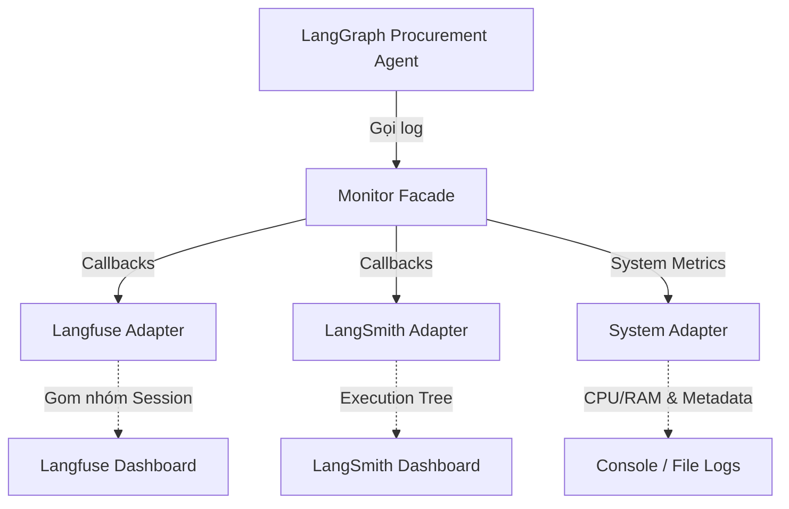

# Procurement Agent Monitor Architecture

Tài liệu này mô tả kiến trúc và cơ chế hoạt động của hệ thống Monitor dành riêng cho **Procurement AI Agent**, được thiết kế để theo dõi sát sao luồng Human-in-the-Loop (HITL) và đo lường hiệu suất LLM.

## 1. Tổng quan Kiến trúc (Architecture Overview)

Hệ thống Monitor được xây dựng theo **Facade Pattern**, cho phép module Agent gọi log mà không cần biết chi tiết hệ thống tracking bên dưới.



## 2. Các Module Cốt lõi

### 2.1 Monitor Facade (`monitor/core/facade.py`)
Đóng vai trò là điểm chạm duy nhất cho Agent. Cung cấp 4 hàm nghiệp vụ chính được thiết kế riêng cho luồng Procurement:
- **`log_hitl_interrupt`**: Ghi nhận thời điểm Agent dừng lại chờ con người duyệt (chờ fix data hoặc chờ duyệt báo giá).
- **`log_revision_loop`**: Đếm số lần feedback. Tự động bắn **ALERT** nếu số lần `revise_count >= 3`.
- **`log_early_exit`**: Ghi nhận các trace bị hủy sớm do dữ liệu đầu vào quá kém (unconfirmed) hoặc LLM đánh giá logic bất khả thi.
- **`log_llm_node`**: Ghi nhận chính xác lượng tokens tiêu thụ (prompt & completion) và độ trễ (latency) của từng node LLM.

### 2.2 Dual-Tracking Adapters (`monitor/adapters/`)
Hệ thống hỗ trợ đẩy telemetry song song lên 2 nền tảng:
- **Langfuse Adapter**: Được cấu hình thêm chức năng **Session Grouping**. Do đặc thù HITL làm ngắt quãng đồ thị (có thể delay nhiều ngày), adapter tự động bọc các trace bằng prefix `procurement-[thread_id]`.
- **LangSmith Adapter**: Gửi nguyên bản Execution Tree của LangChain để phục vụ việc debug prompt.

### 2.3 System Context Adapter
- Tự động đính kèm thông tin **CPU/RAM** vào mỗi log.
- Làm giàu (enrich) log bằng các biến business context như: `phase` (extraction, decision, review), `node_name`, `thread_id` và timestamp.

## 3. Bản đồ Theo dõi (Tracking Map) vs Procurement Graph

Hệ thống theo dõi sát sao 3 Phase của Procurement Agent:

| Phase thực thi | Node trong Graph | Phương thức Monitor tương ứng |
|---|---|---|
| **Phase 1: Bóc tách** | `extract_documents` | `log_llm_node()` |
| | `human_review_extraction` | `log_hitl_interrupt(reason="confidence_low")` |
| | `check_data_ready` | `log_early_exit(reason="data_unconfirmed")` |
| **Phase 2: Ra Quyết định**| `decision_llm` | `log_llm_node()` |
| | `evaluate_sufficiency` | `log_early_exit(reason="insufficient")` |
| **Phase 3: Chờ duyệt** | `human_review_recommendation` | `log_hitl_interrupt(reason="yield_to_buyer")` |
| | `process_feedback` (Loop) | `log_revision_loop(revise_count)` |

## 4. Cấu hình Môi trường (`.env`)

Để kích hoạt hệ thống, cần cấu hình các biến sau:
```env
# Kích hoạt nền tảng
LANGSMITH_ENABLED=true
LANGFUSE_ENABLED=true

# Cấu hình Nghiệp vụ
LANGFUSE_SESSION_ID_PREFIX=procurement-
MAX_REVISE_COUNT=3
MONITOR_ALERT_ENABLED=true
```

## 5. Kịch bản Giả lập (Simulator)
Chạy script dưới đây để kiểm tra luồng telemetry đẩy lên Dashboard. Script mô phỏng việc LLM tốn token, đồ thị bị chặn tại 2 điểm HITL, và mô phỏng lỗi khi Buyer yêu cầu chỉnh sửa đến lần thứ 3 để test cơ chế Alerting.

```bash
python -m monitor.scripts.mock_simulator
```
