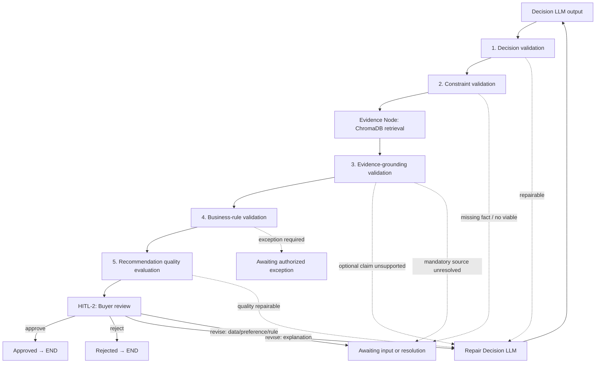

# 🏗️ Winston — Architecture Specification: `evaluate` to `END` (v2)

**Focus:** Downstream recommendation pipeline sau Decision LLM  
**Ngày cập nhật:** 2026-10-01  
**Trạng thái:** Đề xuất kiến trúc — chờ duyệt  

---

## 1. Phạm vi

Tài liệu này mô tả workflow bắt đầu khi `decision_llm` trả proposal và kết thúc tại quyết định cuối cùng của buyer. Không mô tả extraction, normalization, tool calling hay cách tạo đầu vào cho Decision LLM.

**Nodes chính:**  
`evaluate` → `evaluate_sufficiency` → `generate_evidence` → `human_review_recommendation` → `process_feedback`

Ánh xạ sang thiết kế mới:

| Node cũ | Tương đương thiết kế mới |
| --- | --- |
| `evaluate` + `evaluate_sufficiency` | 5 tầng evaluation (Decision → Constraint → Evidence-grounding → Business-rule → Quality) |
| `generate_evidence` | Evidence Node với ChromaDB retrieval |
| `human_review_recommendation` | HITL-2: Buyer review với typed feedback |
| `process_feedback` | Route theo loại feedback; decision LLM nhận output mới |

---

## 2. Ranh giới đầu vào của Evaluation

Evaluation nhận **hai input riêng biệt**:

1. **Decision LLM output** — proposal chưa được xác minh, cần kiểm tra.  
2. **Runtime evaluation context** — dữ liệu tin cậy do application cấp, không đến từ LLM. Gồm: case ID, recommendation ID/version, candidate IDs trong scope, hard/soft constraints, mandatory comparisons, formula allowlist và source scope được phép truy cập.

LLM không được đọc hay ghi: quyền truy cập, candidate scope, constraint, rule, phiên bản hay trạng thái approval.

| Dữ liệu | Bên sở hữu | Evaluation dùng để |
| --- | --- | --- |
| Proposal, rationale, claims, trade-offs | Decision LLM | Đối tượng cần kiểm tra |
| Recommendation ID/version, case ID | Application | Chống stale approval và truy vết |
| Candidate scope, hard/soft constraints, rules | Application | Kiểm feasibility, fairness và quy trình |
| Chroma source scope | Application | Giới hạn truy hồi đúng case/tài liệu/revision |
| Formula allowlist | Application | Replay calculation có kiểm soát |
| Evidence artifacts, issue/action, review decision | Evaluator/Application | Điều phối bước sau và audit |

---

## 3. Flow tổng thể



Evidence Node là bước chuẩn bị cho grounding validation; retrieval score không tự cấp trạng thái verified. Các nhánh `Awaiting` nằm ngoài phạm vi downstream: sau khi dữ liệu/rule/ưu tiên được xử lý ở nơi sở hữu, workflow nhận output mới từ `decision_llm` và bắt đầu lại từ Decision validation.

---

## 4. Contract output của Decision LLM

### 4.1. Nguyên tắc thiết kế

- Mọi fact xuất hiện trong summary, rationale, risk, trade-off, assumption hay negotiation point phải được khai báo thành **claim có ID**.
- Rationale là bản nháp; UI cuối chỉ hiển thị factual claims đã qua grounding.
- LLM không sinh hoặc thay đổi: `recommendation_id`, `recommendation_version`, approval state, evaluation state, feedback history, evidence verdict, authority hay application errors.
- `evidence` trong ranked item luôn bắt đầu rỗng — Evidence Node là nơi duy nhất tạo citation/source excerpt.
- Mỗi predicate dùng metric/operator nằm trong allowlist server-side. Không parse hay execute biểu thức, SQL hay formula do LLM tạo.

### 4.2. Schema logic

| Nhóm | Bắt buộc | Mục đích |
| --- | --- | --- |
| `decision` | Có | Kiểu kết quả, preferred supplier, summary và reasons. |
| `recommendation` | Có | Top-N, ranked list, shortfall nếu có ít candidates hơn Top-N. |
| `claims` | Có | Atomic factual/comparative assertions để evidence verifier xử lý. |
| `comparisons` | Có khi ranking | Scope, metric, supplier IDs và claims so sánh. |
| `trade_offs` | Có khi có alternative material | Giá trị nhận được/mất đi khi chọn phương án. |
| `negotiation_points` | Có thể rỗng | Suggestions, không phải cam kết của NCC. |
| `risk_flags` | Có | Risks với knowledge status, không tự đánh giá pass/fail. |
| `uncertainties` | Có | Unknown, tác động và action đề xuất. |
| `open_questions`, `assumptions` | Có thể rỗng | Việc buyer cần làm và giả định được phép. |

`decision.type` chỉ nhận: `ranked_recommendation` | `no_viable_supplier` | `insufficient_candidates` | `needs_input`. Ba loại không ranking phải có `ranked: []` và `preferred_supplier_id: null`.

Claim là discriminated union:
- `quantitative` — giá trị, đơn vị và source hints.
- `comparison` — operator (minimum/maximum/greater_than) cùng supplier scope đầy đủ.
- `qualitative` — criterion/source requirement; không suy ra từ marketing text.
- `risk` — risk fact, knowledge status và action đề xuất.

### 4.3. Output mẫu

```json
{
  "decision": {
    "type": "ranked_recommendation",
    "preferred_supplier_id": "A",
    "summary": "Ưu tiên A theo tổng chi phí và thời gian giao; B có bảo hành dài hơn.",
    "supporting_claim_ids": ["cl-A-cost", "cl-A-lowest-cost", "cl-A-delivery", "cl-A-fastest", "cl-B-warranty"],
    "reason_codes": ["LOWER_TOTAL_COST", "SHORTER_DELIVERY"],
    "uncertainty_ids": ["unc-quality"]
  },
  "recommendation": {
    "top_n": 3,
    "ranked": [
      {
        "rank": 1,
        "supplier_id": "A",
        "supplier_name": "Vendor A",
        "rationale": "TCO 12.000 USD, thấp nhất trong scope; giao 5 ngày, nhanh nhất trong scope.",
        "rationale_claim_ids": ["cl-A-cost", "cl-A-lowest-cost", "cl-A-delivery", "cl-A-fastest"],
        "comparison_ids": ["cmp-cost", "cmp-delivery", "cmp-warranty"],
        "trade_off_ids": ["trade-warranty"],
        "risk_ids": ["risk-quality-gap"],
        "uncertainty_ids": ["unc-quality"],
        "evidence": []
      },
      {
        "rank": 2,
        "supplier_id": "B",
        "supplier_name": "Vendor B",
        "rationale": "TCO 14.500 USD và giao 7 ngày; bảo hành 24 tháng so với 12 tháng của A.",
        "rationale_claim_ids": ["cl-B-cost", "cl-B-delivery", "cl-B-warranty"],
        "comparison_ids": ["cmp-cost", "cmp-delivery", "cmp-warranty"],
        "trade_off_ids": ["trade-warranty"],
        "risk_ids": ["risk-quality-gap"],
        "uncertainty_ids": ["unc-quality"],
        "evidence": []
      }
    ],
    "shortfall": {
      "requested_count": 3,
      "available_count": 2,
      "returned_count": 2,
      "reason_code": "AVAILABLE_CANDIDATES_BELOW_REQUESTED_TOP_N"
    }
  },
  "claims": [
    {
      "claim_id": "cl-A-cost",
      "category": "quantitative",
      "supplier_ids": ["A"],
      "text": "TCO của A là 12.000 USD.",
      "predicate": {"operator": "equals", "metric": "tco", "value": "12000.00", "unit": "USD"},
      "source_hints": ["Goods total and shipping charge in Vendor A quotation"],
      "calculation_hints": ["sum_declared_tax_inclusive_components"]
    },
    {
      "claim_id": "cl-A-lowest-cost",
      "category": "comparison",
      "supplier_ids": ["A", "B"],
      "text": "A có TCO thấp nhất trong scope.",
      "predicate": {"operator": "minimum", "metric": "tco", "subject_supplier_id": "A", "tie_handling": "disclose"},
      "source_hints": ["Totals for every supplier in the comparison scope"],
      "calculation_hints": []
    }
  ],
  "comparisons": [
    {"comparison_id": "cmp-cost", "criterion": "tco", "supplier_ids": ["A", "B"],
     "claim_ids": ["cl-A-cost", "cl-B-cost", "cl-A-lowest-cost"], "coverage": "complete"},
    {"comparison_id": "cmp-delivery", "criterion": "delivery_days", "supplier_ids": ["A", "B"],
     "claim_ids": ["cl-A-delivery", "cl-B-delivery", "cl-A-fastest"], "coverage": "complete"},
    {"comparison_id": "cmp-warranty", "criterion": "warranty_months", "supplier_ids": ["A", "B"],
     "claim_ids": ["cl-B-warranty"], "coverage": "complete"}
  ],
  "trade_offs": [
    {
      "trade_off_id": "trade-warranty",
      "preferred_supplier_id": "A",
      "alternative_supplier_id": "B",
      "benefit_claim_ids": ["cl-A-lowest-cost", "cl-A-fastest"],
      "cost_claim_ids": ["cl-B-warranty"],
      "uncertainty_ids": ["unc-quality"],
      "text": "Chọn A ưu tiên chi phí và tốc độ; buyer cần cân nhắc lợi ích bảo hành của B."
    }
  ],
  "negotiation_points": [
    {
      "negotiation_id": "neg-A-warranty",
      "supplier_id": "A",
      "kind": "suggestion",
      "action": "Đề nghị A kéo dài bảo hành.",
      "basis_claim_ids": ["cl-B-warranty"],
      "expected_outcome": null
    }
  ],
  "risk_flags": [
    {
      "risk_id": "risk-quality-gap",
      "supplier_ids": ["A", "B"],
      "risk_type": "quality_information_gap",
      "knowledge_status": "unknown",
      "severity": "unknown",
      "claim_ids": [],
      "uncertainty_ids": ["unc-quality"],
      "suggested_action": "Không ưu tiên NCC nào dựa trên xếp hạng chất lượng chưa có dữ liệu."
    }
  ],
  "uncertainties": [
    {
      "uncertainty_id": "unc-quality",
      "supplier_ids": ["A", "B"],
      "description": "Chưa có xếp hạng chất lượng được xác minh.",
      "impact": "Không thể kết luận B có chất lượng cao hơn A.",
      "suggested_criticality": "noncritical",
      "proposed_action": "disclose_and_exclude_from_scoring"
    }
  ],
  "open_questions": [
    {
      "question_id": "question-quality",
      "supplier_ids": ["A", "B"],
      "uncertainty_ids": ["unc-quality"],
      "question": "Có đánh giá chất lượng độc lập để bổ sung không?",
      "proposed_owner": "buyer"
    }
  ],
  "assumptions": []
}
```

> **Lưu ý:** Ví dụ chủ ý không có claim "B chất lượng cao hơn A". Nếu LLM sinh claim này mà không có criterion/source đủ điều kiện, Evaluation sẽ route `REPAIR_OUTPUT` hoặc `REQUEST_DATA`.

---

## 5. Evidence Node với ChromaDB

### 5.1. Trách nhiệm

Evidence Node nhận `rationale`, `claims` và server-provided source scope. Với từng claim, node tìm chunk nguyên gốc phù hợp từ ChromaDB, sau đó trả retrieval artifacts. Node:
- **Không** lấy quote text từ LangGraph state.
- **Không** coi vector similarity là bằng chứng cuối cùng.
- **Không** tự cấp trạng thái verified — đó là việc của grounding validator.

Metadata bắt buộc cho mỗi chunk trong ChromaDB:

| Metadata | Mục đích |
| --- | --- |
| `document_id`, `document_hash`, `source_kind` | Đúng file và đúng revision |
| `supplier_id`, `quote_id`, `item_id` (khi có) | Đúng đối tượng được claim nhắc tới |
| `page`, `block_id`, `table_id`, `row_id`, `cell_locator` | Citation đọc được và giữ ngữ cảnh bảng |
| `parent_chunk_id`, `chunk_hash` | Tải header/context/neighbor và kiểm toàn vẹn |
| `case/tenant access metadata` | Chỉ tìm nguồn ứng dụng cho phép |

Với bảng, index phải giữ headers, đơn vị, currency, conditions/footnotes và hàng/cột liên quan. Một ô số rời không đủ làm evidence.

### 5.2. Retrieval theo claim

1. Tách từng factual claim từ proposal; không query toàn bộ rationale rồi tái dùng một citation cho tất cả claims.
2. Lập query từ text claim, metric, supplier/quote/item, unit và conditions.
3. Server tạo filter/allowed source IDs theo case và source scope; LLM không truyền filter quyền.
4. Query Chroma cho candidate chunks; comparative claim phải tìm evidence cho toàn bộ suppliers trong scope.
5. Tải exact records theo ID, kèm parent/table header/neighbor khi candidate thiếu ngữ cảnh.
6. Giữ cả hit supporting và hit contradicting có liên quan.
7. Lưu chunk ID, exact stored excerpt, locator, hash và retrieval trace thành `EvidenceArtifact`.

> Chroma **Query** dùng nearest-neighbor similarity. Chroma **Get** tải bản ghi theo ID, không qua similarity ranking. Cả hai đều hỗ trợ metadata filtering để giới hạn corpus.

### 5.3. Các loại evidence

| Loại claim | Cách chứng minh |
| --- | --- |
| Direct | Chunk gốc chứa giá trị, unit và điều kiện phù hợp. |
| Derived | Chunks nguồn của các operands + replay phép tính thuộc allowlist. |
| Comparative | Evidence của toàn bộ supplier trong scope + phép so sánh deterministic + tie handling. |
| Human edit | Audit edit được xác thực + tham chiếu nguồn gốc để thấy before/after. |
| Unknown disclosure | Artifact evaluation chỉ rõ dữ liệu chưa xác minh; không biến "không tìm thấy" thành fact về NCC. |

Evidence có bốn trạng thái: `supported` | `contradicted` | `unresolved` | `not_found`.  
Retrieval score/distance chỉ hỗ trợ tìm kiếm/calibration — không phải xác suất claim đúng và không thể tự mở cổng approval.

### 5.4. EvidenceArtifact schema

```json
{
  "evidence_id": "ev-A-delivery",
  "recommendation_id": "rec-case-demo-1",
  "recommendation_version": 1,
  "claim_id": "cl-A-delivery",
  "evidence_kind": "direct_source",
  "support_status": "supported",
  "sources": [
    {
      "chunk_id": "chunk-A-delivery",
      "document_id": "doc-A",
      "document_hash": "demo-hash-A",
      "page": 2,
      "block_id": "delivery-terms",
      "table_id": null,
      "row_id": null,
      "cell_ids": [],
      "exact_excerpt": "Delivery: 5 calendar days after order confirmation.",
      "context_excerpt": "Delivery: 5 calendar days after order confirmation.",
      "source_kind": "quotation"
    }
  ],
  "verification": {
    "value_match": true,
    "unit_match": true,
    "scope_match": true,
    "condition_match": true,
    "source_revision_match": true
  },
  "retrieval_trace": {
    "query_id": "query-cl-A-delivery",
    "candidate_chunk_ids": ["chunk-A-delivery"],
    "distance": 0.12
  }
}
```

> Exact excerpt phải là substring của stored chunk. Model không được viết lại câu trích dẫn rồi gắn như evidence.

---

## 6. Năm tầng Evaluation

### 6.1. Decision validation

**Mục tiêu:** Kiểm cấu trúc và nhất quán của proposal.

- `decision.type` phù hợp ranked list.
- Supplier IDs thuộc candidate scope do application cấp.
- Rank liên tục, unique; preferred supplier khớp rank 1.
- Top-N/shortfall hợp logic quy tắc runtime.
- Claim, comparison, trade-off, risk, uncertainty references tồn tại và không trùng.
- Tất cả assertion factual trong summary/rationale/risk/trade-off/negotiation/assumption đều có claim ID.

**Routing:**
- Lỗi cấu trúc hoặc claim dư nhưng có đủ dữ liệu để sửa → `REPAIR_OUTPUT`.
- Supplier không thuộc candidate scope → `REPAIR_OUTPUT` nếu chỉ là lỗi output; `technical_failure` nếu scope/context không xác thực được.

### 6.2. Constraint validation

**Mục tiêu:** Kiểm feasibility của từng supplier so với hard/soft constraints runtime — scope/coverage, quantity/spec, budget, deadline, commercial conditions và unknown handling.

Mỗi constraint trả `pass | fail | unknown | not_applicable`.

- NCC vi phạm hard constraint không được rank.
- Fact bắt buộc unknown → `REQUEST_DATA`.
- Soft constraint phải hiện trong trade-off; không được tự biến thành hard constraint.

**Routing:**
- Output chọn NCC fail nhưng có candidate hợp lệ khác → `REPAIR_OUTPUT`.
- Không có candidate viable → `REPORT_NO_VIABLE_SUPPLIER`.

> **Lưu ý:** Tầng này **khác** Business-rule validation. Constraint kiểm NCC có đáp ứng yêu cầu hay không; Business-rule kiểm quy trình chọn recommendation có được phép không.

### 6.3. Evidence-grounding validation

**Mục tiêu:** Sau Evidence Node, verifier kiểm mỗi factual claim có nguồn đúng hay không.

- Mỗi factual claim hiển thị có source đúng supplier/item/revision/context.
- Exact excerpt, row/header/cell context tồn tại.
- Value, currency, UOM, time origin và conditions khớp predicate.
- Derived calculations replay được bằng Decimal, operator/formula allowlist và rounding đã định.
- Comparative claims có full supplier coverage và tie handling.
- Counter-evidence không bị bỏ qua.
- Unknown/critical uncertainty được tạo hoặc giữ lại kèm impact/action.

**Routing:**
- Claim optional không được support → `REPAIR_OUTPUT`.
- Claim quyết định hoặc mandatory comparison không có nguồn → `REQUEST_DATA`.
- Chroma timeout/index error → `RETRY_TRANSIENT` rồi `technical_failure`; không chuyển thành business pass/fail.

### 6.4. Business-rule validation

**Mục tiêu:** Kiểm rules runtime về số candidate tối thiểu, mandatory comparisons, single-source/exception, authority và cách xử lý unavailable data.

**Fairness rules bắt buộc:**
- Fee/price thiếu không trở thành 0.
- Lead time unknown không được coi là nhanh.
- Quality/compliance unknown không được coi là tốt.
- Criteria optional thiếu phải được xử lý cùng cách giữa các NCC.
- Không re-normalize weights riêng cho từng NCC để NCC thiếu dữ liệu có lợi.

**Routing:**
- Hard rule fail chỉ route `REQUEST_EXCEPTION` khi rule runtime nói rõ có ngoại lệ và actor đúng authority. Buyer approval thông thường không tự bỏ qua blocker.

### 6.5. Recommendation quality evaluation

**Mục tiêu:** Chỉ chạy sau bốn tầng bắt buộc pass. Chấm utility bằng rubric anchored 0–4.

| Dimension | 0–1 | 3–4 |
| --- | --- | --- |
| Rationale clarity | Chung chung/mâu thuẫn | Specific, nhất quán với claims |
| Comparison completeness | Thiếu criterion/alternative material | Đủ scope và comparisons bắt buộc |
| Trade-off usefulness | Chỉ nêu NCC thắng | Nêu benefit/cost của lựa chọn |
| Uncertainty disclosure | Che unknown/blocker | Nêu impact, owner, next action |
| Actionability | Buyer không biết xử lý gì | Có quyết định/đàm phán/bổ sung rõ |

LLM judge có thể hỗ trợ clarity/usefulness, nhưng **không có quyền override** deterministic, evidence hay business-rule failure. Điểm trung bình không bù cho critical uncertainty bị che giấu.

---

## 7. Check catalog

| Check | Tầng chính | Pass khi | Fail route |
| --- | --- | --- | --- |
| No unsupported claim | Decision + Grounding | Toàn bộ factual assertions đã khai báo và supported | Repair claim dư; mandatory claim thiếu → data |
| No missing mandatory comparison | Business rule + Quality | Có đủ comparison bắt buộc và full scope | Repair khi facts đủ; thiếu fact → data |
| All numerical calculations reproducible | Grounding | Replay khớp operands, formula, unit, rounding | Output sai → repair; thiếu dependency/source → data |
| All recommendation claims backed by sources | Grounding | Direct/derived/comparative evidence graph đầy đủ | Repair hoặc data theo tính bắt buộc |
| Decision respects procurement policy | Constraint + Business rule | Hard rules pass hoặc exception hợp lệ | Exception/input/no viable |
| No supplier receives advantage from unavailable data | Business rule | Unknown không cải thiện rank/score | Repair hoặc input |
| Critical uncertainty explicitly disclosed | Constraint + Grounding + Quality | Disclosure có impact, owner, next action | Repair; critical missing fact → data |

---

## 8. Evaluation result, action và routing

### 8.1. Result contract

```json
{
  "evaluation_id": "eval-rec-case-demo-1-attempt-1",
  "recommendation_id": "rec-case-demo-1",
  "recommendation_version": 1,
  "attempt": 1,
  "overall_status": "repairable",
  "stage_results": [
    {"stage": "decision", "status": "pass", "issue_ids": []},
    {"stage": "constraint", "status": "pass", "issue_ids": []},
    {"stage": "evidence_grounding", "status": "fail", "issue_ids": ["issue-quality-claim"]},
    {"stage": "business_rule", "status": "not_run", "issue_ids": []},
    {"stage": "recommendation_quality", "status": "not_run", "issue_ids": []}
  ],
  "check_results": [
    {"check_id": "NO_UNSUPPORTED_CLAIM", "status": "fail", "issue_ids": ["issue-quality-claim"]},
    {"check_id": "NO_MISSING_MANDATORY_COMPARISON", "status": "not_run", "issue_ids": []},
    {"check_id": "ALL_NUMERICAL_CALCULATIONS_REPRODUCIBLE", "status": "pass", "issue_ids": []},
    {"check_id": "ALL_RECOMMENDATION_CLAIMS_BACKED_BY_SOURCES", "status": "fail", "issue_ids": ["issue-quality-claim"]},
    {"check_id": "DECISION_RESPECTS_PROCUREMENT_POLICY", "status": "not_run", "issue_ids": []},
    {"check_id": "NO_SUPPLIER_ADVANTAGE_FROM_UNAVAILABLE_DATA", "status": "not_run", "issue_ids": []},
    {"check_id": "CRITICAL_UNCERTAINTY_EXPLICITLY_DISCLOSED", "status": "not_run", "issue_ids": []}
  ],
  "issues": [
    {
      "issue_id": "issue-quality-claim",
      "stage": "evidence_grounding",
      "code": "UNSUPPORTED_OPTIONAL_CLAIM",
      "severity": "error",
      "claim_ids": ["claim-extra-quality"],
      "supplier_ids": ["B"],
      "action": "REPAIR_OUTPUT",
      "owner": "decision_llm"
    }
  ],
  "required_actions": [
    {"action_id": "act-repair-1", "type": "REPAIR_OUTPUT", "issue_ids": ["issue-quality-claim"], "route": "repair_decision_llm"}
  ],
  "quality": null
}
```

`overall_status` nhận: `ready_for_review` | `repairable` | `needs_input` | `exception_required` | `no_viable_supplier` | `technical_failure`.

Stage/check status nhận: `pass` | `fail` | `unknown` | `not_applicable` | `not_run`.

### 8.2. Action catalog

| Action | Trigger | Route |
| --- | --- | --- |
| `CONTINUE` | Current stage pass | Stage kế tiếp |
| `REPAIR_OUTPUT` | Có lỗi output và dữ liệu đủ | Repair LLM → chạy lại toàn bộ evaluation |
| `RETRIEVE_MORE_EVIDENCE` | Thiếu table/header/parent context nhưng corpus khả dụng | Evidence Node, tối đa một expansion |
| `REQUEST_DATA` | Thiếu fact/source bắt buộc hoặc cần correction | Chờ nguồn upstream → nhận output LLM mới |
| `REQUEST_EXCEPTION` | Rule fail nhưng cho phép ngoại lệ | Chờ approver có authority → output LLM mới |
| `REPORT_NO_VIABLE_SUPPLIER` | Không có candidate đáp ứng | Chờ buyer xử lý/close |
| `RETRY_TRANSIENT` | Timeout/Chroma/network tạm thời | Retry backoff có giới hạn |
| `ESCALATE_REPAIR_LIMIT` | Output/issue lặp không tiến triển | Chờ manual resolution |
| `PRESENT_FOR_REVIEW` | Mandatory checks pass và quality đạt | HITL-2 |
| `FINALIZE_APPROVAL` | Approve đúng version/authority | Approved → END |
| `FINALIZE_REJECTION` | Reject hợp lệ | Rejected → END |
| `CLOSE_CASE` | Buyer đóng case | Closed → END |

**Ưu tiên route:** integrity/authorization → technical/transient → missing data/exception/no viable → repairable output → warnings.  
- Một warning không che blocker.  
- Tối đa 2 automatic repairs, 1 evidence expansion; retry dịch vụ và buyer revise dùng counters riêng.

---

## 9. Node: `generate_evidence` — Chi tiết triển khai

### 9.1. Mục tiêu

Node này **không được phép bịa** text. Nó hoạt động như một exact matcher/semantic searcher để nối rationale và claims với source documents.

Với mỗi `RankedSupplier` trong state:
1. Parse `rationale_claim_ids` để lấy danh sách claims cần grounding.
2. Với mỗi claim, build query từ `text`, `predicate.metric`, `supplier_ids`, `predicate.unit`.
3. Áp dụng server-provided source scope filter; không nhận filter từ LLM.
4. Thực hiện Chroma Query + Get theo luồng ở mục 5.2.
5. Ghi `EvidenceArtifact` với `support_status` phù hợp.
6. Nếu không tìm được grounding cho claim → ghi `support_status: "not_found"`, không fabricate.

### 9.2. Guard chống hallucination

`not_found` / `unresolved` được truyền vào grounding validator. Grounding validator quyết định có repair, request data hay block approval — **không phải Evidence Node**.

---

## 10. Node: `human_review_recommendation` (HITL-2)

### 10.1. Mục tiêu

Pause graph và đợi Procurement Manager approve hoặc yêu cầu revise.

### 10.2. Thiết kế async

Sử dụng LangGraph `interrupt()`. Vì manager có thể không review trong nhiều giờ, state **PHẢI** được persist bằng `AsyncPostgresSaver` (không dùng `MemorySaver`).

Node có interrupt có thể chạy lại phần code trước interrupt khi resume — do đó mọi writes trước `interrupt()` phải idempotent.

### 10.3. UI Payload Contract

```json
{
  "checkpoint": "recommendation_review",
  "recommendation_id": "rec-case-demo-1",
  "recommendation_version": 1,
  "data": {
    "recommended_vendor": "Vendor A",
    "summary": "Ưu tiên A theo tổng chi phí và thời gian giao; B có bảo hành dài hơn.",
    "rationale": "TCO 12.000 USD, thấp nhất trong scope; giao 5 ngày, nhanh nhất trong scope.",
    "grounding_evidence": [],
    "comparison_matrix": {},
    "trade_offs": [],
    "risk_flags": [],
    "uncertainties": [],
    "open_questions": []
  },
  "loop_status": {
    "current_revisions": 1,
    "max_reached": false
  }
}
```

### 10.4. Feedback Contract (Manager → `/resume` API)

```json
{
  "feedback_id": "feedback-demo-1",
  "recommendation_id": "rec-case-demo-1",
  "recommendation_version": 1,
  "idempotency_key": "review-action-demo-1",
  "decision": "revise",
  "revision_type": "preference_change",
  "note": "Ưu tiên bảo hành khi cân nhắc A và B.",
  "target_ids": ["trade-warranty"],
  "requested_changes": {
    "explanation_change": null,
    "preference_change": {"ordered_metrics": ["warranty_months", "tco", "delivery_days"]},
    "data_corrections": []
  },
  "acknowledged_uncertainty_ids": ["unc-quality"]
}
```

Server lấy actor ID, roles, authority và submitted timestamp từ **authenticated context** — không nhận từ LLM hoặc request body.

---

## 11. Node: `process_feedback` — Route theo loại

### 11.1. Routing table

| Feedback decision | Route |
| --- | --- |
| `approve` | Chỉ accept khi recommendation version là current, status `ready_for_review`, buyer đủ authority và đã acknowledge critical uncertainty bắt buộc. Lưu approval/audit atomically. |
| `reject` | Lưu lý do, version và audit; terminal Rejected. Không coi giá trị khác `revise` là approve. |
| `revise/explanation_change` | Repair Decision LLM; evidence/evaluation của version cũ không dùng cho output mới. |
| `revise/preference_change` | Chuyển yêu cầu cho owner của preferences; chờ output Decision LLM mới rồi restart evaluation. |
| `revise/data_correction` | Chuyển correction có before/after/source/reason cho owner dữ liệu; chờ output mới. |
| `revise/rule_change` | Chỉ authority tương ứng mới xử lý; chờ output mới. |
| `revise/mixed` | Tách change set; route theo thay đổi rộng nhất. |

### 11.2. Prompt Injection Guard khi tái tạo Decision LLM

Feedback history được truyền vào prompt một cách có kiểm soát:

```text
SYSTEM:
You are ranking suppliers.
The manager has rejected previous recommendations with the following feedback:
---
Round 1 Feedback (preference_change): "Ưu tiên bảo hành khi cân nhắc A và B."
Requested metric order: ["warranty_months", "tco", "delivery_days"]
---
You MUST strictly adhere to the manager's constraints. If a vendor fails the manager's new
constraint, penalize their rank. Do NOT invent new claims; use only verified source data.
```

"Đưa note vào prompt" không đồng nghĩa feedback applied — output version mới phải qua toàn bộ evaluation từ đầu.

### 11.3. State update

```python
def process_feedback(state: ProcurementAgentState) -> ProcurementAgentState:
    feedback = state["human_feedback"]
    # Append to history
    state["recommendation"]["feedback_history"].append({
        "round": state.get("revise_count", 0) + 1,
        "decision": feedback["decision"],
        "revision_type": feedback["revision_type"],
        "note": feedback["note"],
        "idempotency_key": feedback["idempotency_key"]
    })
    state["revise_count"] = state.get("revise_count", 0) + 1
    # Clear stale decision output so LLM doesn't reuse old reasoning
    state["decision_output"] = None
    state["evaluation_report"] = None
    return state
```

---

## 12. Loop Guard — Infinite Loop Prevention

### 12.1. Vấn đề

Phiên bản cũ của `buyer_decision_router` chỉ đọc `decision == "revise"` mà không kiểm `max_revise_reached`. Nếu manager yêu cầu điều kiện bất khả thi (vd: "tìm vendor dưới $5,000" khi tất cả quotes >$10k), hệ thống sẽ loop vô tận.

### 12.2. Fix `buyer_decision_router`

```python
def buyer_decision_router(state: ProcurementAgentState) -> str:
    # Guard: escalate if max loops reached
    if state.get("revise_count", 0) >= 3:
        return "escalate"

    feedback = state.get("human_feedback", {})
    decision = feedback.get("decision")

    if decision == "revise":
        return "revise"
    if decision == "approve":
        return "approved"
    if decision == "reject":
        return "rejected"

    # Unexpected state
    return "escalate"
```

### 12.3. Counter riêng biệt

| Counter | Giới hạn đề xuất | Hành động khi đạt |
| --- | --- | --- |
| `revise_count` (buyer) | 3 | `ESCALATE_REPAIR_LIMIT` → manual resolution |
| `auto_repair_count` | 2 | `ESCALATE_REPAIR_LIMIT` |
| `evidence_expansion_count` | 1 | Ghi `unresolved`, không mở rộng thêm |
| `retry_transient_count` | 3 | `technical_failure` |

---

## 13. Approval — Idempotency và Stale Prevention

Approval dùng compare-and-set trên `recommendation_id + recommendation_version + awaiting_review` và `idempotency_key`:

- Cùng key + cùng payload → trả kết quả cũ (idempotent).
- Cùng key + khác payload → trả conflict error.
- Stale version (recommendation đã được update) → từ chối.

Điều này chặn stale approval và double-click.

---

## 14. Rủi ro kỹ thuật và giải pháp

| Rủi ro | Giải pháp |
| --- | --- |
| Vector hit tương tự nhưng sai số/supplier/revision | Typed value/unit/condition checks, source metadata, counter-evidence; không pass bằng distance. |
| Bảng mất header/unit/footnote | Fetch parent/header/neighbor; thiếu tiếp là unresolved. |
| Claim tự do ngoài danh sách claims | Assertion inventory + repair; final renderer chỉ dùng claims verified. |
| TCO xuất hiện như số đã tính, không có câu nguồn nguyên văn | Evidence graph gồm operand chunks + replay formula allowlist; không ép PDF phải ghi "TCO". |
| "Lowest" chỉ chứng minh NCC thắng | Bắt full scope evidence và deterministic comparison; xử lý tie. |
| Unknown tạo lợi thế | Business-rule fairness check và typed unknown states. |
| Corpus Chroma thay đổi hoặc index chưa ready | Source filters/hashes, readiness checks; technical failure/retry, không fallback sang state. |
| Prompt injection trong quote chunk | Chunks chỉ là dữ liệu; rules/router/approval dùng server-authoritative config. |
| LLM judge cho điểm cao với evidence sai | Judge chỉ dùng ở quality layer, không override bốn gates trước. |
| Restart/resume hoặc approval trùng | Persistent state/checkpoint, idempotency, compare-and-set và audit event. |
| `buyer_decision_router` bỏ qua `max_revise_reached` | Fix router đọc `revise_count` trực tiếp từ state (xem mục 12.2). |

---

## 15. Thứ tự triển khai

1. Định nghĩa Pydantic contracts cho LLM output, runtime evaluation context, evidence artifact, evaluation result và feedback.
2. Viết fixtures/oracles: valid, unsupported numeric claim, missing evidence, wrong supplier/revision, no viable, unavailable-data advantage, stale approval.
3. Triển khai Decision và Constraint validators thuần, không gọi LLM/Chroma.
4. Xây Chroma ingestion metadata contract, adapter Query/Get và evidence retrieval per claim.
5. Triển khai grounding verifier, calculation replay và comparative full-scope checks.
6. Thêm Business-rule/fairness validator, quality rubric và deterministic action router.
7. Fix `buyer_decision_router` để đọc `revise_count` và route `escalate` đúng.
8. Nối HITL-2, typed feedback, persistence (`AsyncPostgresSaver`), idempotency và audit.
9. Chạy acceptance matrix, đo latency/false-support/repair loop rồi tối ưu k, cache và concurrency.

**Acceptance tối thiểu:**
- Không unsupported claim.
- Không missing mandatory comparison.
- Numerical calculations replay được.
- Factual claims có source graph.
- Decision tuân rules.
- Missing data không làm NCC có lợi.
- Critical uncertainty luôn được disclose.
- Approve stale/duplicate bị từ chối.
- Reject là terminal đúng nghĩa.
- `buyer_decision_router` không loop vô tận khi `revise_count >= 3`.
