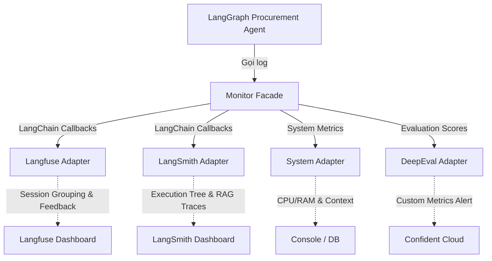

# 🏗️ Winston — Architecture Specification: Monitor Module (v2)

**Focus:** Hệ thống giám sát (Observability) cho toàn bộ pipeline của Procurement Agent, tương thích với kiến trúc `evaluate` to `END` v2.
**Ngày cập nhật:** 2026-10-01
**Trạng thái:** Đề xuất kiến trúc — chờ duyệt

---

## 1. Tổng quan (Overview)

Module `monitor` v2 duy trì nguyên lý **Zero-coupling** thông qua **Facade Pattern**, cho phép tách biệt Core Agents khỏi hệ thống telemetry bên dưới (LangSmith, Langfuse, DeepEval, System Logs).
Đặc biệt, hệ thống được thiết kế để theo dõi chuyên sâu cơ chế Human-in-the-Loop (HITL) và luồng 5 tầng Evaluation mới.

## 2. Kiến trúc Hệ thống (Architecture)

## 3. Các thành phần cốt lõi

### 3.1 Monitor Facade (`monitor/core/facade.py`)
Cung cấp interface tập trung, với các method chính:
- `get_tracing_callbacks()`: Lấy danh sách gộp callback của LangSmith & Langfuse.
- `log_system_resource(action, metadata)`: Ghi CPU/RAM và context.
- `log_hitl_interrupt(reason, metadata)`: Ghi nhận đồ thị dừng lại chờ human.
- `log_evaluation_metrics(scores)`: Đẩy điểm số từ luồng 5 tầng evaluation lên DeepEval/Langfuse.
- `log_feedback(generation_id, feedback_data)`: Lưu typed feedback (revise, approve, reject) gắn trực tiếp với phiên bản output.

### 3.2 Dual-Tracking + Evaluation Adapters
- **Langfuse Adapter:** Cấu hình **Session Grouping** với prefix `procurement-[thread_id]` để gom nối các trace rời rạc do HITL gây ra. Sử dụng Generative Feedback để gắn comment của buyer trực tiếp vào thế hệ LLM.
- **LangSmith Adapter:** Lọc và tag cụ thể các luồng RAG (Evidence Node) để debug ChromaDB retrieval (e.g., tag `evidence_retrieval`).
- **DeepEval Adapter (Mới):** Đẩy các metric như *Completeness*, *Justification*, *Risk Tolerance* của node `evaluate` để chấm điểm LLM tự động.
- **System Adapter:** Ghi lại metadata (phase, node_name, case_id).

## 4. Bản đồ Theo dõi (Tracking Map) theo Workflow v2

| Phase thực thi | Node trong Graph | Phương thức Monitor tương ứng |
|---|---|---|
| **Phase 1: Bóc tách** | `extract_documents` | `log_llm_node()`, tracing |
| | `human_review_extraction` | `log_hitl_interrupt(reason="confidence_low")` |
| **Phase 2: Evaluation (5 Tầng)**| `evaluate` (Decision & Constraint) | `log_evaluation_metrics()` |
| | `generate_evidence` (ChromaDB) | RAG Tracing (LangSmith `has_tag: "evidence_retrieval"`) |
| | `evaluate_sufficiency` | `log_early_exit(reason="insufficient")` |
| **Phase 3: Chờ duyệt (HITL-2)** | `human_review_recommendation` | `log_hitl_interrupt(reason="yield_to_buyer")` |
| | `process_feedback` | `log_feedback(idempotency_key, revision_type)` |

## 5. Theo dõi Evidence Grounding & RAG (LangSmith)

- Node `generate_evidence` thực hiện ChromaDB queries.
- LangSmith tự động log các bước retrieval với tag `type: "retriever"`.
- Thiết lập bộ lọc (filter) trên LangSmith: `has_tag: "evidence_retrieval" AND has_metadata: {"support_status": "not_found"}`.
- Các trace rơi vào filter này chính là các vụ **LLM Hallucination** hoặc thiếu dữ liệu nguồn, giúp QA team dễ dàng bắt lỗi.

## 6. Feedback Loop (Langfuse)

- Typed feedback từ buyer (`revision_type`, `note`) tại `process_feedback` được gửi qua `log_feedback()`.
- Langfuse Adapter sẽ gọi API để đính kèm feedback này thành một "Score" hoặc "Generation Feedback" tương ứng với `generation_id` của bản recommendation.
- Phễu phân tích KPI: Tính tỷ lệ First-Time Acceptance Rate (chấp nhận ngay lần đầu, `revise_count = 0`).
