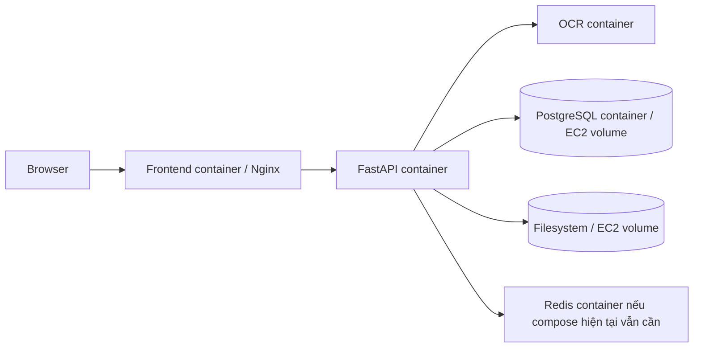

# Hiện trạng và kiến trúc mục tiêu

## Hiện trạng code

| Concern | Hiện tại |
| --- | --- |
| PR, PO, quotation metadata | JSON trong `data/` |
| Workflow và evaluation/audit | Hai file SQLite riêng |
| PDF nguồn | `data/uploads/` trên filesystem |
| Evidence index | Chroma local trong `data/chroma` |
| Analysis | `asyncio.create_task` trong process API |
| Runtime local | Compose chạy frontend, backend, OCR và Redis; backend mount `./data` |

`DATABASE_URL` hiện chọn PostgreSQL adapter cho PR, PO và quotation metadata. Workflow/evaluation vẫn dùng hai SQLite file trong `data/` cho rollout ngắn hạn.

## Kiến trúc mục tiêu

Local và production đều dùng PostgreSQL container và filesystem. Production giữ dữ liệu bằng named volumes trên disk của EC2.

## Các thay đổi implementation bắt buộc

1. PostgreSQL persistence đã được nối cho PR, PO và quotation metadata; backend tự khởi tạo schema hiện tại idempotently khi kết nối.
2. Dùng filesystem adapter cho document ở cả local và production.
3. Giữ source file trong `/app/data/uploads` trên persistent volume ở production.
4. Chọn adapter qua configuration ở composition root; không rải `if production` vào business logic.
5. Thêm PostgreSQL và local filesystem provider vào Compose local; backend tự tạo schema khi khởi động.
6. Giữ Chroma local chỉ khi có persistent volume và backup/rebuild plan; không coi đây là nguồn dữ liệu nghiệp vụ.

## Rủi ro giữ nguyên trong rollout này

- PR/PO/quotation dùng PostgreSQL container; workflow/evaluation dùng SQLite và Chroma ở `/app/data`. Production giữ toàn bộ bằng named volumes; đây là giới hạn single-EC2, không được chạy nhiều backend replica.
- Một EC2 là single point of failure.
- Restart backend làm analysis đang chạy bị ngắt; UI và runbook phải cho phép người dùng chạy lại an toàn.
- Redis hiện không có consumer tìm thấy trong application code nhưng vẫn là dependency của Compose hiện tại; chỉ bỏ nó sau khi kiểm tra riêng.

