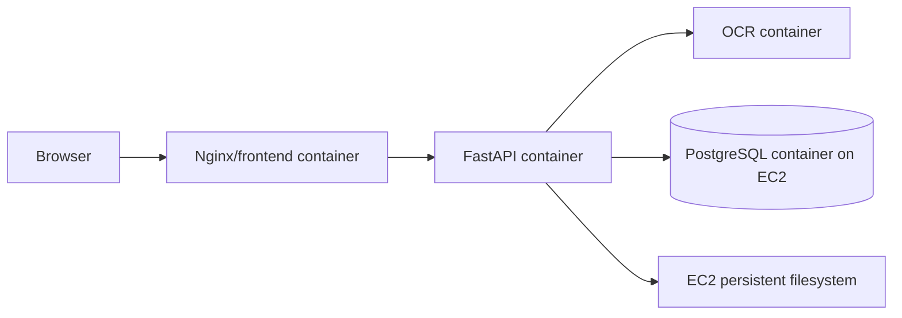

# Architecture spine

## Target topology

## Invariants

### AD-1 — Docker Compose là cách chạy chuẩn `ADOPTED`

- **Binds:** local development và manual production deployment.
- **Prevents:** mỗi môi trường khởi động container bằng lệnh/biến khác nhau không tái lập được.
- **Rule:** Local chạy `docker compose up --build`. Production chạy Compose thủ công trên EC2 với file environment riêng; cùng image/service contract được dùng ở cả hai nơi.

### AD-2 — PostgreSQL container là nguồn dữ liệu giao dịch `IMPLEMENTED`

- **Binds:** PR, quotation metadata và PO.
- **Prevents:** JSON files trở thành persistence production cho ba aggregate này.
- **Rule:** Local và production đều chạy PostgreSQL container. Backend tạo bảng hiện tại bằng DDL idempotent khi kết nối lần đầu.

### AD-2a — Workflow/evaluation single-node exception `ACCEPTED FOR SHORT ROLLOUT`

- **Binds:** SQLite workflow/evaluation và Chroma ở `/app/data`.
- **Rule:** Production giữ thư mục này trong named volume và chỉ chạy một backend replica. Đưa các store này vào PostgreSQL là công việc tiếp theo trước khi scale ngang.

### AD-3 — Binary documents lưu trên filesystem `ADOPTED`

- **Binds:** PDF upload, source evidence và download.
- **Prevents:** upload bị mất khi container được tạo lại.
- **Rule:** Local ghi filesystem; production ghi vào named volume `/app/data` trên EC2. Volume phải được backup.

### AD-4 — Configuration chọn adapter, không chọn nghiệp vụ `PROPOSED`

- **Binds:** database và document storage.
- **Prevents:** code branch `if production` lan vào domain/business workflow.
- **Rule:** Compose production chọn PostgreSQL và filesystem; không cần AWS storage service.

### AD-5 — Production compute không sở hữu dữ liệu bền vững `PROPOSED`

- **Binds:** EC2, Docker containers, backup và recovery.
- **Prevents:** container/EC2 replacement làm mất database hoặc document nguồn.
- **Rule:** PostgreSQL, file upload, SQLite workflow/evaluation và Chroma nằm trên persistent volumes của EC2. EBS snapshot và backup độc lập là cần thiết để phục hồi.

### AD-6 — Deploy production có checkpoint và rollback `ADOPTED`

- **Binds:** mọi deploy thủ công.
- **Prevents:** cập nhật image/schema không thể truy vết hoặc rollback an toàn.
- **Rule:** Trước deploy backup PostgreSQL và volumes; ghi release record; pin image tag/digest; chạy health/smoke test và rollback theo runbook.

### AD-7 — Giới hạn một EC2 được công khai `ADOPTED`

- **Binds:** availability expectation và incident response.
- **Prevents:** hiểu nhầm kiến trúc hiện tại có HA hoặc job đang chạy sẽ tự phục hồi.
- **Rule:** Một EC2 là single point of failure. Restart/deploy có thể ngắt analysis đang chạy; ứng dụng phải báo lỗi rõ và cho phép chạy lại, không tự coi job đã hoàn thành.

## Deferred

- High availability (ALB/Auto Scaling/Multi-AZ) chỉ được đánh giá sau khi có SLA và số liệu tải.
- Redis chỉ bỏ/thay khi chứng minh được không còn Compose/runtime dependency.
- Chroma/vector store chỉ thay đổi sau khi có rebuild/backup strategy riêng.

