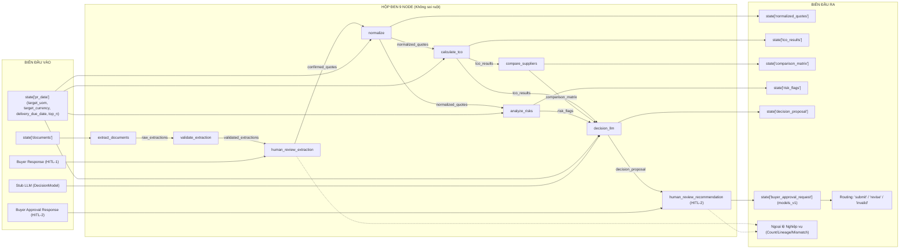

# Kế hoạch Test Biên (Boundary Contract Tests) — Chuỗi 9 Node: Extraction, Validation, HITL-1, Normalization, TCO, Compare, Risk Analysis, Decision LLM & HITL-2

> **Phạm vi:** 9 Node đã chuyển đổi sang `models_v1`:  
> 1. [`src/agents/nodes/extract_documents.py`](file:///v:/P-109/src/agents/nodes/extract_documents.py)  
> 2. [`src/agents/nodes/validate_extraction.py`](file:///v:/P-109/src/agents/nodes/validate_extraction.py)  
> 3. [`src/agents/nodes/human_review_extraction.py`](file:///v:/P-109/src/agents/nodes/human_review_extraction.py) (HITL-1)  
> 4. [`src/agents/nodes/normalize.py`](file:///v:/P-109/src/agents/nodes/normalize.py)  
> 5. [`src/agents/nodes/analysis_tools.py::calculate_tco_node`](file:///v:/P-109/src/agents/nodes/analysis_tools.py)  
> 6. [`src/agents/nodes/analysis_tools.py::compare_suppliers_node`](file:///v:/P-109/src/agents/nodes/analysis_tools.py)  
> 7. [`src/agents/nodes/analysis_tools.py::analyze_risks_node`](file:///v:/P-109/src/agents/nodes/analysis_tools.py)  
> 8. [`src/agents/nodes/decision_llm.py::decision_llm`](file:///v:/P-109/src/agents/nodes/decision_llm.py)  
> 9. [`src/agents/nodes/human_review_recommendation.py::human_review_recommendation`](file:///v:/P-109/src/agents/nodes/human_review_recommendation.py) (HITL-2) & [`buyer_decision_router`](file:///v:/P-109/src/agents/nodes/human_review_recommendation.py)  
>  
> **Triết lý cốt lõi:** **CHỈ ASSERT Ở BIÊN (Boundary-Only Assertions)**  
> - "Biên" là State đầu vào (`State In`) và State đầu ra (`State Out`) của từng node và toàn bộ chuỗi luồng.  
> - **KHÔNG** đụng chạm, soi xét, hay assert hàm private nội bộ.  
> - **KHÔNG** đếm số lần hàm private được gọi (`assert call_count == N`).  
> - **Tập trung Input/Output Contract:** Kiểm chứng hợp đồng cấu trúc đầu vào/đầu ra, các điều kiện thoát sớm, xử lý biên và tính toàn vẹn dữ liệu. Các kiểm thử về độ chính xác nội tại của LLM (hallucination, ranking invalid, v.v.) được để riêng trong tài liệu chuyên sâu [`TC-decision_llm.md`](file:///v:/P-109/tasks/test_agent_plan/TC-decision_llm.md) và comment lại.  
> - **Mục tiêu:** Khi lập trình viên tái cấu trúc (refactor) thuật toán, tối ưu code bên trong, tách hàm hay gộp hàm, bộ test **vẫn xanh 100%** miễn là hợp đồng ở biên không đổi.

---

## I. Phân tích Biên của 9 Node và Chuỗi Luồng Pipeline



### Các cặp Biên cần kiểm thử:
1. **Biên Node 1 (`extract_documents`):** `state["documents"]` + Fake I/O client ➡️ `state["raw_extractions"]`.
2. **Biên Node 2 (`validate_extraction`):** `state["raw_extractions"]` ➡️ `state["validated_extractions"]`, `state["review_mode"]`.
3. **Biên Node 3 (`human_review_extraction`):** `state["raw_extractions"]` + `state["validated_extractions"]` + Buyer Response ➡️ `state["confirmed_quotes"]` (hoặc Business Exception).
4. **Biên Node 4 (`normalize`):** `state["confirmed_quotes"]` + `state["pr_data"]` ➡️ `state["normalized_quotes"]`.
5. **Biên Node 5 (`calculate_tco_node`):** `state["normalized_quotes"]` + `state["confirmed_quotes"]` ➡️ `state["tco_results"]`.
6. **Biên Node 6 (`compare_suppliers_node`):** `state["tco_results"]` + `state["confirmed_quotes"]` ➡️ `state["comparison_matrix"]`.
7. **Biên Node 7 (`analyze_risks_node`):** `state["normalized_quotes"]` + `state["confirmed_quotes"]` + `state["pr_data"]` ➡️ `state["risk_flags"]`.
8. **Biên Node 8 (`decision_llm`):** `state["tco_results"]` + `state["comparison_matrix"]` + `state["risk_flags"]` + `state["pr_data"]` + Stub LLM ➡️ `state["decision_proposal"]`.
9. **Biên Node 9 (`human_review_recommendation` & Router):** `state["decision_proposal"]` + `state["comparison_matrix"]` + Buyer HITL-2 Response ➡️ `state["buyer_approval_request"]` ➡️ Chuỗi định tuyến (`"submit"`, `"revise"`, `"invalid"`).
10. **Biên Toàn Luồng 9 Node (Full Pipeline):** File PDF ➡️ Trích xuất ➡️ HITL-1 ➡️ Chuẩn hóa ➡️ TCO & Rủi ro ➡️ Ma trận ➡️ Đề xuất LLM ➡️ HITL-2 Buyer Duyệt ➡️ Phân nhánh quyết định.

---

## II. Danh sách Test Cases ở Biên

### Phần 1: Test Biên Đơn Node (Single-Node Boundary Contracts)

#### 1. Node `extract_documents`
* **TC-B01 (File hợp lệ -> Raw Draft hoàn chỉnh):**
  * **Input ở biên:** `state = {"documents": ["valid_quote.pdf"]}`, stub OCR trả text, stub Extractor trả 1 raw item.
  * **Output ở biên:** `state["raw_extractions"]` có 1 phần tử (`supplier_name == "Supplier A"`, `currency == "VND"`, `product_name == "Laptop"`).
* **TC-B02 (File rỗng / lỗi đọc -> Empty Draft):**
  * **Input ở biên:** `state = {"documents": ["empty.pdf"]}`, stub OCR trả text rỗng.
  * **Output ở biên:** `state["raw_extractions"][0]` là draft rỗng `ExtractionDraftPayload().model_dump(mode="json")`.
* **TC-B03 (State không có document -> Danh sách draft rỗng):**
  * **Input ở biên:** `state = {"documents": []}`.
  * **Output ở biên:** `result == {"raw_extractions": []}`.

---

#### 2. Node `validate_extraction`
* **TC-B04 (Draft đủ chuẩn -> Hợp lệ và không issue):**
  * **Input ở biên:** `state = {"raw_extractions": [valid_draft_dict]}` (mọi field >= 0.80, có source).
  * **Output ở biên:** `result["review_mode"] == "mandatory"`, `schema_valid is True`, `issues == []`.
* **TC-B05 (Draft thiếu trường bắt buộc -> Báo lỗi blocking):**
  * **Input ở biên:** `state = {"raw_extractions": [draft_missing_supplier]}`.
  * **Output ở biên:** `schema_valid is False`, có issue `code="MISSING_REQUIRED_FIELD"`, `severity=BLOCKING`.
* **TC-B06 (Draft có trường confidence thấp -> Báo cảnh báo warning):**
  * **Input ở biên:** `state = {"raw_extractions": [draft_with_conf_0_75]}`.
  * **Output ở biên:** `schema_valid is True`, có issue `code="LOW_CONFIDENCE"`, `severity=WARNING`.

---

#### 3. Node `human_review_extraction` (HITL-1)
* **TC-B07 (Buyer xác nhận hợp lệ -> Confirmed Quotes):**
  * **Input ở biên:** `state` có 1 draft, Buyer gửi về 1 confirmation khớp `source_item_id`.
  * **Output ở biên:** `result["confirmed_quotes"]` chứa 1 đối tượng `QuotationConfirmationRequest`.
* **TC-B08 (Buyer gửi thiếu/thừa báo giá -> Ngoại lệ đếm số lượng):**
  * **Input ở biên:** `state` có 2 draft, Buyer gửi 1 confirmation.
  * **Output ở biên:** Bắn `ConfirmationCountError(expected=2, actual=1)`.
* **TC-B09 (Buyer gửi item lạ không thuộc draft -> Ngoại lệ liên kết nguồn):**
  * **Input ở biên:** Draft có item `item-A`, Buyer gửi confirmation chứa `source_item_id="item-X"`.
  * **Output ở biên:** Bắn `UnknownSourceItemError(source_item_id="item-X")`.

---

#### 4. Node `normalize`
* **TC-B10 (Chuẩn hóa UOM và FX thành công -> NormalizationStatus.NORMALIZED):**
  * **Input ở biên:** Quote có unit="hộp", qty=2, price=200 USD. PR yêu cầu "cái", "VND".
  * **Output ở biên:** `status == NormalizationStatus.NORMALIZED`, `normalized_quantity == Decimal("20")`, `normalized_unit_price == Decimal("508000.00")`, `rule_id == "uom:hộp->cái;fx:USD->VND"`.
* **TC-B11 (Không tương thích UOM hoặc thiếu tỷ giá -> NormalizationStatus.NEEDS_MAPPING):**
  * **Input ở biên:** Quote có unit="kg", target_uom="cái".
  * **Output ở biên:** `status == NormalizationStatus.NEEDS_MAPPING`, `issues` chứa `"missing UOM mapping 'kg' -> 'cái'"`, các giá trị chuẩn hóa là `None`.
* **TC-B12 (State không có confirmed_quotes -> Danh sách rỗng):**
  * **Input ở biên:** `state = {"confirmed_quotes": []}`.
  * **Output ở biên:** `result == {"normalized_quotes": []}`.

---

#### 5. Node `analyze_risks_node`
* **TC-B13 (Không có rủi ro — Giao hàng kịp hạn & Dữ liệu chuẩn hóa hoàn tất):**
  * **Output ở biên:** `result["risk_flags"] == []`.
* **TC-B14 (Rủi ro trễ hạn giao hàng — Lead time vượt deadline PR):**
  * **Output ở biên:** 1 cờ `lead_time_exceeded`, `severity == RiskSeverity.HIGH`.
* **TC-B15 (Rủi ro chuẩn hóa — Báo giá còn dữ liệu chưa thể map tự động):**
  * **Output ở biên:** 1 cờ `normalization_mapping_required`, `severity == RiskSeverity.HIGH`.
* **TC-B16 (State rỗng — Không có báo giá):**
  * **Output ở biên:** `result == {"risk_flags": []}`.

---

#### 6. Node `decision_llm`
* **TC-B17 (TCO hợp lệ + Ma trận so sánh -> Đề xuất PROPOSED ở biên):**
  * **Output ở biên:** `result["decision_proposal"].status == DecisionProposalStatus.PROPOSED`, `preferred_supplier_id == "NCC A"`, `input_artifact_ids` khớp đúng các revision IDs.
* **TC-B18 (Dữ liệu TCO rỗng hoặc toàn bộ MISSING_DATA -> Thoát sớm NEEDS_INPUT):**
  * **Output ở biên:** `status == DecisionProposalStatus.NEEDS_INPUT`, `rationale == "Không có nhà cung cấp đủ dữ liệu TCO để xếp hạng."`, LLM không được gọi.
* **TC-B19 (Thiếu comparison_matrix -> Thoát sớm NEEDS_INPUT):**
  * **Output ở biên:** `status == DecisionProposalStatus.NEEDS_INPUT`, `rationale == "Thiếu ma trận so sánh nhà cung cấp."`, LLM không được gọi.
* **TC-B20 (Đầu ra dạng Markdown Code Block -> Bóc tách và chuẩn hóa artifact IDs):**
  * **Output ở biên:** Bóc tách sạch JSON fence và tự động ghi đè bắt buộc `input_artifact_ids`.

---

#### 7. Node `human_review_recommendation` & Router (HITL-2)
* **TC-B21 (Buyer Duyệt Đề Xuất -> `action = SUBMIT`):**
  * **Input ở biên:** State chứa `decision_proposal`, `comparison_matrix`, `analysis_revision = 1`. Buyer gửi lại `action = "submit"`, `note = "Đồng ý đề xuất"`.
  * **Output ở biên:** `result["buyer_approval_request"].action == BuyerAction.SUBMIT`, `result["buyer_approval_request"].note == "Đồng ý đề xuất"`.
* **TC-B22 (Buyer Yêu Cầu Chỉnh Sửa -> `action = REVISE` kèm ghi chú):**
  * **Input ở biên:** Buyer gửi `action = "revise"`, `note = "Yêu cầu đàm phán lại giá với Beta"`.
  * **Output ở biên:** `result["buyer_approval_request"].action == BuyerAction.REVISE`, `result["buyer_approval_request"].note` được bảo toàn nguyên vẹn.
* **TC-B23 (Sai Lệch Phiên Phê Duyệt -> `AnalysisRevisionMismatchError`):**
  * **Input ở biên:** State đang ở `analysis_revision = 2`, nhưng Buyer gửi response mang `analysis_revision = 1`.
  * **Output ở biên:** Bắn ngoại lệ `AnalysisRevisionMismatchError(expected=2, actual=1)`.
* **TC-B24 (Định tuyến Quyết Định `buyer_decision_router`):**
  * **Input ở biên:**
    * Khi `request.action == BuyerAction.SUBMIT` ➡️ Router trả về `"submit"`.
    * Khi `request.action == BuyerAction.REVISE` ➡️ Router trả về `"revise"`.
    * Khi `buyer_approval_request` vắng mặt hoặc `None` ➡️ Router trả về `"invalid"`.

---

### Phần 2: Test Biên Toàn Luồng (End-to-End Chain Boundary: 9 Nodes Nối Tiếp)

Toàn bộ chuỗi 9 node nối tiếp:
```python
# Pha 1: Trích xuất & Thẩm định tài liệu (Extraction & HITL-1)
state_1 = {**state_0, **extract_documents(state_0, ocr_client=fake_ocr, extraction_client=fake_extractor)}
state_2 = {**state_1, **validate_extraction(state_1)}
state_3 = {**state_2, **human_review_extraction(state_2)}

# Pha 2: Chuẩn hóa dữ liệu (Normalization)
state_4 = {**state_3, **normalize(state_3)}

# Pha 3: Phân tích Song song & Tổng hợp Ma trận (Deterministic Analysis Phase)
state_5 = {
    **state_4,
    **calculate_tco_node(state_4),
    **analyze_risks_node(state_4),
}
state_6 = {**state_5, **compare_suppliers_node(state_5)}

# Pha 4: Đề xuất Quyết định Mua sắm (Decision LLM Phase)
state_7 = {**state_6, **decision_llm(state_6, llm=stub_llm)}

# Pha 5: Phê Duyệt Khuyến Nghị Mua Sắm (HITL-2 & Routing)
state_final = {**state_7, **human_review_recommendation(state_7)}
next_step = buyer_decision_router(state_final)
```

#### TC-FLOW-08: Chuỗi Toàn Luồng 8 Node — Đề Xuất Quyết Định Hoàn Chỉnh
* Chạy thông suốt từ PDF đến `DecisionProposal` thành công.

#### TC-FLOW-09: Chuỗi 8 Node Tích Hợp Rủi Ro vào Đề Xuất Quyết Định
* Cờ rủi ro `lead_time_exceeded` được truyền vào payload của LLM và ảnh hưởng đến rationale.

#### TC-FLOW-10: Chuỗi 8 Node Lệch Chuẩn Hóa Dẫn đến Thoát Sớm tại Decision LLM
* Khi UOM không tương thích, luồng tự vệ thoát sớm tại `decision_llm` trả về `NEEDS_INPUT`.

#### TC-FLOW-11: Chuỗi Toàn Luồng 9 Node — Buyer Phê Duyệt Trình Manager Duyệt (Full 9-Node E2E Chain to Submit)
* **Ý nghĩa:** Kiểm chứng dòng chảy dữ liệu hoàn chỉnh qua toàn bộ 9 trạm của pipeline mua sắm: từ file PDF ban đầu qua mọi khâu xử lý AI và con người, kết thúc bằng hành động Buyer phê duyệt (`SUBMIT`) và router chỉ định chuyển tiếp sang bước `manager_approval`.
* **Boundary In:**
  * 2 File PDF báo giá (`quote_flow11_a.pdf`, `quote_flow11_b.pdf`).
  * Chuỗi trích xuất và xác nhận HITL-1 chuẩn hóa thành công.
  * `state["pr_data"]`: `target_uom="cái"`, `target_currency="VND"`, `delivery_due_date` sau 20 ngày.
  * Stub LLM đề xuất chọn NCC A.
  * Buyer phản hồi tại HITL-2 chấp thuận đề xuất (`action = "submit"`, `note = "Nhất trí chọn NCC A"`).
* **Boundary Out:**
  * `state_final["decision_proposal"].status == DecisionProposalStatus.PROPOSED`.
  * `state_final["buyer_approval_request"].action == BuyerAction.SUBMIT`.
  * `state_final["buyer_approval_request"].note == "Nhất trí chọn NCC A"`.
  * `buyer_decision_router(state_final) == "submit"`.

#### TC-FLOW-12: Chuỗi Toàn Luồng 9 Node — Buyer Yêu Cầu Chỉnh Sửa Đề Xuất (Full 9-Node E2E Chain to Revise)
* **Ý nghĩa:** Kiểm chứng luồng phản hồi lặp (feedback loop) khi Buyer xem xét đề xuất AI và quyết định yêu cầu điều chỉnh (`REVISE`) kèm lý do cụ thể, kích hoạt router chuyển tiếp sang `process_feedback`.
* **Boundary In:**
  * Toàn bộ 8 node trước chạy thành công sinh ra `decision_proposal`.
  * Buyer phản hồi tại HITL-2 với `action = "revise"`, `note = "Cần đàm phán giảm thêm 5% đơn giá hoặc tăng thời hạn bảo hành lên 24 tháng"`.
* **Boundary Out:**
  * `state_final["buyer_approval_request"].action == BuyerAction.REVISE`.
  * `state_final["buyer_approval_request"].note == "Cần đàm phán giảm thêm 5% đơn giá hoặc tăng thời hạn bảo hành lên 24 tháng"`.
  * `buyer_decision_router(state_final) == "revise"`.

---

## III. Bảng Quy tắc Assert — Đúng chuẩn "Black-Box Boundary"

| Được phép Assert ở Biên (DO) | Nghiêm cấm Assert (DON'T) |
|:---|:---|
| ✅ `state["buyer_approval_request"].action == BuyerAction.SUBMIT` | ❌ Test hay can thiệp code nội bộ của LangGraph interrupt |
| ✅ `state["buyer_approval_request"].note == "..."` | ❌ Bỏ qua kiểm tra `AnalysisRevisionMismatchError` |
| ✅ `buyer_decision_router(state) == "submit"` | ❌ Mock logic kết nối giữa các node với nhau |
| ✅ Gọi liên tiếp các hàm node như pipeline thật | ❌ Can thiệp sửa đổi các trường của Pydantic schema |

---

## IV. Kết luận
Bản kế hoạch kiểm thử biên này đã được mở rộng thành **chuỗi trọn vẹn 9 node**:
- Bao gồm **24 Single-Node Boundary Test Cases** (từ `TC-B01` đến `TC-B24`).
- Bao gồm **12 End-to-End Chain Boundary Test Cases** (từ `TC-FLOW-01` đến `TC-FLOW-12`).
- Đảm bảo tính độc lập tuyệt đối với code triển khai bên trong của toàn bộ 9 node, tuân thủ nghiêm ngặt nguyên tắc Black-Box Boundary Assertions.
