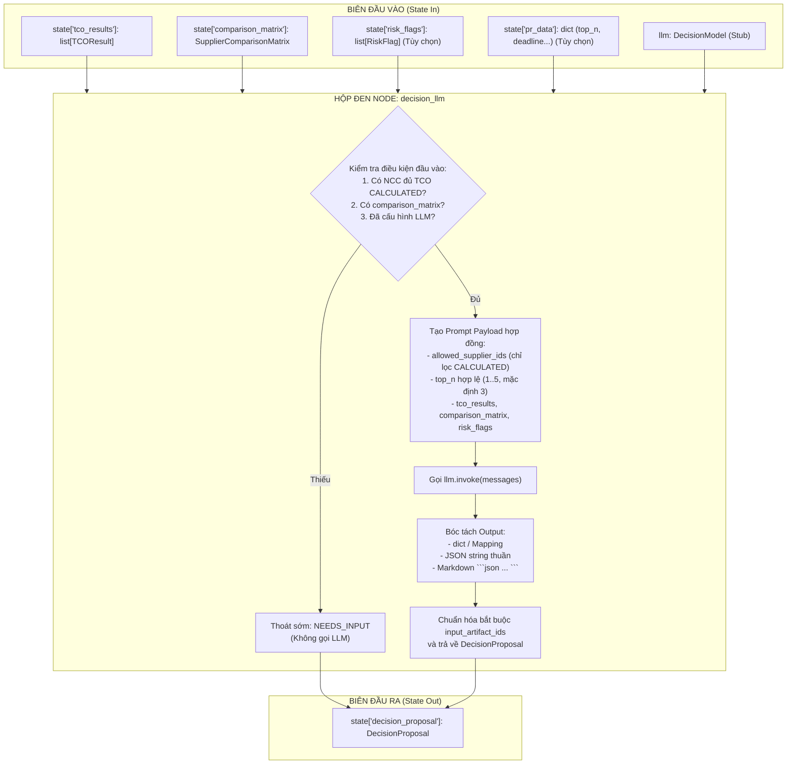

# Test Cases Chi Tiết — Node: `decision_llm` (Pha Đề Xuất Quyết Định Mua Sắm)

> **Node mục tiêu:** [`src/agents/nodes/decision_llm.py::decision_llm`](file:///v:/P-109/src/agents/nodes/decision_llm.py)  
> **Schema target (`models_v1`):**  
> - [`src/models_v1/analysis/decision.py`](file:///v:/P-109/src/models_v1/analysis/decision.py) (`DecisionProposal`, `DecisionProposalStatus`, `TradeOff`)  
> - [`src/models_v1/analysis/tco.py`](file:///v:/P-109/src/models_v1/analysis/tco.py) (`TCOResult`, `TCOCalculationStatus`)  
> - [`src/models_v1/analysis/comparison.py`](file:///v:/P-109/src/models_v1/analysis/comparison.py) (`SupplierComparisonMatrix`, `ComparisonCell`)  
> - [`src/models_v1/analysis/risk.py`](file:///v:/P-109/src/models_v1/analysis/risk.py) (`RiskFlag`, `RiskSeverity`)  
>  
> **Vị trí trong Pipeline Graph:**
> $$\text{begin\_analysis} \longrightarrow \left[ \begin{array}{l} \text{calculate\_tco} \rightarrow \text{compare\_suppliers} \\ \text{analyze\_risks} \end{array} \right] \longrightarrow \mathbf{decision\_llm} \longrightarrow \text{human\_review\_recommendation (HITL-2)}$$
>
> **Triết lý kiểm thử:** **CHỈ ASSERT Ở BIÊN (State In -> State Out & Domain Model Contract)**.
> - Tập trung cao nhất vào **kiểm chứng hợp đồng Input/Output thỏa mãn chuẩn nghiệp vụ** (pre-conditions, payload schema, normalization, formatting, boundaries).
> - Toàn bộ các test case về **độ chính xác nội tại của LLM (hallucination, ảo giác số liệu, trật tự xếp hạng logic, v.v.) được TẠM THỜI COMMENT LẠI** (`<!-- ... -->`) để hoàn thiện sau khi phần hợp đồng Input/Output được duyệt.

---

## I. Phân tích Biên & Hợp đồng Dữ liệu (Contract Specification)



---

## II. Danh sách Test Cases Thỏa Mãn Hợp Đồng Input - Output Chuẩn (Active Test Cases)

### Nhóm 1: Kiểm soát Điều kiện Tiên quyết & Biên Đầu vào (Input Pre-conditions & Boundaries)

#### TC-DEC-01: Không có nhà cung cấp đủ dữ liệu TCO (`eligible_supplier_ids` rỗng)
* **Mục tiêu:** Khi `tco_results = []` hoặc toàn bộ kết quả đều ở trạng thái `MISSING_DATA` $\rightarrow$ Thoát sớm ở biên trả về `NEEDS_INPUT`, tuyệt đối không gọi LLM.
* **State In:**
  * `tco_results`: danh sách rỗng `[]`, hoặc danh sách chỉ gồm các kết quả có `status == TCOCalculationStatus.MISSING_DATA` và `total_tco = None`.
  * `comparison_matrix`: đối tượng `SupplierComparisonMatrix`.
* **State Out ở Biên:**
  * `proposal.status == DecisionProposalStatus.NEEDS_INPUT`
  * `proposal.preferred_supplier_id is None`
  * `proposal.ranked_supplier_ids == []`
  * `proposal.rationale == "Không có nhà cung cấp đủ dữ liệu TCO để xếp hạng."`
  * `proposal.input_artifact_ids` phản ánh đúng revision IDs đầu vào.
  * Stub LLM không được gọi (`call_count == 0`).

---

#### TC-DEC-02: Thiếu ma trận so sánh nhà cung cấp (`comparison_matrix is None`)
* **Mục tiêu:** Khi có `tco_results` hợp lệ nhưng thiếu `comparison_matrix` $\rightarrow$ Thoát sớm ở biên trả về `NEEDS_INPUT`, không gọi LLM.
* **State In:**
  * `tco_results`: ít nhất 1 NCC có TCO `CALCULATED`.
  * `comparison_matrix = None`.
* **State Out ở Biên:**
  * `proposal.status == DecisionProposalStatus.NEEDS_INPUT`
  * `proposal.preferred_supplier_id is None`
  * `proposal.rationale == "Thiếu ma trận so sánh nhà cung cấp."`
  * Stub LLM không được gọi (`call_count == 0`).

---

#### TC-DEC-03: State đầu vào rỗng hoàn toàn (`state = {}`)
* **Mục tiêu:** Kiểm tra độ bền vững ở biên khi state không chứa bất kỳ khóa nào (`state = {}`) $\rightarrow$ Node xử lý an toàn, không ném exception / `KeyError`, trả về `NEEDS_INPUT`.
* **State In:**
  * `state = {}`.
* **State Out ở Biên:**
  * `proposal.status == DecisionProposalStatus.NEEDS_INPUT`
  * `proposal.preferred_supplier_id is None`
  * `proposal.ranked_supplier_ids == []`
  * `proposal.rationale == "Không có nhà cung cấp đủ dữ liệu TCO để xếp hạng."`
  * `proposal.input_artifact_ids == []`
  * Stub LLM không được gọi.

---

#### TC-DEC-04: Chưa cấu hình mô hình quyết định (Không có stub LLM và không có API Key)
* **Mục tiêu:** Khi không truyền stub LLM và settings không cấu hình bất kỳ API key nào $\rightarrow$ Thoát sớm ở biên trả về `NEEDS_INPUT` an toàn.
* **State In:**
  * Đủ dữ liệu `tco_results` và `comparison_matrix`.
  * `llm = None`, settings rỗng toàn bộ API keys.
* **State Out ở Biên:**
  * `proposal.status == DecisionProposalStatus.NEEDS_INPUT`
  * `proposal.rationale == "Chưa cấu hình mô hình quyết định."`

---

#### TC-DEC-05: Lọc dữ liệu đầu vào — Chỉ đưa các NCC `CALCULATED` và có `total_tco` vào danh sách xem xét
* **Mục tiêu:** Khi đầu vào có hỗn hợp NCC: NCC 1 (CALCULATED), NCC 2 (MISSING_DATA), NCC 3 (CALCULATED nhưng `total_tco = None`), NCC 4 (CALCULATED) $\rightarrow$ Node tự động loại bỏ NCC 2 và NCC 3, chỉ gửi `allowed_supplier_ids = ["NCC 1", "NCC 4"]` tới LLM.
* **State In:**
  * `tco_results`: 4 NCC như trên.
  * `comparison_matrix`: ma trận so sánh.
* **State Out ở Biên:**
  * Payload gửi tới LLM có `allowed_supplier_ids == ["NCC 1", "NCC 4"]`.
  * Đề xuất cuối cùng chỉ chọn và xếp hạng giữa NCC 1 và NCC 4.

---

#### TC-DEC-06: Khử trùng lặp đầu vào — Trùng lặp `supplier_id` và `quotation_revision_id`
* **Mục tiêu:** Khi `tco_results` chứa nhiều dòng kết quả từ cùng một nhà cung cấp hoặc cùng revision ID (do nhiều hạng mục/báo giá điều chỉnh) $\rightarrow$ Node khử trùng lặp chính xác:
  * `allowed_supplier_ids` chỉ chứa các NCC duy nhất (giữ nguyên thứ tự xuất hiện đầu tiên).
  * `input_artifact_ids` chỉ chứa các revision IDs duy nhất (giữ nguyên thứ tự).
* **State In:**
  * `tco_results`: NCC A (rev-1), NCC A (rev-1), NCC B (rev-2).
* **State Out ở Biên:**
  * `allowed_supplier_ids` gửi tới LLM là `["NCC A", "NCC B"]` (không bị nhân đôi NCC A).
  * `proposal.input_artifact_ids == ["rev-1", "rev-2"]`.

---

#### TC-DEC-07: Khuyết thiếu hoặc rỗng cờ rủi ro (`risk_flags` vắng mặt hoặc `[]`)
* **Mục tiêu:** Khi state không truyền `risk_flags` (khóa không tồn tại) hoặc `risk_flags = []` $\rightarrow$ Node vẫn vận hành bình thường, tự động truyền danh sách rỗng `"risk_flags": []` vào payload gửi tới LLM.
* **State In:**
  * Đủ `tco_results` và `comparison_matrix`.
  * Không có key `risk_flags` trong state.
* **State Out ở Biên:**
  * LLM nhận user message payload có `"risk_flags": []`.
  * Node xử lý thành công không phát sinh `KeyError`.

---

#### TC-DEC-08: Khuyết thiếu hoặc rỗng `pr_data` (`pr_data` vắng mặt hoặc `{}`)
* **Mục tiêu:** Khi state không có `pr_data` hoặc `pr_data = {}` $\rightarrow$ Node tự động nhận giá trị `top_n` mặc định là 3 (`DEFAULT_TOP_N = 3`).
* **State In:**
  * 3 NCC hợp lệ, `pr_data` không có trong state.
* **State Out ở Biên:**
  * LLM nhận user message payload có `"top_n": 3`.
  * `expected_rank_count` được tính là `min(3, 3) = 3`.

---

### Nhóm 2: Kiểm chứng Hợp đồng Cấu trúc Payload Gửi LLM (Input Prompt Payload Contract)

#### TC-DEC-09: Cấu trúc Prompt Payload chuẩn xác theo Hợp đồng
* **Mục tiêu:** Kiểm tra cấu trúc danh sách messages truyền vào `llm.invoke(messages)`:
  * Phải gồm đúng 2 message: System Message và User Message.
  * System message: `role == "system"`, `content == settings.decision_prompt`.
  * User message: `role == "user"`, `content` là chuỗi JSON hợp lệ và chứa đủ 7 trường bắt buộc:
    1. `"schema"`: khớp với `DecisionProposal.model_json_schema()`
    2. `"allowed_supplier_ids"`: danh sách các NCC đủ điều kiện
    3. `"top_n"`: số lượng xếp hạng mong đợi
    4. `"tco_results"`: danh sách dict serialize từ `TCOResult`
    5. `"comparison_matrix"`: dict serialize từ `SupplierComparisonMatrix`
    6. `"risk_flags"`: danh sách dict serialize từ `RiskFlag`
    7. `"input_artifact_ids"`: danh sách các revision IDs duy nhất
* **State In:** Đủ dữ liệu 2 NCC, 1 cờ rủi ro.
* **State Out ở Biên:**
  * Kiểm tra trực tiếp đối số `messages` gửi vào stub LLM thỏa mãn toàn bộ 7 trường trên.

---

#### TC-DEC-10: Cấu hình `top_n` Biên — Giá trị Mặc định và Xử lý Ngoài Dải
* **Mục tiêu:** Kiểm tra chuẩn hóa dải giá trị của `_configured_top_n(state)`:
  1. Không có trường `top_n` trong `pr_data` $\rightarrow$ nhận mặc định `DEFAULT_TOP_N = 3`.
  2. `top_n = 2` (trong dải 1..5) $\rightarrow$ nhận giá trị 2.
  3. `top_n = 0` hoặc âm $\rightarrow$ fallback về 3.
  4. `top_n = 10` (> 5) $\rightarrow$ fallback về 3.
  5. `top_n = True` (kiểu boolean) $\rightarrow$ fallback về 3 (tránh lỗi bool là subclass của int).
  6. `top_n = "3"` (kiểu string) $\rightarrow$ fallback về 3.
* **State Out ở Biên:** Payload gửi tới LLM phản ánh đúng giá trị `top_n` đã được chuẩn hóa cho từng trường hợp trên.

---

### Nhóm 3: Các Kịch bản Happy Path Input - Output Chuẩn (Successful Proposal Outputs)

#### TC-DEC-11: Happy Path Cơ Bản — Đề xuất Thành công 2 Nhà cung cấp (`PROPOSED`)
* **Mục tiêu:** Kiểm tra luồng chuẩn khi 2 NCC có đầy đủ dữ liệu, LLM đề xuất chọn NCC tốt nhất kèm bảng phân tích đánh đổi (Trade-off).
* **State In:**
  * 2 NCC: "Công ty Alpha" (TCO 10M, lead time 5 ngày) và "Công ty Beta" (TCO 12M, lead time 10 ngày).
  * `comparison_matrix`: ma trận so sánh 2 NCC.
  * Stub LLM trả về proposal hợp lệ:
    ```json
    {
      "status": "proposed",
      "preferred_supplier_id": "Công ty Alpha",
      "ranked_supplier_ids": ["Công ty Alpha", "Công ty Beta"],
      "rationale": "Công ty Alpha có TCO thấp nhất và thời gian giao hàng nhanh nhất.",
      "tradeoffs": [
        {
          "preferred_supplier_id": "Công ty Alpha",
          "alternative_supplier_id": "Công ty Beta",
          "description": "Alpha rẻ hơn 2 triệu VND và giao nhanh hơn 5 ngày so với Beta."
        }
      ],
      "input_artifact_ids": []
    }
    ```
* **State Out ở Biên:**
  * `proposal.status == DecisionProposalStatus.PROPOSED`
  * `proposal.preferred_supplier_id == "Công ty Alpha"`
  * `proposal.ranked_supplier_ids == ["Công ty Alpha", "Công ty Beta"]`
  * `len(proposal.tradeoffs) == 1`
  * `proposal.tradeoffs[0].preferred_supplier_id == "Công ty Alpha"`
  * `proposal.tradeoffs[0].alternative_supplier_id == "Công ty Beta"`
  * `proposal.input_artifact_ids` được tự động chuẩn hóa bằng danh sách `quotation_revision_id` từ `tco_results`.

---

#### TC-DEC-12: Happy Path Đa Nhà Cung Cấp — Xếp hạng Đủ 3 Nhà cung cấp (`top_n = 3`)
* **Mục tiêu:** Khi có 3 NCC hợp lệ và `pr_data["top_n"] = 3` $\rightarrow$ LLM xếp hạng đầy đủ 3 vị trí theo thứ tự ưu tiên.
* **State In:**
  * 3 NCC: Alpha, Beta, Gamma đều có TCO `CALCULATED`.
  * `pr_data = {"top_n": 3}`.
  * Stub LLM trả về `preferred_supplier_id = "Alpha"`, `ranked_supplier_ids = ["Alpha", "Beta", "Gamma"]`.
* **State Out ở Biên:**
  * `proposal.status == DecisionProposalStatus.PROPOSED`
  * `len(proposal.ranked_supplier_ids) == 3`
  * `proposal.ranked_supplier_ids == ["Alpha", "Beta", "Gamma"]`
  * `proposal.preferred_supplier_id == "Alpha"`

---

#### TC-DEC-13: Happy Path Giới Hạn — Yêu cầu `top_n = 1` (Chỉ chọn 1 NCC duy nhất)
* **Mục tiêu:** Khi PR yêu cầu chỉ chọn đúng 1 nhà cung cấp tốt nhất (`top_n = 1`) $\rightarrow$ Bảng xếp hạng chỉ chứa duy nhất 1 phần tử là NCC được chọn.
* **State In:**
  * 2 NCC: Alpha và Beta.
  * `pr_data = {"top_n": 1}`.
  * Stub LLM trả về `preferred_supplier_id = "Alpha"`, `ranked_supplier_ids = ["Alpha"]`.
* **State Out ở Biên:**
  * `proposal.status == DecisionProposalStatus.PROPOSED`
  * `len(proposal.ranked_supplier_ids) == 1`
  * `proposal.ranked_supplier_ids == ["Alpha"]`
  * `proposal.preferred_supplier_id == "Alpha"`

---

#### TC-DEC-14: Kẹp Số Lượng Xếp Hạng — Yêu cầu Top-N vượt quá số NCC có sẵn
* **Mục tiêu:** Khi `pr_data["top_n"] = 5` nhưng thực tế chỉ có 2 NCC đủ dữ liệu TCO $\rightarrow$ `expected_rank_count` tự động kẹp bằng 2 (`min(5, 2)`), LLM xếp hạng đúng 2 NCC.
* **State In:**
  * 2 NCC hợp lệ, `pr_data = {"top_n": 5}`.
  * Stub LLM trả về `ranked_supplier_ids = ["Alpha", "Beta"]`.
* **State Out ở Biên:**
  * Node chấp nhận proposal hợp lệ với 2 NCC xếp hạng, không bắt buộc phải đủ 5.
  * `proposal.status == DecisionProposalStatus.PROPOSED`
  * `len(proposal.ranked_supplier_ids) == 2`

---

#### TC-DEC-15: Tích hợp Rủi Ro — Truyền và Phản ánh Cờ Rủi ro (`risk_flags`)
* **Mục tiêu:** Khi state có cờ rủi ro (ví dụ `lead_time_exceeded` của NCC Beta) $\rightarrow$ Payload gửi tới LLM chứa đầy đủ danh sách `risk_flags`, và kết quả đề xuất giải trình rõ ràng việc lựa chọn dựa trên rủi ro.
* **State In:**
  * NCC Alpha (giá cao hơn nhưng kịp hạn), NCC Beta (giá rẻ hơn nhưng bị `lead_time_exceeded`).
  * `state["risk_flags"]`: 1 cờ `lead_time_exceeded` cho Beta.
  * Stub LLM trả về proposal chọn Alpha vì Beta có rủi ro giao trễ.
* **State Out ở Biên:**
  * Mock LLM nhận user message có chứa đúng `risk_flags`.
  * `proposal.preferred_supplier_id == "Alpha"`
  * `proposal.rationale` phản ánh lý do chọn Alpha do tránh rủi ro giao hàng.

---

#### TC-DEC-16: LLM Chủ Động Yêu Cầu Ý Kiến Người Mua (`status = NEEDS_INPUT`)
* **Mục tiêu:** Khi LLM phân tích thấy các báo giá có rủi ro nghiêm trọng hoặc ngang bằng nhau, LLM chủ động trả về `status = "needs_input"` $\rightarrow$ Node tiếp nhận hợp lệ, giữ nguyên `rationale` giải trình và gán đủ `input_artifact_ids`.
* **State In:**
  * State đầy đủ dữ liệu.
  * Stub LLM trả về:
    ```json
    {
      "status": "needs_input",
      "rationale": "Cả hai nhà cung cấp đều có rủi ro giao hàng trễ > 15 ngày so với deadline PR. Cần Buyer xác nhận chấp thuận nới deadline.",
      "input_artifact_ids": []
    }
    ```
* **State Out ở Biên:**
  * `proposal.status == DecisionProposalStatus.NEEDS_INPUT`
  * `proposal.preferred_supplier_id is None`
  * `proposal.ranked_supplier_ids == []`
  * `proposal.rationale == "Cả hai nhà cung cấp đều có rủi ro giao hàng trễ > 15 ngày so với deadline PR. Cần Buyer xác nhận chấp thuận nới deadline."`
  * `proposal.input_artifact_ids` chứa đầy đủ revision IDs từ `tco_results`.

---

### Nhóm 4: Hợp đồng Định dạng & Khử nhiễu Dữ liệu Đầu ra (Output Formats & Normalization)

#### TC-DEC-17: Định dạng Output — LLM trả về Chuỗi JSON thuần (`str`)
* **Mục tiêu:** LLM trả về một chuỗi JSON text thuần hợp lệ $\rightarrow$ Node giải mã thành công `DecisionProposal`.
* **State In:** Stub LLM trả về `str`: `'{"status": "proposed", "preferred_supplier_id": "Alpha", "ranked_supplier_ids": ["Alpha", "Beta"], "rationale": "Lựa chọn tốt nhất.", "tradeoffs": []}'`.
* **State Out ở Biên:**
  * `proposal.status == DecisionProposalStatus.PROPOSED`
  * `proposal.preferred_supplier_id == "Alpha"`

---

#### TC-DEC-18: Định dạng Output — LLM trả về Python Dictionary (`Mapping`)
* **Mục tiêu:** Một số framework/provider trả về trực tiếp dict đã parse $\rightarrow$ Node tiếp nhận Mapping trực tiếp mà không cần `json.loads`.
* **State In:** Stub LLM trả về `dict`: `{"status": "proposed", "preferred_supplier_id": "Alpha", "ranked_supplier_ids": ["Alpha", "Beta"], "rationale": "Lựa chọn tốt nhất.", "tradeoffs": []}`.
* **State Out ở Biên:**
  * `proposal.status == DecisionProposalStatus.PROPOSED`
  * `proposal.preferred_supplier_id == "Alpha"`

---

#### TC-DEC-19: Định dạng Output — LLM bọc JSON trong Markdown Code Block có tag `json` (````json ... ````)
* **Mục tiêu:** LLM sinh phản hồi bọc trong markdown fence ````json \n { ... } \n ```` $\rightarrow$ Node tự động bóc tách và giải mã thành công.
* **State In:** Stub LLM trả về:
  ```text
  ```json
  {
    "status": "proposed",
    "preferred_supplier_id": "Alpha",
    "ranked_supplier_ids": ["Alpha", "Beta"],
    "rationale": "Lựa chọn tốt nhất.",
    "tradeoffs": []
  }
  ```
  ```
* **State Out ở Biên:**
  * `proposal.status == DecisionProposalStatus.PROPOSED`
  * `proposal.preferred_supplier_id == "Alpha"`

---

#### TC-DEC-20: Định dạng Output — LLM bọc JSON trong Markdown Code Block không có tag ngôn ngữ (```` ... ````)
* **Mục tiêu:** LLM sinh phản hồi bọc trong markdown fence ```` \n { ... } \n ```` (không ghi chữ `json`) $\rightarrow$ Node vẫn bóc tách chính xác các dòng bên trong fence.
* **State In:** Stub LLM trả về:
  ```text
  ```
  {
    "status": "proposed",
    "preferred_supplier_id": "Alpha",
    "ranked_supplier_ids": ["Alpha", "Beta"],
    "rationale": "Lựa chọn tốt nhất.",
    "tradeoffs": []
  }
  ```
  ```
* **State Out ở Biên:**
  * `proposal.status == DecisionProposalStatus.PROPOSED`
  * `proposal.preferred_supplier_id == "Alpha"`

---

#### TC-DEC-21: Định dạng Output — Chuỗi JSON chứa khoảng trắng và dòng trống đầu/cuối (`whitespace & newline stripping`)
* **Mục tiêu:** LLM trả về chuỗi JSON có nhiều dòng trống và khoảng trắng thừa ở đầu hoặc cuối (`\n\n  { ... } \n\t  `) $\rightarrow$ Node strip sạch sẽ trước khi parse.
* **State In:** Stub LLM trả về `"\n\n  {\"status\": \"proposed\", \"preferred_supplier_id\": \"Alpha\", \"ranked_supplier_ids\": [\"Alpha\", \"Beta\"], \"rationale\": \"Tot\", \"tradeoffs\": []}  \n\n"`.
* **State Out ở Biên:**
  * `proposal.status == DecisionProposalStatus.PROPOSED`
  * `proposal.preferred_supplier_id == "Alpha"`

---

#### TC-DEC-22: Chuẩn hóa Bắt buộc `input_artifact_ids` Đầu ra (Output Artifact Enforcement)
* **Mục tiêu:** Bất kể LLM trả về `input_artifact_ids` rỗng `[]`, thiếu trường, hoặc bịa ra các artifact ID lạ $\rightarrow$ Node luôn tự động chuẩn hóa và gán đè danh sách `quotation_revision_id` thực tế từ `tco_results`.
* **State In:**
  * `tco_results` chứa 2 revision IDs: `["rev-alpha-01", "rev-beta-01"]`.
  * Stub LLM trả về `input_artifact_ids = ["bogus-artifact-id-999"]`.
* **State Out ở Biên:**
  * `proposal.input_artifact_ids == ["rev-alpha-01", "rev-beta-01"]` (giá trị bịa đặt từ LLM bị loại bỏ hoàn toàn).

---

#### TC-DEC-23: Kiểm chứng Tính Toàn vẹn Schema Đầu ra (Pydantic Model Contract)
* **Mục tiêu:** Kiểm tra định dạng đầu ra của hàm `decision_llm`:
  1. Trả về đúng dictionary với duy nhất một key: `{"decision_proposal": ...}`.
  2. Giá trị của key là một instance hợp lệ của `DecisionProposal` (`models_v1`).
  3. Mọi trường (`status`, `preferred_supplier_id`, `ranked_supplier_ids`, `rationale`, `tradeoffs`, `input_artifact_ids`) đều thỏa mãn kiểu dữ liệu tương ứng.
* **State In:** 2 NCC hợp lệ, stub LLM trả về proposal chuẩn.
* **State Out ở Biên:**
  * `isinstance(output["decision_proposal"], DecisionProposal) is True`.
  * Không phát sinh bất kỳ lỗi `ValidationError` nào.

---

## III. Các Test Case Kiểm Soát Độ Chính Xác & Chống Ảo Giác (Tạm thời Comment Out)

<!-- 
### Nhóm: Chống Ảo Giác & Bất Biến Xếp Hạng (Grounding & Guardrail Invariants)
> *Ghi chú: Toàn bộ nhóm test case dưới đây kiểm tra chất lượng suy luận nội tại, chống ảo giác (hallucination) của LLM và tính hợp lý của đề xuất. Tạm thời được comment lại theo chỉ thị và sẽ kích hoạt độc lập khi bước kiểm thử hợp đồng hoàn tất.*

#### TC-DEC-GUARD-01: Chống ảo giác — LLM đề xuất Nhà cung cấp lạ không có trong snapshot
* Mục tiêu: LLM bịa ra preferred_supplier_id không nằm trong allowed_supplier_ids -> Hạ cấp về NEEDS_INPUT.
* Stub Response: preferred_supplier_id = "NCC Ma Khong Ton Tai".
* Expected Output: status == NEEDS_INPUT, rationale == "Đề xuất mô hình tham chiếu dữ liệu ngoài analysis snapshot."

#### TC-DEC-GUARD-02: Chống ảo giác — Nhà cung cấp trong bảng Trade-off không hợp lệ
* Mục tiêu: Trong tradeoffs, LLM so sánh với alternative_supplier_id lạ -> Hạ cấp về NEEDS_INPUT.
* Stub Response: preferred_supplier_id = "Alpha", alternative_supplier_id = "NCC X Lạ".
* Expected Output: status == NEEDS_INPUT, rationale == "Đề xuất mô hình tham chiếu dữ liệu ngoài analysis snapshot."

#### TC-DEC-GUARD-03: Chống so sánh vô nghĩa — Nhà cung cấp tự so sánh với chính mình trong Trade-off
* Mục tiêu: Tradeoff tự so sánh Alpha với Alpha -> Vi phạm bất biến -> Hạ cấp về NEEDS_INPUT.
* Stub Response: preferred_supplier_id = "Alpha", alternative_supplier_id = "Alpha".
* Expected Output: status == NEEDS_INPUT, rationale == "Đề xuất mô hình tham chiếu dữ liệu ngoài analysis snapshot."

#### TC-DEC-GUARD-04: Bất biến Xếp hạng — Phần tử đầu tiên của BXH không khớp với Preferred Supplier
* Mục tiêu: ranked_supplier_ids[0] != preferred_supplier_id -> Hạ cấp về NEEDS_INPUT.
* Stub Response: preferred = "Alpha", ranked = ["Beta", "Alpha"].
* Expected Output: status == NEEDS_INPUT, rationale == "Đề xuất mô hình tham chiếu dữ liệu ngoài analysis snapshot."

#### TC-DEC-GUARD-05: Bất biến Xếp hạng — Trùng lặp Nhà cung cấp trong Bảng Xếp hạng
* Mục tiêu: ranked_supplier_ids có 2 phần tử trùng nhau -> Hạ cấp về NEEDS_INPUT.
* Stub Response: ranked = ["Alpha", "Alpha"].
* Expected Output: status == NEEDS_INPUT, rationale == "Đề xuất mô hình tham chiếu dữ liệu ngoài analysis snapshot."

#### TC-DEC-GUARD-06: Bất biến Xếp hạng — Số lượng xếp hạng không đủ Top-N mong đợi
* Mục tiêu: Có 3 NCC hợp lệ, top_n = 3, nhưng LLM chỉ xếp hạng 2 NCC -> Hạ cấp về NEEDS_INPUT.
* Stub Response: ranked = ["Alpha", "Beta"] (thiếu Gamma).
* Expected Output: status == NEEDS_INPUT, rationale == "Đề xuất mô hình tham chiếu dữ liệu ngoài analysis snapshot."

#### TC-DEC-GUARD-07: LLM trả về chuỗi văn bản không phải JSON (Malformed Syntax / Plain Text)
* Mục tiêu: LLM sinh text đàm thoại tự do thay vì JSON -> Bắt JSONDecodeError -> Trả về NEEDS_INPUT ("Phản hồi mô hình không đúng DecisionProposal.").

#### TC-DEC-GUARD-08: LLM trả về JSON sai Schema Pydantic (Thiếu trường bắt buộc)
* Mục tiêu: LLM trả về JSON thiếu trường bắt buộc của DecisionProposal -> Bắt ValidationError -> Trả về NEEDS_INPUT ("Phản hồi mô hình không đúng DecisionProposal.").

#### TC-DEC-GUARD-09: Độ chính xác kinh tế — Đề xuất nhà cung cấp TCO đắt hơn mà không giải trình được đánh đổi kỹ thuật/rủi ro
* Mục tiêu: LLM chọn NCC đắt hơn mà tradeoffs không nêu được lý do hợp lý -> Cảnh báo hoặc gắn cờ đánh giá chất lượng đề xuất.

#### TC-DEC-GUARD-10: Ảo giác số liệu — Rationale trích dẫn sai số liệu TCO hoặc sai lead time so với comparison matrix
* Mục tiêu: Rationale của LLM chứa con số chênh lệch tiền hoặc ngày giao hàng sai lệch so với dữ liệu thực tế -> Đánh giá độ trung thực số liệu.
-->

---

## IV. Bảng Quy tắc Assert — Đúng Chuẩn "Black-Box Boundary"

| Được phép Assert ở Biên (DO) | Nghiêm cấm Assert (DON'T) |
|:---|:---|
| ✅ `state["decision_proposal"].status == DecisionProposalStatus.PROPOSED` | ❌ Test hay inspect hàm private `_ground_proposal()` |
| ✅ `state["decision_proposal"].preferred_supplier_id == "Alpha"` | ❌ Test hay inspect hàm private `_decode_proposal()` |
| ✅ `state["decision_proposal"].rationale == "..."` | ❌ Test hay inspect hàm private `_eligible_supplier_ids()` |
| ✅ `state["decision_proposal"].input_artifact_ids == [...]` | ❌ Test hay inspect hàm private `_configured_top_n()` |
| ✅ Kiểm tra nội dung message gửi vào `llm.invoke(messages)` | ❌ Mock sâu vào thư viện LangChain hay LangSmith |
| ✅ Gọi trực tiếp hàm node `decision_llm(state, llm=stub_llm)` | ❌ Chọc vào biến nội bộ của hàm `decision_llm` |

---

## V. Kết luận
Tài liệu đã được mở rộng thành **23 Test Cases chuẩn hóa ở biên Input - Output** cho `decision_llm`:
1. **8 test cases** kiểm soát điều kiện tiên quyết đầu vào, state rỗng, lọc NCC `CALCULATED`, khử trùng lặp và giá trị mặc định.
2. **2 test cases** kiểm chứng hợp đồng cấu trúc prompt payload gửi tới LLM và xử lý `top_n`.
3. **6 test cases** Happy Path đa dạng (2 NCC, 3 NCC, Top-1, Kẹp Top-N, cờ Rủi ro, và LLM chủ động yêu cầu ý kiến Buyer).
4. **7 test cases** kiểm chứng định dạng phản hồi (JSON text, dict, Markdown code block có/không tag, whitespace stripping), chuẩn hóa `input_artifact_ids` và Pydantic schema integrity.
5. **10 test cases** kiểm soát độ chính xác, chống ảo giác (hallucination), và bất biến xếp hạng đã được **comment lại hoàn toàn** (`<!-- ... -->`) để sẵn sàng kích hoạt sau.
