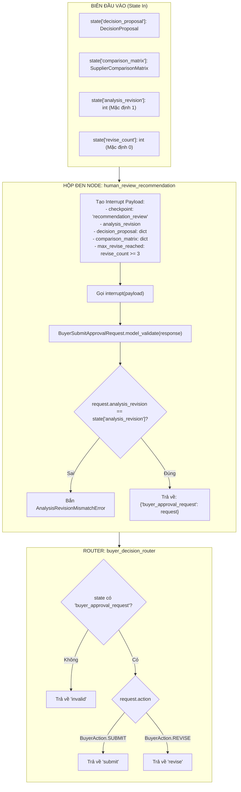

# Test Cases — Node: `human_review_recommendation` & `buyer_decision_router` (HITL-2)

> **Node mục tiêu:**  
> - [`src/agents/nodes/human_review_recommendation.py::human_review_recommendation`](file:///v:/P-109/src/agents/nodes/human_review_recommendation.py)  
> - [`src/agents/nodes/human_review_recommendation.py::buyer_decision_router`](file:///v:/P-109/src/agents/nodes/human_review_recommendation.py)  
>  
> **Schema target (`models_v1`):**  
> - [`src/models_v1/approval.py`](file:///v:/P-109/src/models_v1/approval.py) (`BuyerAction`, `BuyerSubmitApprovalRequest`)  
> - [`src/models_v1/analysis/decision.py`](file:///v:/P-109/src/models_v1/analysis/decision.py) (`DecisionProposal`, `DecisionProposalStatus`, `TradeOff`)  
> - [`src/models_v1/analysis/comparison.py`](file:///v:/P-109/src/models_v1/analysis/comparison.py) (`SupplierComparisonMatrix`, `ComparisonCell`)  
>  
> **Vị trí trong Pipeline Graph (HITL-2):**  
> $$\text{decision\_llm} \longrightarrow \mathbf{human\_review\_recommendation} \longrightarrow \mathbf{buyer\_decision\_router} \longrightarrow \begin{cases} \text{"submit"} \rightarrow \text{manager\_approval} \\ \text{"revise"} \rightarrow \text{process\_feedback} \\ \text{"invalid"} \rightarrow \text{END / Error} \end{cases}$$  
>  
> **Đặc tính node:** LangGraph Interrupt Node (Tạm dừng workflow tại checkpoint `recommendation_review`, hiển thị đề xuất AI và ma trận so sánh để Buyer phê duyệt hoặc yêu cầu chỉnh sửa).  
> **Chiến lược Mock:** Chỉ mock duy nhất hàm `langgraph.types.interrupt` để giả lập phản hồi của Buyer; toàn bộ logic Pydantic parsing, kiểm tra phiên revision và routing chạy 100% code thật.  
> **Triết lý kiểm thử:** **CHỈ ASSERT Ở BIÊN (Black-Box Boundary)**.

---

## I. Phân tích Biên & Hợp Đồng Dữ Liệu (Contract Specification)



---

## II. Danh sách Test Cases Chi Tiết

### Nhóm 1: Node `human_review_recommendation` (HITL-2 Boundary)

#### TC-HRR-01: Happy Path — Buyer duyệt đề xuất (`action = SUBMIT`) kèm ghi chú
* **Mục tiêu:** Kiểm tra luồng Buyer chấp thuận đề xuất AI và nộp trình Manager phê duyệt (`SUBMIT`).
* **State In:**
  * `decision_proposal`: [`DecisionProposal`](file:///v:/P-109/src/models_v1/analysis/decision.py) hợp lệ.
  * `comparison_matrix`: [`SupplierComparisonMatrix`](file:///v:/P-109/src/models_v1/analysis/comparison.py) hợp lệ.
  * `analysis_revision`: 1.
* **Buyer Response (Giả lập `interrupt`):**
  ```python
  {
      "analysis_revision": 1,
      "action": "submit",
      "note": "Đồng ý đề xuất chọn NCC Alpha vì giá tốt nhất.",
  }
  ```
* **State Out ở Biên:**
  * `state["buyer_approval_request"].action == BuyerAction.SUBMIT`
  * `state["buyer_approval_request"].analysis_revision == 1`
  * `state["buyer_approval_request"].note == "Đồng ý đề xuất chọn NCC Alpha vì giá tốt nhất."`

---

#### TC-HRR-02: Happy Path — Buyer duyệt đề xuất (`action = SUBMIT`) không kèm ghi chú
* **Mục tiêu:** Khi Buyer nộp duyệt mà không điền ghi chú (`note = None`), schema model vẫn chấp nhận hợp lệ (ghi chú là tùy chọn đối với hành động `SUBMIT`).
* **State In:** Đủ `decision_proposal`, `comparison_matrix`, `analysis_revision = 1`.
* **Buyer Response:**
  ```python
  {
      "analysis_revision": 1,
      "action": "submit",
  }
  ```
* **State Out ở Biên:**
  * `state["buyer_approval_request"].action == BuyerAction.SUBMIT`
  * `state["buyer_approval_request"].note is None`

---

#### TC-HRR-03: Happy Path — Buyer yêu cầu điều chỉnh (`action = REVISE`) kèm ghi chú bắt buộc
* **Mục tiêu:** Kiểm tra luồng Buyer yêu cầu AI phân tích lại / nới lỏng tiêu chí kèm lý do chi tiết.
* **State In:** Đủ dữ liệu, `analysis_revision = 1`.
* **Buyer Response:**
  ```python
  {
      "analysis_revision": 1,
      "action": "revise",
      "note": "Yêu cầu đàm phán lại tiến độ giao hàng với NCC Beta do thời hạn gấp.",
  }
  ```
* **State Out ở Biên:**
  * `state["buyer_approval_request"].action == BuyerAction.REVISE`
  * `state["buyer_approval_request"].note == "Yêu cầu đàm phán lại tiến độ giao hàng với NCC Beta do thời hạn gấp."`

---

#### TC-HRR-04: Bắt buộc Ghi chú khi Yêu cầu Chỉnh sửa (`action = REVISE` thiếu note)
* **Mục tiêu:** Khi Buyer chọn `action = "revise"` nhưng không cung cấp `note` hoặc để `note = ""` $\rightarrow$ Pydantic model validator từ chối, bắn `ValidationError`.
* **State In:** `analysis_revision = 1`.
* **Buyer Response:**
  ```python
  {
      "analysis_revision": 1,
      "action": "revise",
      # Thiếu note
  }
  ```
* **Kỳ vọng ở Biên:**
  * Ném `pydantic.ValidationError` chứa thông điệp `"note is required when Buyer requests revision"`.

---

#### TC-HRR-05: Kiểm tra Cấu trúc Interrupt Payload gửi tới Buyer UI
* **Mục tiêu:** Xác minh payload truyền vào hàm `interrupt()` phản ánh đầy đủ thông tin bối cảnh cho Buyer:
  1. `checkpoint == "recommendation_review"`
  2. `analysis_revision == 2`
  3. `decision_proposal` là dictionary serialize từ `DecisionProposal`
  4. `comparison_matrix` là dictionary serialize từ `SupplierComparisonMatrix`
  5. `max_revise_reached` phản ánh đúng trạng thái số lần sửa đổi.
* **State In:**
  * `analysis_revision = 2`
  * `revise_count = 1`
* **Assert tại mock `interrupt`:**
  * Đối số nhận được thỏa mãn toàn bộ 5 trường trên.

---

#### TC-HRR-06: Cờ Cảnh Báo Số Lần Điều Chỉnh (`max_revise_reached`)
* **Mục tiêu:** Kiểm tra logic cảnh báo chạm trần số lần điều chỉnh (`state.get("revise_count", 0) >= 3`):
  * Trường hợp 1: `revise_count = 0` hoặc không có trong state $\rightarrow$ `max_revise_reached is False`.
  * Trường hợp 2: `revise_count = 2` $\rightarrow$ `max_revise_reached is False`.
  * Trường hợp 3: `revise_count = 3` $\rightarrow$ `max_revise_reached is True`.
  * Trường hợp 4: `revise_count = 4` $\rightarrow$ `max_revise_reached is True`.

---

#### TC-HRR-07: Chống Sai Lệch Phiên Phê Duyệt (`AnalysisRevisionMismatchError`)
* **Mục tiêu:** Tránh lỗi xung đột phiên duyệt (Stale Approval): State hiện tại đang ở revision 2 (sau khi AI đã phân tích lại), nhưng Buyer gửi phản hồi từ giao diện cũ mang revision 1.
* **State In:** `analysis_revision = 2`.
* **Buyer Response:** `{"analysis_revision": 1, "action": "submit"}`.
* **Kỳ vọng ở Biên:**
  * Bắn ngoại lệ `AnalysisRevisionMismatchError(expected=2, actual=1)`.
  * `str(exc) == "Expected analysis revision 2, received 1"`.

---

#### TC-HRR-08: Giá trị Mặc định cho `analysis_revision`
* **Mục tiêu:** Khi state không chứa trường `analysis_revision`, node tự động mặc định là `1`.
* **State In:** State không có key `analysis_revision`.
* **Buyer Response:** `{"analysis_revision": 1, "action": "submit"}`.
* **State Out ở Biên:**
  * Thực thi trơn tru, nhận `analysis_revision = 1`.

---

#### TC-HRR-09: Buyer Trả Về Dữ Liệu Lỗi Cú Pháp hoặc Sai Schema
* **Mục tiêu:** Khi payload từ giao diện Buyer không hợp lệ (sai kiểu, action lạ, revision âm) $\rightarrow$ Pydantic chặn đứng bằng `ValidationError`.
* **Buyer Response các trường hợp:**
  * `{"analysis_revision": 1, "action": "reject"}` (action không nằm trong `BuyerAction`).
  * `{"analysis_revision": 0, "action": "submit"}` (`analysis_revision` vi phạm `ge=1`).
* **Kỳ vọng ở Biên:** Ném `pydantic.ValidationError`.

---

### Nhóm 2: Router `buyer_decision_router` (Decision Routing)

#### TC-HRR-10: Router định tuyến SUBMIT $\rightarrow$ `"submit"`
* **Mục tiêu:** Khi `state["buyer_approval_request"].action == BuyerAction.SUBMIT` $\rightarrow$ Router trả về chuỗi `"submit"`.
* **State In:** `state["buyer_approval_request"] = BuyerSubmitApprovalRequest(analysis_revision=1, action=BuyerAction.SUBMIT)`.
* **Output ở Biên:** `buyer_decision_router(state) == "submit"`.

---

#### TC-HRR-11: Router định tuyến REVISE $\rightarrow$ `"revise"`
* **Mục tiêu:** Khi `state["buyer_approval_request"].action == BuyerAction.REVISE` $\rightarrow$ Router trả về chuỗi `"revise"`.
* **State In:** `state["buyer_approval_request"] = BuyerSubmitApprovalRequest(analysis_revision=1, action=BuyerAction.REVISE, note="Sửa lại")`.
* **Output ở Biên:** `buyer_decision_router(state) == "revise"`.

---

#### TC-HRR-12: Router định tuyến INVALID khi thiếu request
* **Mục tiêu:** Khi `state` không có key `buyer_approval_request` hoặc mang giá trị `None` $\rightarrow$ Router trả về `"invalid"` an toàn, tránh exception.
* **State In:** `state = {}` hoặc `{"buyer_approval_request": None}`.
* **Output ở Biên:** `buyer_decision_router(state) == "invalid"`.

---

## III. Bảng Quy tắc Assert — Đúng Chuẩn "Black-Box Boundary"

| Được phép Assert ở Biên (DO) | Nghiêm cấm Assert (DON'T) |
|:---|:---|
| ✅ `state["buyer_approval_request"].action == BuyerAction.SUBMIT` | ❌ Can thiệp sửa đổi model `BuyerSubmitApprovalRequest` để ép pass |
| ✅ `state["buyer_approval_request"].note == "..."` | ❌ Bỏ qua kiểm tra `AnalysisRevisionMismatchError` |
| ✅ `buyer_decision_router(state) in {"submit", "revise", "invalid"}` | ❌ Mock sâu vào LangGraph runtime |
| ✅ Kiểm tra dict truyền vào `mock_interrupt.call_args[0][0]` | ❌ Sửa giá trị `analysis_revision` trong node |

---

## IV. Kết luận
Tài liệu định nghĩa **12 Test Cases chuẩn ở biên** cho cặp node `human_review_recommendation` và `buyer_decision_router`:
- 9 test cases cho node ngắt quãng `human_review_recommendation` (Submit, Revise, Validation note, Payload structure, Revision mismatch, Max revise flag).
- 3 test cases cho router `buyer_decision_router` (Định tuyến Submit, Revise, và Invalid fallback).
