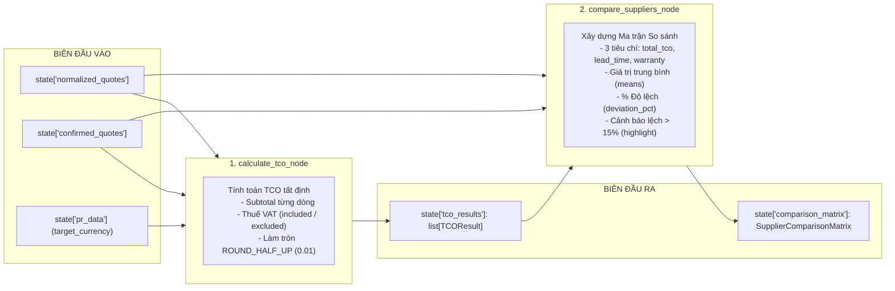

# Test Cases — 2 Node: `calculate_tco` và `compare_suppliers` (Analysis Phase)

> **Phạm vi:** 2 Node tính toán tất định trong pha phân tích (Deterministic Analysis Phase) vừa được migrate sang `models_v1`:
> 1. `src/agents/nodes/analysis_tools.py::calculate_tco_node` (qua tool `src/agents/tools/calculate_tco.py`)
> 2. `src/agents/nodes/analysis_tools.py::compare_suppliers_node` (qua tool `src/agents/tools/compare_suppliers.py`)
>
> **Schema target (`models_v1`):**
> - `src/models_v1/analysis/tco.py` (`TCOResult`, `TCOBreakdownItem`, `TCOCalculationStatus`)
> - `src/models_v1/analysis/comparison.py` (`SupplierComparisonMatrix`, `ComparisonCell`)
> - `src/models_v1/analysis/normalization.py` (`NormalizedQuotationArtifact`, `NormalizedItem`, `NormalizationStatus`)
> - `src/models_v1/quotation/confirmation.py` (`QuotationConfirmationRequest`, `ConfirmedItemPayload`)
>
> **Đặc tính 2 node:** Pure Deterministic Calculation (100% logic số học, làm tròn Decimal, tra cứu ma trận; không dùng LLM, không I/O mạng hay cơ sở dữ liệu, 0% Mocking).
>
> **Triết lý kiểm thử:** **CHỈ ASSERT Ở BIÊN (State In -> State Out & Domain Model Contract)**. Tuyệt đối không assert hoặc inspect hàm private nội bộ (`_money`, `_mean`, `_cell`, `_decimal_text`).

---

## I. Phân tích Biên & Hợp đồng Dữ liệu (Contract Specification)

### 1. Hợp đồng Node `calculate_tco_node`
* **Input State:**
  * `state["normalized_quotes"]: list[NormalizedQuotationArtifact]`
  * `state["confirmed_quotes"]: list[QuotationConfirmationRequest]`
  * `state["pr_data"]: dict[str, Any]` (chứa `target_currency`, mặc định `"VND"`)
* **Output State:**
  * `{"tco_results": list[TCOResult]}`
* **Quy tắc tính toán & Bất biến nghiệp vụ:**
  1. **Xử lý Thuế VAT:**
     * Nếu `confirmed.vat_included is True`: `vat_rate = Decimal("0")` (VAT đã nằm trong giá).
     * Nếu `confirmed.vat_included is False`: `vat_rate = confirmed.vat_rate` (tính thêm VAT).
  2. **Công thức dòng hàng (Line Item):**
     * `item_subtotal = (normalized_quantity * normalized_unit_price).quantize(0.01, ROUND_HALF_UP)`
     * `vat_amount = (item_subtotal * vat_rate).quantize(0.01, ROUND_HALF_UP)`
     * `item_tco = item_subtotal + vat_amount`
     * `surcharges = Decimal("0.00")`
  3. **Tổng cộng cấp Nhà cung cấp (Supplier Level):**
     * `subtotal = sum(item_subtotal)`
     * `total_vat = sum(vat_amount)`
     * `total_tco = subtotal + total_vat`
  4. **Bất biến khi thiếu dữ liệu (`MISSING_DATA`):**
     * Nếu có bất kỳ item nào có `normalized_quantity is None` hoặc `normalized_unit_price is None` (do lỗi normalize `NEEDS_MAPPING`):
       * `missing_fields` ghi nhận đường dẫn: `items[{i}].normalized_quantity` hoặc `items[{i}].normalized_unit_price`.
       * Bỏ qua tính dòng đó.
       * `status = TCOCalculationStatus.MISSING_DATA`.
       * **Bắt buộc:** `total_tco = None` (Invariant kiểm tra bởi model validator).
     * Nếu đầy đủ dữ liệu:
       * `status = TCOCalculationStatus.CALCULATED`.
       * `missing_fields = []`.
       * `total_tco` có giá trị `Decimal`.

---

### 2. Hợp đồng Node `compare_suppliers_node`
* **Input State:**
  * `state["normalized_quotes"]: list[NormalizedQuotationArtifact]`
  * `state["confirmed_quotes"]: list[QuotationConfirmationRequest]`
  * `state["tco_results"]: list[TCOResult]`
* **Output State:**
  * `{"comparison_matrix": SupplierComparisonMatrix}`
* **Quy tắc xây dựng Ma trận So sánh:**
  1. **3 Tiêu chí cố định (`CRITERIA`):**
     * `total_tco`: lấy từ `tco_results[supplier].total_tco` (có thể là `None`).
     * `lead_time_days`: `Decimal(confirmed.lead_time_days)`.
     * `warranty_months`: `Decimal(confirmed.warranty_months)`.
  2. **Tính Trung bình (`means`):**
     * `mean = sum(values có dữ liệu) / count(values có dữ liệu)`.
     * Nếu không có giá trị nào có dữ liệu -> `mean = None`.
  3. **Quy tắc xác định Ô Ma trận (`ComparisonCell`):**
     * **Trường hợp 1 (Thiếu dữ liệu):** Nếu giá trị tiêu chí là `None`:
       * `cell.value = "Thiếu dữ liệu"`
       * `cell.note = "Thiếu dữ liệu"`
       * `cell.deviation_pct = None`, `cell.highlight = False`.
     * **Trường hợp 2 (Không đủ dữ liệu so sánh):** Nếu số NCC có dữ liệu hợp lệ cho tiêu chí đó `< 2` (hoặc `mean is None`):
       * `cell.value = format(value, "f")`
       * `cell.note = "Không đủ dữ liệu so sánh"`
       * `cell.deviation_pct = None`, `cell.highlight = False`.
     * **Trường hợp 3 (So sánh đầy đủ >= 2 NCC):**
       * `deviation_pct = (value - mean) / mean * 100` (nếu `mean == 0` thì `0`).
       * `highlight = abs(deviation_pct) > 15%` (`deviation_threshold = 0.15`).

---

## II. Danh sách Test Cases Chi tiết

### Nhóm 1: Node `calculate_tco_node`

#### TC-TCO-01: Happy Path — Đơn giá đã bao gồm VAT (`vat_included = True`)
* **Mục tiêu:** Kiểm tra khi báo giá đã bao gồm thuế, `vat_rate` tính toán phải về 0, `total_vat == Decimal("0.00")`, và `total_tco == subtotal`.
* **State In:**
  * `confirmed_quotes`: 1 quote của `"NCC Minh Phát"`, `vat_included=True`, `vat_rate=Decimal("0.10")`, 1 item: `quantity=10`, `unit_price=500000.00`.
  * `normalized_quotes`: 1 quote tương ứng với `normalized_quantity=Decimal("10")`, `normalized_unit_price=Decimal("500000.00")`.
  * `pr_data`: `{"target_currency": "VND"}`.
* **State Out ở Biên:**
  * `result["tco_results"][0].status == TCOCalculationStatus.CALCULATED`
  * `result["tco_results"][0].subtotal == Decimal("5000000.00")`
  * `result["tco_results"][0].total_vat == Decimal("0.00")`
  * `result["tco_results"][0].total_tco == Decimal("5000000.00")`
  * `result["tco_results"][0].missing_fields == []`
  * Breakdown item 0 có: `vat_rate == Decimal("0")`, `vat_amount == Decimal("0.00")`, `item_tco == Decimal("5000000.00")`.

---

#### TC-TCO-02: Happy Path — Đơn giá chưa bao gồm VAT (`vat_included = False`)
* **Mục tiêu:** Kiểm tra khi chưa có VAT, hệ thống tính chuẩn số tiền VAT và cộng dồn vào `total_tco`.
* **State In:**
  * `confirmed_quotes`: 1 quote của `"NCC Hoàng Hà"`, `vat_included=False`, `vat_rate=Decimal("0.08")` (VAT 8%), item: `quantity=5`, `unit_price=200000.00`.
  * `normalized_quotes`: `normalized_quantity=Decimal("5")`, `normalized_unit_price=Decimal("200000.00")`.
* **State Out ở Biên:**
  * `subtotal == Decimal("1000000.00")`
  * `total_vat == Decimal("80000.00")` (1.000.000 * 8%)
  * `total_tco == Decimal("1080000.00")`
  * `status == TCOCalculationStatus.CALCULATED`

---

#### TC-TCO-03: Đa dòng hàng & Làm tròn Số học (Decimal `ROUND_HALF_UP`)
* **Mục tiêu:** Báo giá có nhiều dòng hàng với số lượng và đơn giá lẻ, kiểm tra phép nhân và làm tròn `0.01` theo chuẩn tài chính.
* **State In:**
  * 1 quote có 2 dòng hàng:
    * Dòng 1: `quantity=3`, `unit_price=333333.33` (subtotal = 999999.99)
    * Dòng 2: `quantity=7`, `unit_price=142857.14` (subtotal = 999999.98)
    * `vat_included=False`, `vat_rate=Decimal("0.10")`
* **State Out ở Biên:**
  * `subtotal == Decimal("1999999.97")`
  * Dòng 1 `vat_amount == Decimal("100000.00")` (999999.99 * 0.10 = 99999.999 -> 100000.00)
  * Dòng 2 `vat_amount == Decimal("100000.00")` (999999.98 * 0.10 = 99999.998 -> 100000.00)
  * `total_vat == Decimal("200000.00")`
  * `total_tco == Decimal("2199999.97")`

---

#### TC-TCO-04: Thiếu Dữ liệu Chuẩn hóa (`normalized_quantity` hoặc `unit_price` là `None`)
* **Mục tiêu:** Báo giá từ bước `normalize` bị gắn cờ `NEEDS_MAPPING` (ví dụ UOM hoặc tỷ giá không quy đổi được), dẫn đến các trường chuẩn hóa là `None`. Node phải chuyển sang trạng thái `MISSING_DATA`, ghi nhận `missing_fields` và bắt buộc `total_tco is None`.
* **State In:**
  * 1 quote có item: `normalized_quantity=None`, `normalized_unit_price=Decimal("150000.00")`.
* **State Out ở Biên:**
  * `tco_result.status == TCOCalculationStatus.MISSING_DATA`
  * `"items[0].normalized_quantity" in tco_result.missing_fields`
  * `tco_result.total_tco is None` (Bất biến Pydantic Contract)
  * `tco_result.breakdown == []` (không sinh dòng tính toán sai)

---

#### TC-TCO-05: Nhiều Nhà cung cấp Song song (Multiple Quotations)
* **Mục tiêu:** Tính toán song song danh sách nhiều báo giá, khớp chính xác theo từng `quotation_revision_id` và `supplier_name`.
* **State In:**
  * 2 quotes: NCC 1 (10 triệu VND) và NCC 2 (12 triệu VND).
* **State Out ở Biên:**
  * `len(result["tco_results"]) == 2`
  * Kết quả từng NCC tính đúng, không bị ghi đè hay lẫn lộn ID.

---

#### TC-TCO-06: Danh sách Báo giá Rỗng (Empty State Boundary)
* **Mục tiêu:** Kiểm tra biên khi không có báo giá nào trong state.
* **State In:**
  * `state["normalized_quotes"] = []`, `state["confirmed_quotes"] = []`.
* **State Out ở Biên:**
  * `result["tco_results"] == []`

---

### Nhóm 2: Node `compare_suppliers_node`

#### TC-CMP-01: Happy Path — So sánh Đầy đủ 2 Nhà cung cấp
* **Mục tiêu:** 2 NCC có đủ 3 tiêu chí, tính chính xác giá trị trung bình (`means`) và tỷ lệ phần trăm độ lệch (`deviation_pct`).
* **State In:**
  * NCC A: `total_tco = 10000000.00`, `lead_time_days = 10`, `warranty_months = 12`
  * NCC B: `total_tco = 12000000.00`, `lead_time_days = 20`, `warranty_months = 24`
* **State Out ở Biên:**
  * `means["total_tco"] == Decimal("11000000.00")`
  * `means["lead_time_days"] == Decimal("15")`
  * `means["warranty_months"] == Decimal("18")`
  * NCC A:
    * `matrix["NCC A"]["total_tco"].deviation_pct == Decimal("-9.090909090909090909090909091")` (rẻ hơn ~9.09%)
    * `matrix["NCC A"]["lead_time_days"].deviation_pct == Decimal("-33.33333333333333333333333333")` (nhanh hơn 33.33%)
    * `matrix["NCC A"]["warranty_months"].deviation_pct == Decimal("-33.33333333333333333333333333")` (bảo hành ít hơn 33.33%)

---

#### TC-CMP-02: Cảnh báo Lệch Ngưỡng (> 15% Deviation Highlight)
* **Mục tiêu:** Kiểm tra logic gắn cờ `highlight=True` khi độ lệch tuyệt đối `|deviation_pct| > 15%`, và `highlight=False` khi nằm trong phạm vi 15%.
* **State In:**
  * Dữ liệu từ TC-CMP-01:
    * `total_tco`: độ lệch ~9.09% (<= 15%) -> `highlight == False`.
    * `lead_time_days`: độ lệch ~33.33% (> 15%) -> `highlight == True`.
    * `warranty_months`: độ lệch ~33.33% (> 15%) -> `highlight == True`.
* **State Out ở Biên:**
  * `matrix["NCC A"]["total_tco"].highlight is False`
  * `matrix["NCC A"]["lead_time_days"].highlight is True`
  * `matrix["NCC B"]["lead_time_days"].highlight is True`

---

#### TC-CMP-03: Chỉ có 1 Nhà cung cấp — Cảnh báo Không đủ Dữ liệu So sánh
* **Mục tiêu:** Khi danh sách chỉ có 1 NCC, không thể so sánh chéo -> ô ma trận hiển thị số liệu nhưng gắn ghi chú `"Không đủ dữ liệu so sánh"`.
* **State In:**
  * Chỉ có 1 báo giá của `"NCC Độc Quyền"` (`total_tco = 5000000.00`, `lead_time_days = 5`, `warranty_months = 12`).
* **State Out ở Biên:**
  * `matrix["NCC Độc Quyền"]["total_tco"].value == "5000000.00"`
  * `matrix["NCC Độc Quyền"]["total_tco"].note == "Không đủ dữ liệu so sánh"`
  * `matrix["NCC Độc Quyền"]["total_tco"].deviation_pct is None`
  * `matrix["NCC Độc Quyền"]["total_tco"].highlight is False`

---

#### TC-CMP-04: Một Nhà cung cấp Bị Thiếu TCO (`total_tco is None`)
* **Mục tiêu:** NCC A có đủ dữ liệu, nhưng NCC B bị `total_tco = None` (do lỗi normalize). Kiểm tra:
  * Tiêu chí `total_tco`: NCC B hiển thị `"Thiếu dữ liệu"`. NCC A chỉ còn 1 mình nên gắn note `"Không đủ dữ liệu so sánh"`.
  * Tiêu chí `lead_time_days` và `warranty_months`: Cả 2 đều có -> so sánh bình thường.
* **State In:**
  * NCC A: `total_tco = 10000000.00`, `lead_time = 7`, `warranty = 12`.
  * NCC B: `total_tco = None` (MISSING_DATA), `lead_time = 14`, `warranty = 24`.
* **State Out ở Biên:**
  * Ô `matrix["NCC B"]["total_tco"]`: `value == "Thiếu dữ liệu"`, `note == "Thiếu dữ liệu"`.
  * Ô `matrix["NCC A"]["total_tco"]`: `note == "Không đủ dữ liệu so sánh"` (vì chỉ có 1 NCC có số liệu TCO).
  * Ô `matrix["NCC A"]["lead_time_days"]`: tính `deviation_pct` bình thường vì cả 2 NCC đều có số ngày giao hàng.

---

#### TC-CMP-05: Độ lệch Bằng 0 khi Các Nhà cung cấp Bằng nhau Tuyệt đối
* **Mục tiêu:** Cả 2 NCC chào cùng đơn giá và điều khoản -> `deviation_pct == Decimal("0")`, `highlight is False`.
* **State In:**
  * NCC A và NCC B đều có: `total_tco = 10000000.00`, `lead_time = 10`, `warranty = 12`.
* **State Out ở Biên:**
  * `matrix["NCC A"]["total_tco"].deviation_pct == Decimal("0")`
  * `matrix["NCC A"]["total_tco"].highlight is False`

---

#### TC-CMP-06: Danh sách Báo giá Rỗng (Empty Comparison Boundary)
* **Mục tiêu:** Kiểm tra khi không có báo giá nào trong state.
* **State In:**
  * `normalized_quotes = []`, `confirmed_quotes = []`, `tco_results = []`.
* **State Out ở Biên:**
  * `comparison_matrix.suppliers == []`
  * `comparison_matrix.matrix == {}`
  * `comparison_matrix.means == {"total_tco": None, "lead_time_days": None, "warranty_months": None}`

---

## III. Bảng Quy tắc Assert — Đúng chuẩn "Black-Box Boundary"

| Được phép Assert ở Biên (DO) | Nghiêm cấm Assert (DON'T) |
|:---|:---|
| ✅ `state["tco_results"][0].total_tco == Decimal("5000000.00")` | ❌ Test hay mock hàm `_money(value)` |
| ✅ `state["tco_results"][0].status == TCOCalculationStatus.CALCULATED` | ❌ Đếm số lần hàm con làm tròn được gọi |
| ✅ `state["comparison_matrix"].means["total_tco"] == Decimal(...)` | ❌ Test hay mock hàm private `_mean(values)` |
| ✅ `state["comparison_matrix"].matrix["NCC A"]["total_tco"].highlight is True` | ❌ Test hay mock hàm `_cell()` hay `_decimal_text()` |
| ✅ Chạy liên tiếp `calculate_tco_node` -> `compare_suppliers_node` | ❌ Mock việc chuyển đổi state giữa 2 node |

