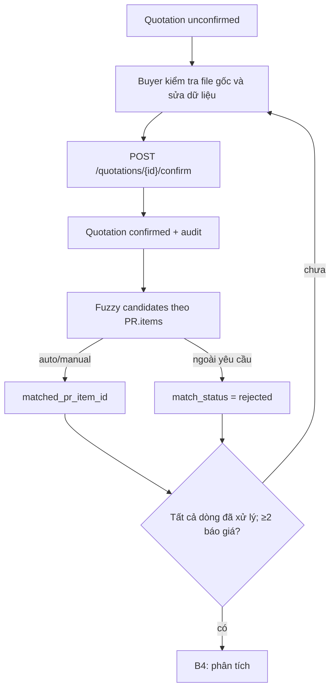

# Bước 3 — Buyer đối soát báo giá và ghép mặt hàng

**Input:** `Quotation` ở B2, file nguồn, danh mục `PurchaseRequest.items[]`, bản nháp chỉnh sửa của Buyer. **UI:** `/purchase-requests/{id}/workflow/3`; endpoint đọc `GET /api/v1/prs/{id}/quotations`, `GET /api/v1/prs/{id}/fuzzy-matches`, `GET /api/v1/quotations/{id}/review-preview` và file gốc.

## Schema xác nhận thương mại

`POST /api/v1/quotations/{quotation_id}/confirm` nhận `QuotationConfirmation`:

| Trường | Kiểu / ràng buộc | Cách dùng |
| --- | --- | --- |
| `supplier_name` | string 2–200 | Tên NCC do Buyer chốt; server gán/reuse `supplier_id` theo tên chuẩn hóa |
| `delivery_time`, `payment_terms` | string, tối đa 500/1000 | Điều khoản mô tả |
| `items[]` | 1–100 `QuotationItem` | Dòng hàng đã sửa; từng dòng cần tên, `quantity > 0`, `unit_price > 0`, `line_total > 0` |
| `items[].matched_pr_item_id`, `match_status` | string/enum tùy chọn | Liên hệ dòng báo giá với dòng PR; trạng thái xem bên dưới |
| `currency` | string hoặc null | Tiền tệ báo giá |
| `vat_rate` | Decimal 0–1 | UI nhập phần trăm rồi chia 100 |
| `vat_included` | boolean | Giá dòng đã gồm VAT hay chưa |
| `shipping_fee` | Decimal ≥0 | Phí vận chuyển |
| `lead_time_days`, `warranty_months` | integer ≥0 | Thời gian giao/bảo hành quy chuẩn |
| `goods_total_including_tax`, `shipping_total_including_tax` | Decimal ≥0 hoặc null | Tổng Buyer xác nhận; B4 kiểm tra lại phép tính nếu cả hai có giá trị |

```json
{
  "supplier_name": "NCC A", "delivery_time": "7 ngày", "payment_terms": "30 ngày",
  "currency": "VND", "vat_rate": 0.1, "vat_included": false,
  "shipping_fee": 100000, "lead_time_days": 7, "warranty_months": 12,
  "items": [{"product_name": "Vật tư A", "product_code": "A-01", "unit": "Cái", "quantity": 15, "unit_price": 900000, "line_total": 13500000}],
  "goods_total_including_tax": 14850000,
  "shipping_total_including_tax": 110000
}
```

Sau confirm, `Quotation.status=confirmed`, `confirmed_at` được gán, `supplier_id` có giá trị, `confirmation_audit` giữ actor, thời gian, bản trước, payload đã gửi và text nguồn. `PR.quotation_count` được tính lại từ **số báo giá confirmed**; nếu >0 PR chuyển `comparing`.

## Ghép từng dòng với PR

`GET /api/v1/prs/{id}/fuzzy-matches` trả `BatchMatchResult`: `total`, `auto_matched`, `suggested`, `unmatched`, `results[]` (`quote_item_id`, `best_match`, `candidates[]`, điểm). Buyer có thể gọi `POST /api/v1/quotations/{quote_id}/items/{quote_id}:item:{index}/confirm-match` với `{action: "CONFIRM" | "REJECT" | "MAP_TO_NEW", pr_item_id?: string}`. Server ghi `matched_pr_item_id` và `match_status` (`manual_matched` hoặc `rejected`) vào báo giá **đã confirmed**. Auto match dùng `auto_matched`.

Điều kiện UI để sang B4: ít nhất **2 báo giá**, tất cả `confirmed`, mỗi báo giá có ít nhất một dòng và mọi dòng đã `auto_matched`/`manual_matched` với PR hoặc `rejected` để tách riêng. Đây là guard UI; service B4 có thêm điều kiện hai NCC độc lập và trường thương mại đầy đủ.



`POST /api/v1/quotations/{id}/reopen` đưa báo giá về `unconfirmed`; `re-extract` chỉ áp dụng khi chưa confirmed. Sửa PR có ảnh hưởng cấu trúc có thể mở lại báo giá và xóa kết quả ghép; lần phân tích trước sẽ thành `stale` nếu snapshot thay đổi.

Route `reopen` hiện chưa tính lại `PR.quotation_count` và status ngay lúc mở lại. Cần đọc tập báo giá thực tế thay vì chỉ dựa vào trường đếm này sau thao tác reopen.

**Điểm cần rà soát:** confirm quote và xác nhận ghép dòng là **hai lần ghi riêng**. Một báo giá `confirmed` vẫn có thể chưa hoàn tất ghép; `quotation_count` không thể dùng một mình làm tín hiệu đủ điều kiện phân tích.

Nguồn: [`quotations.tsx`](../../frontend/src/features/quotations.tsx), [`procurementWorkflow.tsx`](../../frontend/src/features/procurementWorkflow.tsx), [`confirmation.py`](../../src/domain/quotation/confirmation.py), [`fuzzy_match.py`](../../src/domain/fuzzy_match.py), [`procurement.py`](../../src/api/routes/procurement.py).
