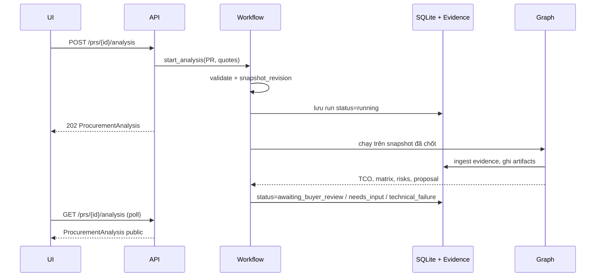

# Bước 4 — Tổng hợp, tính TCO và phân tích đề xuất

**Input:** PR hiện tại và toàn bộ `Quotation` của PR. **UI:** `/purchase-requests/{id}/workflow/4`. UI hiển thị ma trận từ báo giá đã xác nhận, rồi gọi `POST /api/v1/prs/{id}/analysis`; `GET` cùng URL để polling. Bước này chạy async: `202 running`, hoặc `200` nếu dùng kết quả còn hợp lệ.

## Điều kiện trước khi chạy

`ProcurementWorkflow.prepare()` yêu cầu ≥2 báo giá **đều confirmed**, từ ≥2 NCC độc lập (tên chuẩn hóa và `supplier_id` không trùng), có `supplier_id`, `items[]`, `vat_included`, `vat_rate`, `shipping_fee`, `lead_time_days`, `warranty_months`. Nếu tổng Buyer gửi cho hàng và ship đều có, service kiểm tra tổng đó khớp phép tính VAT/phí với làm tròn 2 chữ số. Input thiếu được lưu thành analysis `needs_input` và POST trả `422`; UI đọc lại để hiện hướng dẫn `missing_fields[]`.

## Snapshot nội bộ đưa vào graph

| Nhóm | Trường quan trọng | Nguồn |
| --- | --- | --- |
| `pr` | `id`, `requested_quantity/uom`, `target_currency`, `budget`, `deadline`, `items[{id, order_index, product_name, quantity, unit}]` | PR repository |
| `quotes[]` | Toàn bộ quote đã confirmed, `file_hash`, `confirmation_audit` | Quotation repository |
| `raw_extractions[]` | Mỗi dòng báo giá: supplier, tên hàng, giá, lượng, UOM, VAT, shipping, lead time, warranty, source | Adapter từ confirmed quote |
| `confirmed_quotes[]` | Commercial payload Buyer chốt | Graph input |
| `context` | `candidate_ids`, `facts`, `source_scope.document_hashes`, `mandatory_comparisons=[tco, delivery_days, warranty_months]`, `authorized_edit_ids` | Evaluation context |
| `snapshot_revision` | Hash của PR business fields + quote snapshots + policy | Chống dùng đề xuất khi input đã đổi |

Graph chạy normalize → TCO → ma trận so sánh/rủi ro → Decision LLM → human review interrupt. Evidence gồm chunk nguồn và chunk `human_edit`, đưa vào PostgreSQL adapter. Analysis run lưu SQLite trước khi background job chạy; `analysis_id` gắn với một lần chạy, `recommendation_id` và `recommendation_version` gắn đề xuất, `snapshot_revision` gắn input bất biến.

## Public output `ProcurementAnalysis`

| Trường | Kiểu / ý nghĩa |
| --- | --- |
| `pr_id`, `status` | ID PR; `not_started`, `running`, `stale`, `needs_input`, `awaiting_buyer_review`, `technical_failure`, ... |
| `analysis_id?`, `recommendation_id?`, `recommendation_version?`, `snapshot_revision?` | Khóa truy vết và chống duyệt phiên bản cũ |
| `message?`, `missing_fields[]`, `events[]` | Hướng dẫn lỗi và tiến trình node |
| `supplier_names` | Ánh xạ supplier ID → tên |
| `tco_results[]` | TCO theo NCC: `items_tco[]`, `subtotal`, `total_surcharges`, `total_vat`, `total_tco`, `status`, `missing_fields[]` |
| `comparison_matrix` | Ma trận đối chiếu do graph trả |
| `risk_flags[]` | Cảnh báo rủi ro đã chiếu sang contract public |
| `decision_proposal`, `review?` | Đề xuất; `review` chỉ sẵn sàng khi `awaiting_buyer_review` |
| `evaluation?`, `pending_feedback?`, `pr?` | Dữ liệu bổ trợ; `GET` gắn snapshot PR hiện tại |

**Điểm cần rà soát:** UI B4 có tổng dự kiến tính trực tiếp từ báo giá trước khi POST; đó không phải `tco_results` chính thức. Adapter hiện dùng `pr.target_currency` cho raw line và VND cho fact TCO/phí, cần xác nhận quy tắc quy đổi. `GET` đánh dấu `stale` nếu revision khác; không dùng kết quả cũ để duyệt.

Nguồn: [`workflow.py`](../../src/application/procurement/workflow.py), [`procurement_workflow.py`](../../src/api/routes/procurement_workflow.py), [`procurement/workflow.py`](../../src/domain/procurement/workflow.py), [`procurementWorkflow.tsx`](../../frontend/src/features/procurementWorkflow.tsx).
