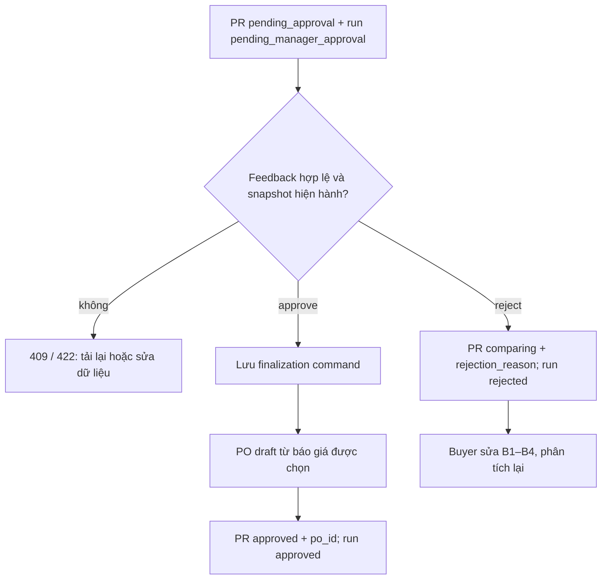

# Bước 6 — Manager quyết định và tạo PO nháp

**Input:** PR `pending_approval`, analysis `pending_manager_approval` có `buyer_confirmation`, `recommendation_id/version`, review và snapshot báo giá. **UI Manager:** `/purchase-requests/{id}/comparison`; POST `/api/v1/recommendations/{recommendation_id}/feedback` (vai trò `manager`). UI hiện gửi `approve` hoặc `reject`.

## Schema feedback

`Feedback` trong `src/domain/analysis/evaluation.py`:

| Trường | Kiểu / ràng buộc | Ý nghĩa |
| --- | --- | --- |
| `feedback_id` | string không rỗng | ID lần phản hồi |
| `recommendation_id` | string không rỗng | Phải khớp URL |
| `recommendation_version` | integer ≥1 | Phải khớp phiên bản run |
| `idempotency_key` | string không rỗng | Retry an toàn của cùng quyết định |
| `decision` | `approve`, `reject`, `revise`, `close` | UI gửi approve/reject; nhánh hiện hành pending chỉ cho approve/reject; `close` bị service từ chối |
| `note` | string | Bắt buộc nội dung khi `reject` |
| `acknowledged_uncertainty_ids[]` | string[] | Xác nhận các bất định được review |
| `revision_type`, `target_ids[]`, `requested_changes` | tùy chọn | Dành cho nhánh revise ở workflow rộng hơn; không có trong UI quyết định hiện hành |

```json
{
  "feedback_id": "<uuid>",
  "recommendation_id": "<recommendation-id>",
  "recommendation_version": 1,
  "idempotency_key": "<uuid>",
  "decision": "approve",
  "note": "Đồng ý theo đề xuất",
  "acknowledged_uncertainty_ids": []
}
```

## Output theo nhánh

| Quyết định | `ProcurementFeedbackResult` | Side effect |
| --- | --- | --- |
| `approve` | `receipt{feedback_id, recommendation_id, recommendation_version, state, workflow_status, route}`, `status=approved`, `po` | Lưu lệnh finalize SQLite; tạo `PurchaseOrder` **status=draft**; PR → `approved`, gán `po_id`; run → `approved` |
| `reject` | `receipt`, `status=rejected`, không có `po` | PR → `comparing`, lưu `rejection_reason`; run → `rejected`; Buyer sửa/bổ sung và chạy lại |

`PurchaseOrder` public gồm `id`, `code`, `pr_id/pr_code`, `quotation_id`, `supplier_name`, `items[]` (tên, mã, đơn vị, số lượng, đơn giá, thành tiền), `subtotal`, `shipping_amount`, `tax_amount`, `total_amount`, `currency`, `delivery_time`, `payment_terms`, `warranty`, `approver_id/name`, `approved_at`, `manager_note`, `created_at`, `recommendation_id/version`, `snapshot_revision`, `status=draft`. PO ID tạo xác định từ recommendation ID + version; `total_amount` lấy tổng hàng đã gồm thuế + ship đã gồm thuế của **báo giá được chọn**, có thể suy lại từ VAT/phí nếu tổng cũ thiếu.



**Điểm cần rà soát:** PR `approved` không có nghĩa PO đã phát hành: PO mới ở trạng thái `draft`. `rejected` là trạng thái analysis, còn PR quay về `comparing`. Finalize có lệnh bền vững và `reconcile()` lúc khởi động để hoàn tất trường hợp bị gián đoạn; idempotency key tránh tạo PO lặp.

Nguồn: [`comparison.tsx`](../../frontend/src/features/comparison.tsx), [`evaluation.py`](../../src/domain/analysis/evaluation.py), [`procurement_workflow.py`](../../src/api/routes/procurement_workflow.py), [`workflow.py`](../../src/application/procurement/workflow.py), [`contracts.py`](../../src/domain/procurement/contracts.py), [`purchase_orders.py`](../../src/infrastructure/repositories/purchase_orders.py).
