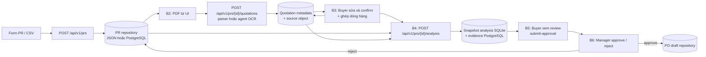
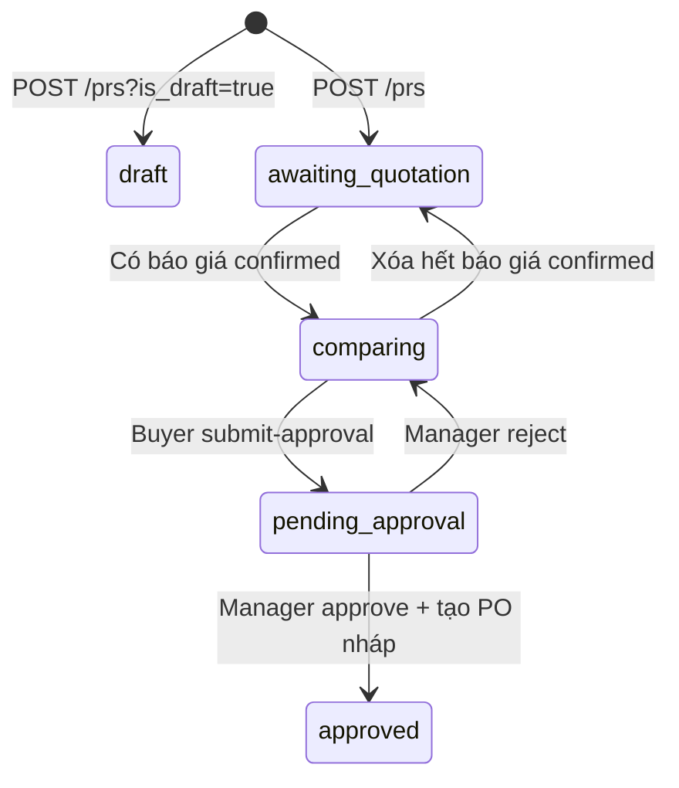

# Dữ liệu theo luồng tạo PR hiện hành

**Phạm vi:** luồng web `/purchase-requests/new` → wizard 5 bước → Buyer gửi duyệt → Manager quyết định → PO nháp. PR ở đây là **Purchase Request / đề nghị mua hàng**. Tài liệu mô tả mã nguồn hiện tại, không thay thế Pydantic contract. Cập nhật đối chiếu: 2026-10-15.

| Bước | Tài liệu | Input chính | Output / nơi lưu |
| --- | --- | --- | --- |
| 1. Tạo PR | [01-create-pr.md](01-create-pr.md) | Form hoặc CSV danh mục | `PurchaseRequest`, kho PR |
| 2. Tải báo giá | [02-upload-quotation.md](02-upload-quotation.md) | PR ID, file nguồn | `Quotation` chưa xác nhận, kho báo giá và file |
| 3. Đối soát | [03-review-quotation.md](03-review-quotation.md) | Trích xuất, chỉnh sửa Buyer, ghép mặt hàng | `Quotation` đã xác nhận, `quotation_count` |
| 4. Tổng hợp và phân tích | [04-analysis.md](04-analysis.md) | PR + toàn bộ báo giá đã xác nhận | `ProcurementAnalysis`, snapshot SQLite, evidence |
| 5. Xem đề xuất và gửi duyệt | [05-submit-approval.md](05-submit-approval.md) | Phân tích đang chờ Buyer, ghi chú | Xác nhận Buyer; PR chờ Manager |
| 6. Manager xử lý | [06-manager-decision.md](06-manager-decision.md) | Feedback và recommendation revision | PR đã duyệt + PO nháp, hoặc PR quay lại so sánh |

## Dataflow

> Hiện chưa thấy route chuyển `draft → awaiting_quotation`; PATCH không đổi trạng thái, còn upload từ chối PR `draft`. `reopen` báo giá cũng chưa tính lại `quotation_count`/trạng thái PR, nên mũi tên quay về `awaiting_quotation` chỉ áp dụng khi xóa và đếm lại. `rejected` tồn tại trong enum PR nhưng nhánh Manager hiện gọi `prs.reject()` để đưa PR về `comparing`; analysis mang trạng thái `rejected`.

## Khóa liên kết và nơi lưu

| Dữ liệu | Khóa liên kết | Nguồn sự thật hiện dùng |
| --- | --- | --- |
| PR | `PurchaseRequest.id`, mã người dùng `code`, `version` | `PurchaseRequestRepository`: JSON `data/purchase_requests.json` hoặc PostgreSQL record store theo cấu hình |
| Báo giá | `Quotation.id`, `pr_id`, `supplier_id`, `source_hash` | `QuotationRepository`: metadata JSON/PostgreSQL; file nguồn filesystem/S3 |
| Phân tích | `analysis_id`, `pr_id`, `recommendation_id`, `recommendation_version`, `snapshot_revision` | `ProcurementWorkflow`: bảng `analysis` SQLite; evidence qua PostgreSQL adapter |
| PO nháp | `PurchaseOrder.id`, `pr_id`, `quotation_id`, `recommendation_id` | `PurchaseOrderRepository`: JSON/PostgreSQL; lệnh finalize trong SQLite |

Các số tiền và số lượng trong domain PR dùng `Decimal` và serialize JSON thành **string**. TypeScript dùng `number` cho nhiều trường; khi đối chiếu API nên xem payload JSON thực tế, không suy từ kiểu TypeScript. `source_path`, `confirmation_audit`, `source_ocr_text` của báo giá nằm ở lưu trữ nội bộ và bị loại khỏi response public.

## Các điểm cần xác nhận khi điều chỉnh schema

1. **Giới hạn file khác nhau:** wizard nhận tối đa 5 PDF cho mỗi PR, mỗi file ≤5 MB; endpoint upload hỗ trợ tối đa 10 báo giá cho mỗi PR và định dạng PDF/TXT/EML. Endpoint batch `/prs/{id}/extract` lại có giới hạn 5 PDF.
2. **Validation khác nhau:** form yêu cầu ngày nhận tối thiểu ngày mai và tối thiểu một mặt hàng; `CreatePurchaseRequest` chỉ ràng buộc kiểu `date`, `estimated_budget >= 0`, `items` mặc định rỗng. CSV import có thể trả một phần `valid_items` kèm `errors`.
3. **Tiền tệ:** form có VND/USD, nhưng adapter phân tích hiện gán `currency=pr.target_currency` cho raw line và xây fact TCO/phí với đơn vị `VND`. Cần kiểm tra chính sách quy đổi trước khi chấp nhận so sánh khác tiền tệ.
4. **Điều kiện ghép mặt hàng:** wizard B3/B4 yêu cầu từng dòng đã được ghép hoặc tách riêng và tối thiểu 2 báo giá; service phân tích kiểm tra 2 nhà cung cấp độc lập, confirmed và các trường thương mại bắt buộc. Hai lớp guard chưa tương đương.
5. **Trạng thái từ chối:** Manager trả analysis `rejected`, nhưng PR quay về `comparing` và lưu `rejection_reason`; enum PR `rejected` không phản ánh nhánh xử lý này.
6. **Tài liệu cũ và route cũ:** `/api/prs` trong `src/api/routes/pr.py` là case in-memory khác với wizard `/api/v1/prs`. [Spec cũ](../specs/create_and_manage_PR.md) và [sơ đồ cũ](../data_flow.md) có mô tả khác mã đang chạy.
7. **Draft và số lượng báo giá:** chưa có API promotion từ `draft` sang `awaiting_quotation`; `reopen` không đồng bộ ngay `quotation_count`, trong khi xóa và xác nhận có đồng bộ.

Nguồn chính: [`frontend/src/features/procurementWorkflow.tsx`](../../frontend/src/features/procurementWorkflow.tsx), [`src/api/routes/procurement.py`](../../src/api/routes/procurement.py), [`src/api/routes/procurement_workflow.py`](../../src/api/routes/procurement_workflow.py), [`src/application/procurement/workflow.py`](../../src/application/procurement/workflow.py).
